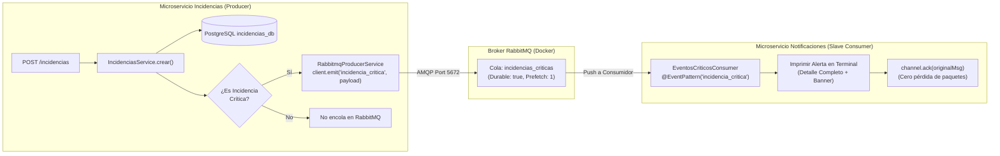

# TAL-11: Productores y Consumidores Básicos de Eventos (RabbitMQ)

## 1. Diagnóstico y Contexto del Requerimiento

En la arquitectura previa del sistema de gestión de incidencias y mantenimiento de la Universidad Católica de Temuco (UCT), la comunicación entre el backend de incidencias (`ms-incidencias`) y los procesos de notificación y supervisión operaba de forma monolítica y síncrona mediante peticiones HTTP directas.

Este esquema presentaba serias limitaciones arquitectónicas:
1. **Acoplamiento Fuerte**: Si el microservicio de notificaciones o supervisión se encontraba ocupado o inaccesible, las peticiones HTTP del usuario podían degradarse en latencia o fallar.
2. **Falta de Tolerancia a Fallos y Pérdida de Eventos**: Ante caídas temporales de los servicios receptores, no existía un mecanismo de encolamiento duradero con reintentos automáticos y confirmación de paquetes (ACK).
3. **Ausencia de Asincronía para Alertas de Alta Severidad**: Las incidencias críticas (aquellas con fallas severas de infraestructura, cortes eléctricos, caídas de servidores o catalogadas con prioridad 'Crítica') requieren ser notificadas y auditadas de manera prioritaria mediante un canal dedicado y desacoplado del ciclo de vida de la petición HTTP.

### Objetivos y Criterios de Aceptación (TAL-11)
- **Integración de SDK de RabbitMQ**: Incorporar la infraestructura de mensajería asíncrona mediante `@nestjs/microservices`, `amqplib` y `amqp-connection-manager`.
- **Contenedor Docker del Broker**: Añadir el broker de mensajería `rabbitmq:3-management` en `docker-compose.yml` con sus puertos AMQP (`5672`) y de administración web (`15672`).
- **Productor de Eventos (Producer)**: Cuando se registre una nueva incidencia crítica en `ms-incidencias` (por prioridad explícita 'Crítica', título o descripción crítica, o escalamiento dinámico), el backend publica un mensaje en la cola `incidencias_criticas`.
- **Módulo Esclavo Consumidor (Consumer)**: Implementar un consumidor esclavo (tanto integrado en `ms-notificaciones` como disponible en script standalone) que lea de dicha cola e imprima el mensaje detallado de alerta en consola.
- **Cero Pérdida de Paquetes (Manual ACKs)**: Configurar estrategia de confirmación explícita (`noAck: false`, con `channel.ack(originalMessage)` y `channel.nack(originalMessage, false, true)` ante fallos transitorios).
- **Resiliencia y Degradación Elegante**: Si el broker RabbitMQ está apagado o en mantenimiento, el registro de la incidencia en base de datos PostgreSQL no se interrumpe, registrando advertencias sin romper la experiencia del usuario.

---

## 2. Resumen de Archivos Creados y Modificados

| Directorio | Archivo | Tipo de Cambio | Propósito |
|---|---|---|---|
| Raíz | `docker-compose.yml` | **Modificado** | Integración del contenedor `rabbitmq:3-management` (puertos 5672 y 15672) con volumen persistente `rabbitmq_data` y vinculación de `ms-notificaciones`. |
| `ms-incidencias` | `package.json` | **Modificado** | Incorporación de dependencias `@nestjs/microservices`, `amqplib`, `amqp-connection-manager` y `@types/amqplib`. Alineación a NestJS 12.3.2. |
| `ms-incidencias` | `.env.example` | **Modificado** | Variables de entorno `RABBITMQ_URL` y `RABBITMQ_QUEUE_CRITICAS`. |
| `ms-incidencias/src/rabbitmq` | `rabbitmq-producer.service.ts` | **Creado** | Servicio productor inyectable con `ClientProxy` de NestJS, manejo de timeouts, fallback y logging. |
| `ms-incidencias/src/rabbitmq` | `rabbitmq-producer.service.spec.ts` | **Creado** | Pruebas unitarias exhaustivas del productor RabbitMQ (éxito, manejo de fallas de conexión, destrucción limpia). |
| `ms-incidencias/src/rabbitmq` | `rabbitmq.module.ts` | **Creado** | Módulo de RabbitMQ exportable para `ms-incidencias`. |
| `ms-incidencias/src/rabbitmq/interfaces` | `incidencia-evento.interface.ts` | **Creado** | Contrato de datos del evento `IncidenciaCriticaEvento`. |
| `ms-incidencias/src/incidencias/dto` | `crear-incidencia.dto.ts` | **Modificado** | Inclusión de campo opcional `prioridad?: string` en el DTO de creación. |
| `ms-incidencias/src/incidencias` | `incidencias.module.ts` | **Modificado** | Importación de `RabbitmqModule`. |
| `ms-incidencias/src/incidencias` | `incidencias.service.ts` | **Modificado** | Detección de incidencias críticas (`esIncidenciaCritica`), publicación asíncrona a RabbitMQ y manejo resiliente ante fallas del broker. |
| `ms-incidencias/src/incidencias` | `incidencias.service.spec.ts` | **Modificado** | Pruebas de integración del productor RabbitMQ en el flujo de creación de incidencias. |
| `ms-notificaciones` | `package.json` | **Modificado** | Incorporación de `@nestjs/microservices`, `amqplib`, `amqp-connection-manager`, `ts-node`, `jest`, `@nestjs/testing` y scripts de testing y consumidor standalone. |
| `ms-notificaciones` | `.env.example` | **Creado** | Variables de entorno para consumidor RabbitMQ. |
| `ms-notificaciones` | `tsconfig.json` | **Modificado** | Soporte de types para Node y Jest, y rootDir compatible. |
| `ms-notificaciones` | `tsconfig.build.json` | **Creado** | Configuración de compilación excluyendo tests para `nest build`. |
| `ms-notificaciones` | `jest.config.ts` | **Creado** | Configuración de pruebas Jest con soporte para ES Modules. |
| `ms-notificaciones/src` | `main.ts` | **Modificado** | Conexión del microservicio híbrido (HTTP + RabbitMQ) con `noAck: false` y `prefetchCount: 1`. |
| `ms-notificaciones/src` | `app.module.ts` | **Modificado** | Integración del módulo de eventos `EventosModule`. |
| `ms-notificaciones/src/eventos` | `eventos.module.ts` | **Creado** | Módulo consumidor de eventos críticos. |
| `ms-notificaciones/src/eventos` | `eventos-criticos.consumer.ts` | **Creado** | Controlador esclavo con patrones `@EventPattern('incidencia_critica')` e `@EventPattern('incidencias_criticas')`, impresión en terminal y confirmación manual (`channel.ack()`). |
| `ms-notificaciones/src/eventos` | `eventos-criticos.consumer.spec.ts` | **Creado** | Pruebas unitarias del consumidor esclavo (ACK manual, parsing de payloads, NACK con requeue ante errores). |
| `ms-notificaciones/src/eventos/interfaces` | `incidencia-critica.interface.ts` | **Creado** | Clase y DTO del payload de incidencia crítica consumido. |
| `ms-notificaciones/src` | `standalone-consumer.ts` | **Creado** | Consumidor esclavo independiente ejecutable vía CLI (`pnpm --prefix ms-notificaciones run start:consumer`). |
| `docs/Sprint-2/semana-2` | `TAL-11-productores-y-consumidores-basicos-de-eventos.md` | **Creado** | Documentación técnica exhaustiva del requerimiento TAL-11. |

---

## 3. Arquitectura del Patrón Publicador-Suscriptor



---

## 4. Estructura del Mensaje y Criterio de Cero Pérdida de Paquetes

### Payload del Evento
```json
{
  "evento": "INCIDENCIA_CRITICA_REGISTRADA",
  "id_incidencia": "550e8400-e29b-41d4-a716-446655440000",
  "id_activo": "3fa85f64-5717-4562-b3fc-2c963f66afa6",
  "id_reportante": "7c9e6679-7425-40de-944b-e07fc1f90ae7",
  "titulo": "Caída del switch troncal del datacenter",
  "descripcion": "Sin comunicación en servidores centrales y campus",
  "prioridad": "Crítica",
  "fecha_creacion": "2026-11-02T19:30:00.000Z",
  "estado": "Reportada"
}
```

### Garantía de Entrega y ACKs Manuales
El criterio de aceptación estipula:
> *"Mensajes ingresan a la cola sin pérdida de paquetes (Acks manuales o automáticos configurados)."*

Se configuró la estrategia de **Acks Manuales (`noAck: false`)**:
1. RabbitMQ no elimina el mensaje de la cola hasta recibir la confirmación explícita `channel.ack(originalMsg)`.
2. Si el consumidor finaliza inesperadamente o se desconecta a mitad del procesamiento, RabbitMQ re-encola automáticamente el mensaje (`At-least-once delivery`).
3. En caso de error no recuperable o fallo transitorio detectado en tiempo de ejecución, el consumidor invoca `channel.nack(originalMsg, false, true)` para reintentar sin descartar el paquete.

---

## 5. Salida en Consola del Consumidor Esclavo

Cuando una incidencia crítica es capturada y procesada por el consumidor, se imprime en la terminal:

```text
================================================================================
🚨 [CONSUMIDOR ESCLAVO - RABBITMQ] ALERTA DE INCIDENCIA CRÍTICA DETECTADA 🚨
================================================================================
🆔 ID Incidencia:    550e8400-e29b-41d4-a716-446655440000
🏢 ID Activo:        3fa85f64-5717-4562-b3fc-2c963f66afa6
👤 ID Reportante:    7c9e6679-7425-40de-944b-e07fc1f90ae7
📌 Título:           Caída del switch troncal del datacenter
📝 Descripción:      Sin comunicación en servidores centrales y campus
⚠️  Prioridad:        Crítica
📅 Fecha Creación:   2026-11-02T19:30:00.000Z
📊 Estado:           Reportada
--------------------------------------------------------------------------------
✅ Estado del mensaje: PROCESADO Y CONFIRMADO CON MANUAL ACK (Cero pérdida de paquetes)
================================================================================
```

---

## 6. Modos de Ejecución del Consumidor

### Opción A: Integrado en `ms-notificaciones`
Inicia tanto el servidor HTTP como el consumidor RabbitMQ en el mismo proceso:
```bash
pnpm --prefix ms-notificaciones run start:dev
```

### Opción B: Consumidor Esclavo Independiente (Standalone CLI)
Para demostración o despliegue como worker esclavo en una terminal separada:
```bash
pnpm --prefix ms-notificaciones run start:consumer
```

### Opción C: Despliegue con Docker Compose
```bash
docker compose up -d rabbitmq ms-notificaciones
```

---

## 7. Resultados de Pruebas Unitarias y de Compilación

### Microservicio `ms-incidencias`
- **Compilación**: `pnpm --prefix ms-incidencias run build` -> Exitoso (cero errores TypeScript).
- **Pruebas**: `pnpm --prefix ms-incidencias test`
  - **Suites**: 13 passed, 13 total.
  - **Pruebas**: 110 passed, 110 total (incluye 4 pruebas nuevas de publicación a RabbitMQ y 5 pruebas de `RabbitmqProducerService`).

### Microservicio `ms-notificaciones`
- **Compilación**: `pnpm --prefix ms-notificaciones run build` -> Exitoso (cero errores TypeScript).
- **Pruebas**: `pnpm --prefix ms-notificaciones test`
  - **Suites**: 1 passed, 1 total.
  - **Pruebas**: 3 passed, 3 total (validando ACK manual, parsing de payload y manejo de errores con NACK).

