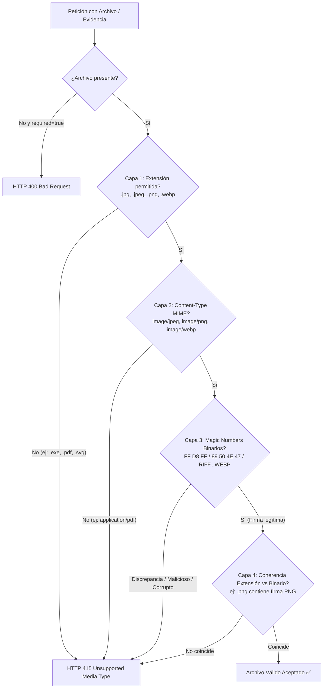

# TAL-127: Refactor - Middleware de Validación MIME de Evidencias

## 1. Diagnóstico y Contexto del Requerimiento

En el sistema de gestión de incidencias y mantenimiento de la Universidad Católica de Temuco (UCT), los usuarios y técnicos adjuntan evidencias fotográficas para respaldar averías, diagnósticos y reparaciones de activos.

Anteriormente, la validación de archivos en la subida de evidencias dependía únicamente de expresiones regulares superficiales aplicadas al nombre del archivo (`ParseFilePipeBuilder`), lo que presentaba **graves riesgos de seguridad**:
1. **Falsificación de Extensión (Spoofing)**: Un usuario o atacante podía renombrar un ejecutable malicioso (`malware.exe`) o documento (`reporte.pdf`) a `evidencia.jpg` y el backend lo aceptaba, ya que el validador por defecto no inspeccionaba el contenido binario del archivo.
2. **Vulnerabilidades por Archivos SVG**: Los archivos `.svg` (gráficos vectoriales basados en XML) pueden contener etiquetas `<script>` capaces de ejecutar ataques XSS (*Cross-Site Scripting*) o inyección de código si son renderizados directamente por el navegador.
3. **Formatos No Autorizados**: Archivos PDF, ejecutables binarios o scripts podían ser almacenados como falsas evidencias fotográficas.

### Objetivos y Criterios de Aceptación (TAL-127)
1. **Validación Binaria Estricta (Magic Numbers)**: Validar los encabezados binarios (*file signatures*) del archivo para garantizar que solo se acepten imágenes auténticas:
   - `image/jpeg` (`.jpg`, `.jpeg`)
   - `image/png` (`.png`)
   - `image/webp` (`.webp`)
2. **Rechazo de Archivos No Permitidos**: Las peticiones con archivos `PDF`, `EXE`, `SVG` o archivos camuflados deben ser rechazadas con **HTTP 415 (Unsupported Media Type)** o **HTTP 400 (Bad Request)**.
3. **Modularidad y Reusabilidad**: Separar la lógica en el archivo independiente `validators/file-mime.pipe.ts` para que pueda ser reutilizado en cualquier controlador o endpoint de la arquitectura.
4. **Cero Dependencias Adicionales**: Implementación basada en APIs nativas de Node.js (`Buffer`, `Uint8Array`) y NestJS (`PipeTransform`), sin requerir librerías pesadas externas.

---

## 2. Resumen de Archivos Modificados y Creados

| Archivo | Tipo de Cambio | Propósito |
|---|---|---|
| `ms-incidencias/src/validators/file-mime.pipe.ts` | **Creado** | Implementación del Pipe reutilizable `FileMimeValidationPipe`, funciones auxiliares de detección de Magic Numbers (`detectarMimePorMagicNumbers`), extracción de extensiones (`extraerExtension`) y validación de URLs (`validarExtensionEvidencia`). |
| `ms-incidencias/src/validators/file-mime.pipe.spec.ts` | **Creado** | Suite de pruebas unitarias exhaustiva con 19 pruebas que validan rechazo de PDF, EXE, SVG, archivos camuflados (spoofing), aceptación de JPEG/PNG/WebP, coherencia binaria y opciones de estado HTTP. |
| `ms-incidencias/src/incidencias/incidencias.controller.ts` | **Modificado** | Integración de `FileMimeValidationPipe` en el endpoint `@Post(':id_incidencia/evidencias/upload')`. |
| `ms-incidencias/src/incidencias/incidencias.controller.spec.ts` | **Modificado** | Pruebas unitarias para el controlador verificando delegación de subida y creación de evidencia. |
| `ms-incidencias/src/incidencias/incidencias.service.ts` | **Modificado** | Integración de `validarExtensionEvidencia` en `crearEvidencia` para proteger también la subida mediante URL Cloudinary. |
| `ms-incidencias/src/incidencias/incidencias.service.spec.ts` | **Modificado** | Pruebas de integración del servicio confirmando rechazo de URLs con extensiones `.exe` o `.pdf`. |
| `docs/Sprint-2/semana-2/TAL-127-refactor-middleware-de-validacion-mime-de-evidencias.md` | **Creado** | Documentación técnica exhaustiva del requerimiento TAL-127. |

---

## 3. Arquitectura de Validación Multi-Capa

El pipe aplica una validación en 5 capas secuenciales de defensa en profundidad:



### 3.1. Firmas Binarias (Magic Numbers) Soportadas

| Formato | MIME Permitido | Extensiones | Firma Binaria (Bytes Hexadecimales) |
|---|---|---|---|
| **JPEG / JPG** | `image/jpeg` | `.jpg`, `.jpeg` | `FF D8 FF` (Bytes 0, 1 y 2) |
| **PNG** | `image/png` | `.png` | `89 50 4E 47 0D 0A 1A 0A` (8 bytes fijos) |
| **WebP** | `image/webp` | `.webp` | `52 49 46 46` (`RIFF` en 0-3) y `57 45 42 50` (`WEBP` en 8-11) |

### 3.2. Firmas Peligrosas Detectadas y Rechazadas Explícitamente

| Formato Peligroso | MIME | Firma Binaria Detectada | Razón de Rechazo |
|---|---|---|---|
| **PDF** | `application/pdf` | `25 50 44 46` (`%PDF`) | Formato de documento, no evidencia de imagen. |
| **EXE / DLL / DOS** | `application/x-msdownload` | `4D 5A` (`MZ` header Windows PE) | **Riesgo crítico de ejecución de malware**. |
| **SVG** | `image/svg+xml` | `<?xml` o `<svg` (encabezado texto/XML) | **Riesgo de ataque XSS (inyección de scripts)**. |
| **ZIP / JAR** | `application/zip` | `50 4B 03 04` (`PK..`) | Archivos comprimidos no permitidos. |

---

## 4. Uso y Reusabilidad del Pipe

### 4.1. Uso Estándar en Controladores NestJS

```typescript
@Post(':id_incidencia/evidencias/upload')
@UseInterceptors(FileInterceptor('file'))
async uploadEvidencia(
  @Param('id_incidencia', ParseUUIDPipe) id: string,
  @Body('id_tipo_evidencia') id_tipo_evidencia: string,
  @UploadedFile(new FileMimeValidationPipe()) file: Express.Multer.File,
) {
  return this.incidenciasService.procesarYGuardarEvidencia(id, Number(id_tipo_evidencia), file);
}
```

### 4.2. Opciones Configurables

El constructor de `FileMimeValidationPipe` admite opciones personalizadas:

```typescript
new FileMimeValidationPipe({
  allowedMimes: ['image/jpeg', 'image/png'], // Restringir formatos
  allowedExtensions: ['jpg', 'png'],
  errorStatusCode: HttpStatus.BAD_REQUEST,   // Retornar 400 en vez de 415
  required: false,                          // Permitir campo opcional
})
```

### 4.3. Validación de URLs en Creación de Evidencias

En `crearEvidencia`, se reutiliza la función exportada `validarExtensionEvidencia(body.url_evidencia)`:
- Si se envía `https://servidor.com/malware.exe` $\to$ Rechazado con **HTTP 415**.
- Si se envía `https://servidor.com/documento.pdf` $\to$ Rechazado con **HTTP 415**.
- Si se envía `https://cloudinary.com/foto.jpg` $\to$ **Aceptado**.

---

## 5. Resultados de Pruebas y Compilación

### 5.1. Cobertura de Pruebas Unitarias
Se ejecutaron todas las suites de prueba de `ms-incidencias` mediante `npm test`:

```text
PASS src/validators/file-mime.pipe.spec.ts
PASS src/auth/jwt-auth.guard.spec.ts
PASS src/common/filters/openapi-exception.filter.spec.ts
PASS src/auth/roles.guard.spec.ts
PASS src/ordenes-trabajo/ordenes-trabajo.service.spec.ts
PASS src/incidencias/prioridad-dinamica.service.spec.ts
PASS src/app.controller.spec.ts
PASS src/ordenes-trabajo/ordenes-trabajo.controller.spec.ts
PASS src/incidencias/exportar-incidencias.service.spec.ts
PASS src/incidencias/incidencias.service.spec.ts
PASS src/incidencias/incidencias.controller.spec.ts

Test Suites: 11 passed, 11 total
Tests:       76 passed, 76 total
Snapshots:   0 total
Time:        13.099 s
Ran all test suites.
```

### 5.2. Compilación del Proyecto
Se ejecutó `npm run build` en `ms-incidencias`:
```text
> ms-incidencias@0.0.1 build
> nest build
Done (0 errors, 0 warnings).
```
Se garantizó compatibilidad estricta con TypeScript, NestJS, Express Multer y Sharp.

