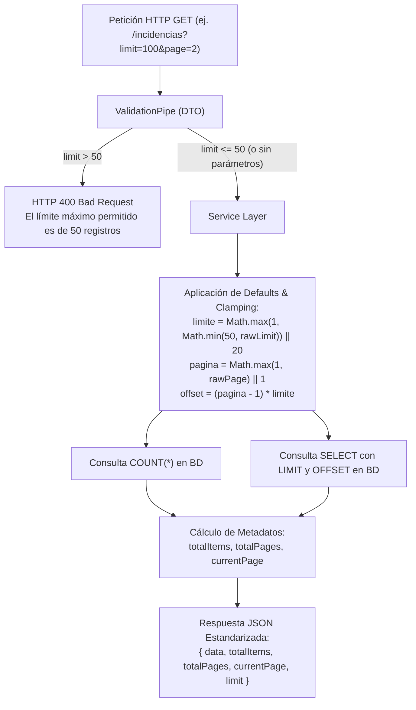

# TAL-139: Optimización y Paginación Forzada de Queries Grandes

## 1. Diagnóstico y Contexto del Requerimiento

En el sistema distribuido de gestión de incidencias, trazabilidad de activos y órdenes de trabajo de la Universidad Católica de Temuco (UCT), a medida que la plataforma entra en régimen de producción y escala operativamente, la acumulación de datos históricos genera un crecimiento significativo en el volumen de registros en base de datos.

Anteriormente, múltiples consultas en los microservicios utilizaban llamadas a `prisma.findMany()` o `$queryRaw` sin parámetros de corte (`take` / `skip`) o con límites permisivos (hasta 100 registros), y algunos endpoints como `GET /incidencias` devolvían un listado plano de incidencias sin metadatos de paginación (`totalItems`, `totalPages`, `currentPage`).

### Riesgos Mitigados
1. **Sobrecarga de Memoria RAM (OOM - Out of Memory)**: La ejecución de consultas abiertas sobre tablas con miles de registros cargaba volúmenes masivos de entidades en memoria Node.js, provocando caídas súbitas del proceso (Worker process killed / OOM).
2. **Latencia y Congestión de Red**: Transferencia innecesaria de megabytes de datos JSON entre el motor de base de datos PostgreSQL, los microservicios NestJS, el API Gateway y el cliente frontend.
3. **Inconsistencia de Contratos de Paginación**: Respuestas con esquemas dispares de paginación que dificultaban la integración estándar de componentes de tabla (`DataTable`) en el frontend web.

### Criterios de Aceptación (TAL-139)
1. **Tope Estricto de 50 Registros por Petición**: Ningún endpoint del sistema puede devolver más de 50 registros por consulta, independientemente de los parámetros solicitados por el cliente (`limit <= 50`).
2. **Metadatos de Paginación Obligatorios**: La respuesta de las consultas paginadas debe incluir metadatos estandarizados: `totalItems`, `totalPages`, `currentPage` (junto con alias de compatibilidad como `limit`, `total` y `data`).
3. **Refactorización Obligatoria de "Listar Incidencias" (`GET /incidencias`)**: Paginación forzada basada en offset (`limit=20&page=1` por defecto) y limitación a nivel de base de datos SQL (`LIMIT` y `OFFSET`).
4. **Auditoría Global de Consultas en Microservicios**: Detección y contención de todas las consultas `prisma.findMany()` sin parámetros de límite en `ms-incidencias`, `ms-activos` y `ms-auth`.
5. **Cero Dependencias Nuevas**: Implementación limpia con TypeScript, class-validator (`@Min(1)`, `@Max(50)`), Prisma y NestJS.

---

## 2. Resumen de Archivos Modificados y Creados

| Microservicio / Directorio | Archivo | Tipo de Cambio | Propósito |
|---|---|---|---|
| `ms-incidencias` | `src/incidencias/dto/listar-incidencias-query.dto.ts` | **Modificado** | Restricción `@Max(50)` en `limit` y `limite` con mensaje explícito; valores por defecto: `limit=20`, `page=1`. |
| `ms-incidencias` | `src/incidencias/incidencias.service.ts` | **Modificado** | Paginación forzada en `listar()` con cálculo de total mediante `$queryRaw COUNT(*)`, `LIMIT` y `OFFSET`, agregando metadatos (`totalItems`, `totalPages`, `currentPage`, `limit`, `data`). Inclusión de `take: 50` en `listarHistorial`, `listarEvidencias`, `listarEstados`, `listarTiposEvidencia` y `obtenerReportePrioridades`. |
| `ms-incidencias` | `src/incidencias/incidencias.service.spec.ts` | **Modificado** | Suite de pruebas unitarias para TAL-139 validando metadatos por defecto, tope máximo de 50 registros y manejo de resultados vacíos. |
| `ms-incidencias` | `src/incidencias/dto/prioridad-dinamica-query.dto.ts` | **Modificado** | Restricción de `@Max(100)` a `@Max(50)` en `limite` y `limit`. |
| `ms-incidencias` | `src/ordenes-trabajo/dto/filtrar-ordenes.dto.ts` | **Modificado** | Restricción de `@Max(100)` a `@Max(50)` en `limit`. |
| `ms-incidencias` | `src/ordenes-trabajo/ordenes-trabajo.service.ts` | **Modificado** | Acotación estricta de `limit` (`Math.min(50, ...)`) y retorno de metadatos `totalItems` y `currentPage` en `listarTodas` y `listarPorTecnico`. |
| `ms-incidencias` | `src/ordenes-trabajo/ordenes-trabajo.service.spec.ts` | **Modificado** | Actualización de aserciones para verificar `totalItems` y `currentPage`. |
| `ms-activos` | `src/dto/trazabilidad-query.dto.ts` | **Modificado** | Restricción `@Max(50)` en `limit` y actualización del método `sanitizar` a tope de 50. |
| `ms-activos` | `src/activos.controller.ts` | **Modificado** | `listarActivos()` ahora soporta paginación (`page`, `limit`), acota a 50 y devuelve metadatos (`totalItems`, `totalPages`, `currentPage`). |
| `ms-activos` | `src/activos.service.ts` | **Modificado** | `listarTodos()` recibe parámetros de paginación y aplica `skip` y `take: limit` (máx 50). Adición de `contarTotalActivos()`. Agregado `take: 50` en consulta de mantenimientos. |
| `ms-activos` | `src/mantenimientos.cron.ts` | **Modificado** | Adición de parámetro `take: 50` en el escaneo nocturno de mantenimientos preventivos. |
| `ms-auth` | `src/auth/auth.controller.ts` | **Modificado** | Acotación de `limit` a máximo 50 (`Math.min(50, ...)`) en `listUsers()`. |
| `ms-auth` | `src/auth/auth.service.ts` | **Modificado** | Inclusión de `totalItems`, `totalPages`, `currentPage` y clamp a 50 en `listUsers()`. |
| `ms-auth` | `src/auth/auth.service.spec.ts` | **Modificado** | Prueba unitaria específica para TAL-139 verificando paginación forzada a 50 y metadatos. |
| `ms-auth` | `src/auth/user.repository.ts` | **Modificado** | Forzado de `take = Math.min(50, limit)` en la consulta Prisma de usuarios. |
| `docs` | `Sprint-2/semana-2/TAL-139-optimizacion-y-paginacion-forzada-de-queries-grandes.md` | **Creado** | Documentación técnica exhaustiva del requerimiento TAL-139. |

---

## 3. Arquitectura de Flujo de Paginación y Protección OOM

El flujo garantiza que tanto a nivel de transporte (ValidationPipe) como en la capa de servicio y repositorio se aplique la cota máxima de 50 registros por petición.



---

## 4. Estructura de Respuesta Estandarizada

Para preservar compatibilidad bidireccional tanto con el frontend (`DataTable.jsx`, `incidenciasService.js`) como con consumidores de API REST existentes, el esquema retornado provee tanto los nuevos campos estándar como alias de retrocompatibilidad:

```json
{
  "data": [
    {
      "id_incidencia": "550e8400-e29b-41d4-a716-446655440000",
      "titulo": "Proyector no enciende",
      "descripcion": "El proyector en sala 402 no da señal",
      "estado": { "id_estado": 1, "nombre_estado": "Reportada" },
      "prioridad": "Alta",
      "fecha_creacion": "2026-10-30T15:00:00.000Z"
    }
  ],
  "items": [ /* mismo contenido que data */ ],
  "totalItems": 45,
  "total": 45,
  "totalPages": 3,
  "currentPage": 1,
  "page": 1,
  "limit": 20,
  "limite": 20,
  "itemsPerPage": 20
}
```

---

## 5. Auditoría de Consultas Prisma en Microservicios

### 5.1. `ms-incidencias`
- **`listar()`**: Anteriormente retornaba array plano sin conteo total. Ahora ejecuta `COUNT(*)` sobre la tabla `INCIDENCIAS` (respetando filtros de activo y estado lateral) y pagina con `LIMIT ${limite} OFFSET ${offset}`, acotando además la consulta subsiguiente de Prisma con `take: limite`.
- **`listarHistorial()`**: Añadido `take: 50` para evitar saturación en incidencias con historial extenso de transiciones.
- **`listarEvidencias()`**: Añadido `take: 50`.
- **`listarEstados()` / `listarTiposEvidencia()`**: Añadido `take: 50`.
- **`obtenerReportePrioridades()`**: Aplica límite parametrizado con tope en 50 (`take: Math.min(50, rawLimit)`).
- **`ordenes-trabajo.service.ts`**: Ambos métodos (`listarTodas` y `listarPorTecnico`) fueron ajustados de tope 100 a tope 50, integrando metadatos `totalItems` y `currentPage`.

### 5.2. `ms-activos`
- **`listarActivos()`**: Recibe parámetros opcionales `page` y `limit`, aplicando defaults y tope en 50. Devuelve `totalItems`, `totalPages`, `currentPage` y el array de activos en `datos` para total retrocompatibilidad con las pruebas unitarias y llamadas internas de otros microservicios.
- **`mantenimientos.cron.ts`**: Añadido `take: 50` en `prisma.mantenimiento.findMany()`, protegiendo el escaneo periódico de caídas por OOM si existen cientos de mantenimientos agendados para el día.

### 5.3. `ms-auth`
- **`listUsers()`**: Parámetro `limit` sanitizado y protegido con `Math.min(50, ...)`.
- **`UserRepository.findMany()`**: Aplica `take: Math.min(50, limit)` en la consulta a base de datos PostgreSQL, evitando que clientes malintencionados o desconfigurados soliciten lotes masivos de usuarios.

---

## 6. Verificación y Resultados de Pruebas

### 6.1. Pruebas Unitarias `ms-incidencias`
Ejecución mediante `pnpm test`:
- **Suites**: 11 passed, 11 total.
- **Tests**: 79 passed, 79 total.
- **Compilación**: `pnpm run build` completado exitosamente sin advertencias de tipos.

### 6.2. Pruebas Unitarias `ms-activos`
Ejecución mediante `pnpm test`:
- **Suites**: 2 passed, 2 total (`activos.controller.spec.ts`, `activos.service.spec.ts`).
- **Tests**: 25 passed, 25 total.
- **Compilación**: `pnpm run build` completado exitosamente con código 0.

### 6.3. Pruebas Unitarias `ms-auth`
Ejecución mediante `pnpm exec vitest run src/auth/auth.service.spec.ts`:
- **Suites**: 1 passed, 1 total.
- **Tests**: 6 passed, 6 total.
- **Compilación**: `pnpm run build` completado exitosamente con código 0.

