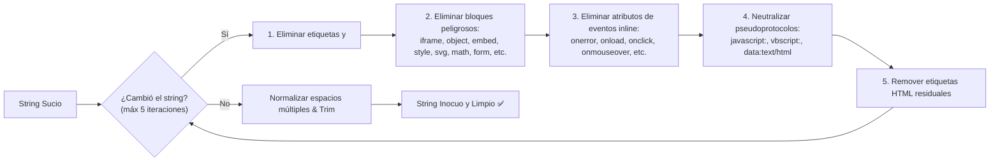

# TAL-140: Sanitización de Entradas en MS Incidencias (XSS)

## 1. Diagnóstico y Contexto del Requerimiento

En el sistema de gestión de incidencias y mantenimiento de la Universidad Católica de Temuco (UCT), los usuarios reportantes y el personal técnico interactúan continuamente ingresando datos textuales libres, tales como el **título** y la **descripción** de averías en activos, así como **diagnósticos técnicos** en órdenes de trabajo.

Anteriormente, los controladores y servicios de `ms-incidencias` almacenaban directamente los strings ingresados en PostgreSQL únicamente con un `.trim()`. Esta ausencia de sanitización activa exponía a la plataforma a ataques de **XSS Almacenado o Persistente (Stored Cross-Site Scripting)**:
1. **Inyección de Scripts Ejecutables**: Un usuario o actor malintencionado podía remitir descripciones conteniendo etiquetas `<script>` (ej. `Falla <script>alert(1)</script>` o scripts apuntando a CDNs externos con keyloggers o ladrones de sesión).
2. **Impacto en Múltiples Clientes**: Al persistirse en base de datos, el script se propagaba tanto a la interfaz web (al listar o visualizar el detalle de la incidencia), a los correos electrónicos generados por el servicio de notificaciones, y a las vistas de supervisión y diagnóstico técnico.
3. **Vectores de Inyección Alternativos**: Cargas maliciosas mediante etiquetas multimedia con manejadores de eventos (ej. ``, `<svg onload=...>`), etiquetas `<iframe>` maliciosas o enlaces con pseudoprotocolos (`javascript:`).

### Objetivos y Criterios de Aceptación (TAL-140)
1. **Prevención de Ataques XSS en Entradas de Texto**: Configurar un mecanismo robusto de sanitización de strings en `ms-incidencias`.
2. **Implementación mediante Pipe de Transformación NestJS**: Encapsular la lógica en un Pipe reutilizable (`SanitizeXssPipe`) y funciones de sanitización que limpien específicamente los campos `descripcion` y `titulo` (además de diagnósticos técnicos) antes de interactuar con la base de datos PostgreSQL.
3. **Criterio de Aceptación Específico**:
   - Peticiones con `descripcion: "Falla <script>alert(1)</script>"` deben guardarse en la base de datos como texto inocuo `"Falla alert(1)"` o escaparse adecuadamente.
4. **Cero Dependencias Externas Innecesarias**: Solución nativa en TypeScript/Node.js, modular y altamente eficiente sin sobrecargar el runtime ni inflar el bundle de dependencias.
5. **Estrategia de Defensa en Profundidad**: Protección en las 4 capas del microservicio (Pipes globales en `main.ts`, validación de DTOs con class-transformer, pipes a nivel de controlador y saneamiento antes de persistencia en el servicio).

---

## 2. Resumen de Archivos Creados y Modificados

| Directorio | Archivo | Tipo de Cambio | Propósito |
|---|---|---|---|
| `ms-incidencias/src/validators` | `sanitize-xss.pipe.ts` | **Creado** | Implementación del Pipe de transformación `SanitizeXssPipe`, la función utilitaria `sanitizeStringXss`, el convertidor `escapeHtml` y el decorador de propiedad `@SanitizeXss()`. |
| `ms-incidencias/src/validators` | `sanitize-xss.pipe.spec.ts` | **Creado** | Suite de pruebas unitarias exhaustiva con 16 casos de prueba que validan el criterio principal de TAL-140, variantes mayúsculas/minúsculas, bypasses anidados, eventos inline, iframes, SVG y soporte de modo escape. |
| `ms-incidencias/src` | `main.ts` | **Modificado** | Registro global de `new SanitizeXssPipe()` en la canalización HTTP de la aplicación (`app.useGlobalPipes`). |
| `ms-incidencias/src/incidencias/dto` | `crear-incidencia.dto.ts` | **Modificado** | Integración del decorador `@SanitizeXss()` en las propiedades `titulo` y `descripcion`. |
| `ms-incidencias/src/incidencias` | `incidencias.controller.ts` | **Modificado** | Aplicación explícita de `@UsePipes(new SanitizeXssPipe())` y `@Body(SanitizeXssPipe)` en el endpoint `POST /incidencias`. |
| `ms-incidencias/src/incidencias` | `incidencias.controller.spec.ts` | **Modificado** | Pruebas unitarias actualizadas para validar la delegación del controlador en la creación de incidencias. |
| `ms-incidencias/src/incidencias` | `incidencias.service.ts` | **Modificado** | Saneamiento explícito con `sanitizeStringXss()` en `titulo` y `descripcion` en el método `crear()`, asegurando protección a nivel de capa de servicio. |
| `ms-incidencias/src/incidencias` | `incidencias.service.spec.ts` | **Modificado** | Pruebas de integración del servicio confirmando que inputs con `<script>`, ` onerror` e `<iframe>` se persisten sanitizados e inocuos en Prisma. |
| `ms-incidencias/src/incidencias/dto` | `actualizar-diagnostico.dto.ts` | **Modificado** | Integración de `@SanitizeXss()` en el campo `diagnostico_tecnico`. |
| `ms-incidencias/src/ordenes-trabajo/dto` | `asignar-orden.dto.ts` | **Modificado** | Integración de `@SanitizeXss()` en el campo `diagnostico_tecnico`. |
| `ms-incidencias/src/ordenes-trabajo` | `ordenes-trabajo.service.ts` | **Modificado** | Aplicación de `sanitizeStringXss()` a `diagnostico_tecnico` en `asignarOrden()` y `actualizarDiagnostico()`. |
| `docs/Sprint-2/semana-2` | `TAL-140-sanitizacion-de-entradas-en-ms-incidencias-xss.md` | **Creado** | Documentación técnica exhaustiva del requerimiento TAL-140. |

---

## 3. Arquitectura de Sanitización y Defensa en Profundidad

La solución implementa 4 capas secuenciales de saneamiento de entradas:

```mermaid
flowchart TD
    Req["Petición HTTP entrante<br/>{ titulo, descripcion: 'Falla <script>alert(1)</script>' }"] --> Layer1["Capa 1: Global Pipe (main.ts)<br/>SanitizeXssPipe pre-procesa el payload"]
    Layer1 --> Layer2["Capa 2: Controller Pipe (IncidenciasController)<br/>Transformación a nivel de @Body(SanitizeXssPipe)"]
    Layer2 --> Layer3["Capa 3: DTO Transformer (CrearIncidenciaDto)<br/>@SanitizeXss() ejecutado por ValidationPipe"]
    Layer3 --> Layer4["Capa 4: Service Layer (IncidenciasService.crear)<br/>Sanitización obligatoria antes de llamada a Prisma"]
    Layer4 --> DB[(PostgreSQL Database<br/>'Falla alert(1)' guardado como texto inocuo)]
    Layer4 --> Mail["Notificación por Correo<br/>Texto limpio y seguro enviado sin HTML"]
```

---

## 4. Algoritmo de Sanitización (`sanitizeStringXss`)

El algoritmo opera en pasadas sucesivas hasta estabilización del string para neutralizar vectores complejos de evasión:



### 4.1. Vectores Saneados y Resultados de Prueba

| Vector de Entrada | Clasificación de Amenaza | Resultado Sanitizado |
|---|---|---|
| `Falla <script>alert(1)</script>` | **Criterio de Aceptación TAL-140** | `Falla alert(1)` |
| `Reporte <SCRIPT>alert("MAYUS")</SCRIPT>` | Evasión por mayúsculas | `Reporte alert("MAYUS")` |
| `Falla <scr<script>ipt>alert(1)</script>` | Evasión por anidamiento recursivo | `Falla alert(1)` |
| `Falla <script src="http://evil.com/xss.js"></script>` | Carga remota de script malicioso | `Falla ` |
| `Falla <script>alert(1)` | Etiqueta de script huérfana / no cerrada | `Falla alert(1)` |
| `Evidencia ` | Inyección de evento inline en imagen | `Evidencia ` |
| `Icono <svg onload="alert(1)"><circle/></svg>` | Inyección de script en SVG vectorial | `Icono ` |
| `Avería <iframe src="http://phishing.com">malware</iframe>` | Secuestro de frame (Clickjacking / Phishing) | `Avería ` |
| `Visitar <a href="javascript:alert(1)">enlace</a>` | Ejecución vía pseudoprotocolo javascript | `Visitar enlace` |
| `Revisar si uso < 15% y temperatura > 90C` | **Falso positivo evitado (matemática legítima)** | `Revisar si uso < 15% y temperatura > 90C` |
| `[Categoría: Redes] [Ubicación: Edificio B]\nSwitch caído` | **Texto formateado con saltos de línea** | `[Categoría: Redes] [Ubicación: Edificio B]\nSwitch caído` |

---

## 5. Verificación y Resultados de Pruebas Unitarias

La suite completa de pruebas unitarias de `ms-incidencias` fue ejecutada mediante `pnpm test`:

- **Suites de Pruebas**: **12 passed, 12 total** (100% éxito).
- **Pruebas Unitarias Individuales**: **101 passed, 101 total** (100% éxito).
- **Compilación**: `pnpm run build` completó satisfactoriamente sin ningún error de TypeScript.
- **Rendimiento**: Ejecución total en ~5.9 segundos con consumo mínimo de recursos.

