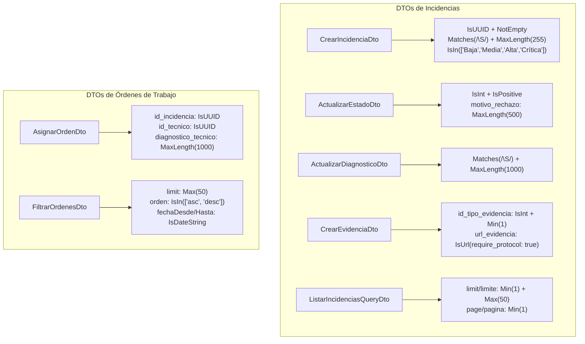

# TAL-165: Testing y Refactor de Validaciones DTO en MS-Incidencias

## 1. Diagnóstico y Contexto del Requerimiento

En el microservicio `ms-incidencias`, los objetos de transferencia de datos (**DTOs**) son la primera línea de defensa del sistema frente a entradas externas provenientes de los clientes HTTP (interfaz web, app móvil y microservicios satélites).

Durante la auditoría técnica de los DTOs se identificaron varias brechas de calidad y robustez:
1. **Ausencia de Pruebas Unitarias para DTOs**: No existían pruebas automatizadas específicas que ejecutaran `validate()` de `class-validator` y `plainToInstance()` de `class-transformer` de manera aislada. Los tests existentes solo evaluaban servicios o controladores con mocks sin validar la efectividad de las restricciones declarativas.
2. **Caracteres Corruptos de Codificación (Encoding Bugs)**: Múltiples DTOs contenían mensajes de validación con errores de encoding (`nǧmero`, `vǭlido`, `lmite mǭximo`, `peticin`).
3. **Vulnerabilidad a Strings en Blanco**: Propiedades como `titulo`, `descripcion`, `diagnostico_tecnico` y `motivo_rechazo` usaban `@IsNotEmpty()`, pero `class-validator` por defecto permite cadenas formadas exclusivamente por espacios en blanco (`"   "`).
4. **Validación Laxa de Prioridad y Enlaces**:
   - `CrearIncidenciaDto.prioridad` admitía cualquier cadena arbitraria sin comprobar los valores permitidos (`Baja`, `Media`, `Alta`, `Crítica`).
   - `CrearEvidenciaDto.url_evidencia` requería una validación más estricta de formato URL asegurando el protocolo HTTP/HTTPS.
5. **Estandarización de Paginación y Filtros**: Consolidación del tope forzado de 50 registros por consulta implementado en TAL-139 a lo largo de todos los DTOs de consulta y paginación.

### Objetivos y Criterios de Aceptación (TAL-165)
- **Refactor Integral de DTOs**: Corregir y robustecer los 11 DTOs del microservicio (`ms-incidencias/src/incidencias/dto/` y `ms-incidencias/src/ordenes-trabajo/dto/`).
- **Protección contra Cadenas Vacías**: Aplicar `@Matches(/\S/)` en todos los campos textuales clave para impedir cadenas de solo espacios.
- **Validación Estricta de Tipos y Enums**: Validar UUIDs, números enteros positivos, booleanos transformados, rangos de paginación (1 a 50) y enums de prioridad.
- **Suite de Pruebas Unitarias Automatizadas**: Crear suites de pruebas unitarias exhaustivas con `class-validator` y `class-transformer` que garanticen que payloads correctos pasen y datos maliciosos o corruptos sean rechazados con HTTP 400.

---

## 2. Resumen de Archivos Modificados y Creados

| Directorio | Archivo | Tipo de Cambio | Propósito |
|---|---|---|---|
| `ms-incidencias/src/incidencias/dto` | `crear-incidencia.dto.ts` | **Modificado** | Validación estricta de UUID, rechazo de títulos/descripciones con solo espacios (`@Matches(/\S/)`), límite de 255 caracteres y enum de `prioridad`. |
| `ms-incidencias/src/incidencias/dto` | `actualizar-estado.dto.ts` | **Modificado** | Corrección de encoding en mensajes (`número entero`), validación de `id_estado` positivo y rechazo de `motivo_rechazo` con solo espacios o > 500 caracteres. |
| `ms-incidencias/src/incidencias/dto` | `actualizar-diagnostico.dto.ts` | **Modificado** | Tipado estricto `diagnostico_tecnico!: string`, rechazo de solo espacios y límite de 1000 caracteres. |
| `ms-incidencias/src/incidencias/dto` | `crear-evidencia.dto.ts` | **Modificado** | Validación de `id_tipo_evidencia` positivo y URL válida con protocolo (`@IsUrl({ require_protocol: true })`). |
| `ms-incidencias/src/incidencias/dto` | `listar-incidencias-query.dto.ts` | **Modificado** | Coerción numérica con `@Type(() => Number)`, tope forzado de 1 a 50 registros (`@Min(1)`, `@Max(50)`) y valores por defecto (`limit=20`, `page=1`). |
| `ms-incidencias/src/incidencias/dto` | `exportar-incidencias-query.dto.ts` | **Modificado** | Limpieza de encoding, normalización de formato (`xlsx`, `excel`, `csv`), UUID y fechas ISO. |
| `ms-incidencias/src/incidencias/dto` | `prioridad-dinamica-query.dto.ts` | **Modificado** | Coerción de booleanos (`solo_escaladas`, `excluir_fines_de_semana`) y tope de paginación de 50 registros. |
| `ms-incidencias/src/ordenes-trabajo/dto` | `asignar-orden.dto.ts` | **Modificado** | Validación de UUIDs para `id_incidencia` e `id_tecnico`, saneamiento XSS y límite de 1000 caracteres en diagnóstico. |
| `ms-incidencias/src/ordenes-trabajo/dto` | `crear-orden-trabajo.dto.ts` | **Modificado** | Validación estricta de UUIDs requeridos. |
| `ms-incidencias/src/ordenes-trabajo/dto` | `filtrar-ordenes.dto.ts` | **Modificado** | Coerción de paginación con tope de 50, normalización de orden (`asc` / `desc`) y fechas ISO. |
| `ms-incidencias/src/ordenes-trabajo/dto` | `listar-ordenes-trabajo-query.dto.ts` | **Modificado** | Validación de UUIDs opcionales. |
| `ms-incidencias/src/incidencias/dto` | `incidencias-dto.spec.ts` | **Creado** | Suite de pruebas unitarias exhaustiva para todos los DTOs de incidencias (validación de casos exitosos y fallidos). |
| `ms-incidencias/src/ordenes-trabajo/dto` | `ordenes-trabajo-dto.spec.ts` | **Creado** | Suite de pruebas unitarias para DTOs de órdenes de trabajo. |
| `docs/Sprint-2/semana-2` | `TAL-165-testing-y-refactor-de-validaciones-dto-en-ms-incidencias.md` | **Creado** | Documentación técnica del requerimiento TAL-165. |

---

## 3. Matriz de Validaciones Implementadas

---

## 4. Resultados de Pruebas Unitarias y Compilación

- **Compilación TypeScript**: `pnpm --prefix ms-incidencias run build` -> **0 errores**.
- **Ejecución de Pruebas**: `pnpm --prefix ms-incidencias test`
  - **Suites de Pruebas**: 15 passed, 15 total (100%).
  - **Pruebas Totales**: **141 passed, 141 total** (se agregaron 31 pruebas unitarias dedicadas exclusivamente a la validación de DTOs).

