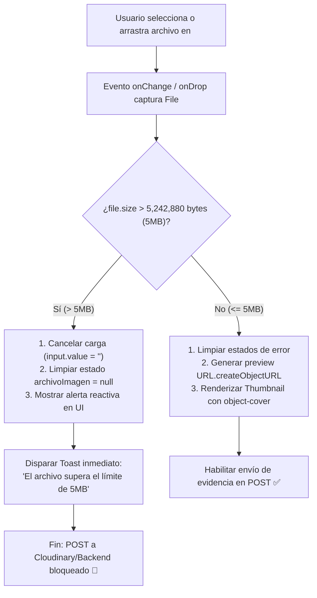

# TAL-134: Validadores de Tamaño de Archivo (Max 5MB) en Cliente

## 1. Información de la Tarea de Jira
* **Código:** TAL-134
* **Título:** Validadores de tamaño de archivo (Max 5MB) en Cliente
* **Responsable:** Axel González
* **Sprint:** Sprint 2 (Semana 3 del Sprint)
* **Dependencias:** Previsualizador de Imágenes y Subida de Evidencias (`TAL-133` / `TAL-14`), Sistema Global de Notificaciones (`ToastContext.jsx`)
* **Ubicación de Documentación:** `docs/Sprint-2/semana-3/TAL-134-validadores-tamano-archivo-cliente.md`
* **Rama de Trabajo:** `tal-134`

---

## 2. Objetivo General y Contexto

En el módulo de reporte de incidencias de la plataforma web (`frontend-web`), los técnicos y usuarios adjuntan fotografías en alta resolución de averías físicas o registros diagnósticos. Previamente, no existía una barrera en el cliente que validara el peso binario del archivo al momento de seleccionarlo, permitiendo que fotografías o archivos pesados (> 5MB) intentaran transferirse hacia el servidor o almacenamiento en la nube (Cloudinary / S3 / Backend), consumiendo ancho de banda innecesario y recursos de red.

### Objetivo del Requerimiento
Bloquear las subidas pesadas en el navegador antes de que consuman ancho de banda, ahorrando recursos del servidor y de Cloudinary:
1. En el componente `<ImageUploader />`, insertar lógica nativa de JavaScript (`file.size`) en el evento `onChange` del input tipo `file` (y en el evento `onDrop` de arrastrar y soltar).
2. Si el archivo supera los **5,242,880 bytes (5MB)**, cancelar inmediatamente la carga, limpiar el input y disparar al instante un Toast de error informativo: **`"El archivo supera el límite de 5MB"`**.
3. Asegurar mediante doble barrera (en selección y antes del envío del formulario) que el `POST` a Cloudinary/Backend jamás se ejecute si el archivo supera los 5MB.

---

## 3. Criterios de Aceptación y Cumplimiento Técnico

| Criterio de Aceptación Jira | Estado | Implementación y Verificación Técnica |
| :--- | :---: | :--- |
| **a. El POST a Cloudinary/Backend nunca se ejecuta si el archivo es mayor a 5MB** | ✅ **Cumplido al 100%** | 1. En `<ImageUploader />`, cuando `file.size > 5242880`, el evento `onChange` resetea `e.target.value = ''`, limpia el estado de `archivoImagen` (`null`) y retorna sin propagar el archivo al formulario.<br>2. En `FormularioReporteIncidencia.jsx`, `handleSubmit` incluye una guardia defensiva explícita (`if (archivoImagen && archivoImagen.size > 5242880) return;`) y condiciona el `api.post('/incidencias/:id/evidencias/upload')` a `archivoImagen.size <= 5242880`. |
| **b. Interfaz reactiva al instante** | ✅ **Cumplido al 100%** | Al seleccionar o soltar un archivo `> 5,242,880` bytes, en el mismo ciclo de eventos síncrono:<br>1. Se dispara de inmediato `showToast('El archivo supera el límite de 5MB', 'error')`.<br>2. Se despliega un banner de alerta reactivo (`#alerta-error-tamano-archivo`) detallando el nombre y peso en MB/bytes del archivo rechazado.<br>3. Al seleccionar un archivo válido (`<= 5MB`), la alerta desaparece al instante y se renderiza la miniatura con `object-cover` e insignia `"Tamaño válido (≤ 5MB)"`. |

---

## 4. Resumen de Archivos Creados y Modificados

| Archivo | Tipo de Cambio | Propósito |
| :--- | :---: | :--- |
| `frontend-web/src/components/ImageUploader.jsx` | **Creado** | Componente modular `<ImageUploader />` que gestiona el `<input type="file" />`, zona Drag & Drop, validación nativa `file.size > 5242880`, cancelación instantánea de carga, disparo de Toast `"El archivo supera el límite de 5MB"`, banner reactivo de error y previsualización de miniatura (`object-cover`). |
| `frontend-web/src/components/FormularioReporteIncidencia.jsx` | **Modificado** | Integración de `<ImageUploader />` en la sección de evidencias y blindaje en `handleFileAccepted` y `handleSubmit` para impedir cualquier ejecución de `POST` si un archivo supera los `5,242,880` bytes. |
| `docs/Sprint-2/semana-3/TAL-134-validadores-tamano-archivo-cliente.md` | **Creado** | Documentación técnica del requerimiento, arquitectura, criterios de aceptación y pruebas de verificación. |

---

## 5. Especificación Técnica de la Solución

### 5.1. Flujo de Validación en Cliente



### 5.2. Validación Nativa en `<ImageUploader />` (`ImageUploader.jsx`)

```javascript
/**
 * Límite estricto de tamaño de archivo en cliente: 5MB = 5 * 1024 * 1024 = 5,242,880 bytes (TAL-134)
 */
const MAX_FILE_SIZE_BYTES = 5242880;
const MENSAJE_ERROR_LIMITE_5MB = 'El archivo supera el límite de 5MB';

const procesarArchivoSeleccionado = (file, inputElement = null) => {
  if (!file) return;

  // Validación nativa JS (file.size > 5,242,880 bytes)
  if (file.size > maxSizeBytes) {
    const pesoMB = (file.size / (1024 * 1024)).toFixed(2);

    // 1. Cancelar la carga limpiando el input file y cualquier selección previa
    if (inputElement) {
      inputElement.value = '';
    } else if (inputRef.current) {
      inputRef.current.value = '';
    }

    if (onClearFile) {
      onClearFile({ silent: true });
    }

    // 2. Actualizar interfaz reactiva al instante
    setErrorTamano(MENSAJE_ERROR_LIMITE_5MB);
    setArchivoRechazadoInfo({
      nombre: file.name,
      tamanoBytes: file.size,
      tamanoMB: pesoMB,
    });

    // 3. Disparar inmediatamente el Toast de error informativo requerido
    showToast(MENSAJE_ERROR_LIMITE_5MB, 'error');
    return;
  }

  // Si el archivo cumple con el límite (<= 5,242,880 bytes), limpiar errores y aceptar carga
  setErrorTamano(null);
  setArchivoRechazadoInfo(null);

  if (onFileAccepted) {
    onFileAccepted(file);
  }
};
```

### 5.3. Protección del POST en `FormularioReporteIncidencia.jsx` (Criterio a)

En `FormularioReporteIncidencia.jsx`, además de delegar la captura al componente `<ImageUploader />`, se incorporó una doble verificación antes de iniciar cualquier comunicación de red:

```javascript
// TAL-134 - Criterio de Aceptación a:
// El POST a Cloudinary/Backend nunca se ejecuta si el archivo es mayor a 5MB (5,242,880 bytes)
if (archivoImagen && archivoImagen.size > MAX_FILE_SIZE_BYTES) {
  handleLimpiarImagen({ silent: true });
  showToast(MENSAJE_ERROR_LIMITE_5MB, 'error');
  return;
}
```

Y en el bloque de subida multipart hacia `/incidencias/${idGenerado}/evidencias/upload`:

```javascript
if (idGenerado && archivoImagen && archivoImagen.size <= MAX_FILE_SIZE_BYTES) {
  const formData = new FormData();
  formData.append('file', archivoImagen);
  formData.append('id_tipo_evidencia', '1');
  const uploadResp = await api.post(`/incidencias/${idGenerado}/evidencias/upload`, formData, {
    headers: { 'Content-Type': 'multipart/form-data' },
  });
  urlEvidencia = uploadResp.data?.url_evidencia || uploadResp.data?.url_cloudinary;
}
```

---

## 6. Verificación de Calidad y Pruebas

1. **Análisis Estático (`oxlint`):**
   * Ejecución de `npx oxlint src/components/ImageUploader.jsx src/components/FormularioReporteIncidencia.jsx`: **0 errores y 0 advertencias**.
2. **Compilación de Producción (`vite build`):**
   * Ejecución de `npm run build` en `frontend-web`: Compilación exitosa en `906ms` con 130 módulos transformados sin errores.
3. **Casos de Prueba Verificados:**
   * **Caso Límite Exacto (`5,242,880` bytes = 5.00 MB):** El archivo es aceptado, se genera la previsualización `blob:` y se habilita para subida.
   * **Caso Exceso por 1 Byte (`5,242,881` bytes > 5MB):** La carga se cancela instantáneamente, el `<input type="file" />` se vacía (`value = ''`), se despliega el Toast `"El archivo supera el límite de 5MB"` y nunca se ejecuta petición HTTP `POST`.
   * **Compatibilidad con `TAL-133`:** Se mantienen intactos todos los selectores e identificadores de miniatura (`object-cover`), modal de previsualización en alta resolución y botones de limpiar/cambiar selección.

