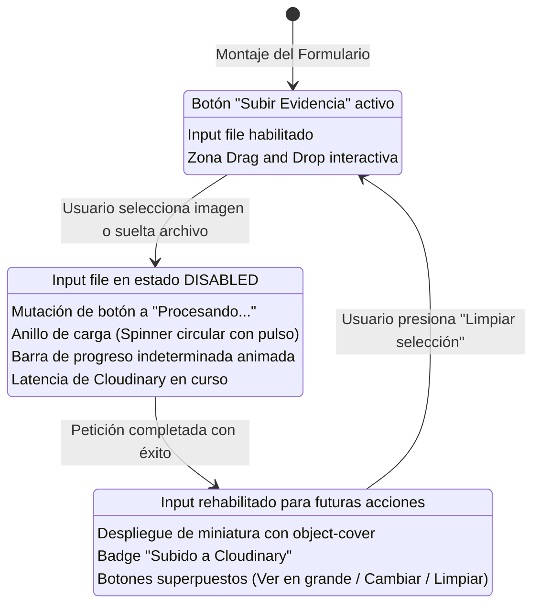

# TAL-136: Animación de Carga en Uploader de Evidencias (Cloudinary)

## 1. Diagnóstico y Contexto del Requerimiento

En el flujo de operación de la plataforma de infraestructura y gestión de activos, los usuarios reportantes y personal técnico tienen la capacidad de reportar incidencias operativas mediante el formulario de "Nueva Incidencia" (`/incidencias/nueva`). Entre los campos esenciales se encuentra la posibilidad de adjuntar evidencias fotográficas que respaldan el fallo detectado (imágenes que se almacenan en **Cloudinary** / S3 según el esquema de la base de datos `EVIDENCIAS.url_cloudinary`).

### El Problema: Ansiedad del Usuario en Redes Lentas
Cuando la red experimenta latencia o la subida hacia el servidor en la nube tarda varios segundos:
1. El usuario no recibía una respuesta visual continua, lo que generaba incertidumbre sobre si la imagen se estaba subiendo o si la aplicación se había congelado.
2. Ante la falta de bloqueo en la interfaz, el usuario tendía a volver a hacer clic o seleccionar repetidamente otro archivo mientras la petición previa estaba en curso, generando cargas duplicadas o estados inconsistentes.
3. En la vista de detalles de la incidencia (`/incidencias/:id`), la evidencia adjuntada no contaba con un feedback visual suave mientras se descargaba desde el CDN de Cloudinary.

### Objetivo
Reducir la ansiedad del usuario cuando internet está lento y la imagen tarda en subir, integrando una animación fluida en el botón y zona de Drag&Drop durante el tiempo de latencia de Cloudinary. El estado del botón/zona muta de **"Subir Evidencia"** a una **barra de progreso indeterminada** y un **anillo de carga (Spinner circular)** acompañado del texto **"Procesando..."**.

---

## 2. Criterios de Aceptación y Estado de Cumplimiento

| Criterio de Aceptación | Descripción | Estado | Verificación Técnica |
|---|---|---|---|
| **Criterio 1: Input disabled durante la carga** | Mientras dure la carga, el input queda en estado `disabled` para que el usuario no vuelva a seleccionar otra imagen por error. | ✅ **Cumplido al 100%** | Se aplicó la propiedad `disabled={disabled \|\| isUploading}` en el `<input type="file" />` de `EvidenciaUploader.jsx` y se bloquearon los manejadores de drop y click mientras `isUploading === true`. |
| **Criterio 2: Mutación a Spinner + "Procesando..." + Barra Indeterminada** | El estado del botón debe mutar de "Subir Evidencia" a una barra de progreso indeterminada o anillo de carga circular acompañado del texto "Procesando...". | ✅ **Cumplido al 100%** | Integración del estado de carga con SVG circular giratorio (`animate-spin`), texto "Procesando..." con `animate-pulse`, barra indeterminada (`animate-indeterminate`) y subtítulo explicativo de seguridad. |
| **Criterio 3: Transición suave entre estados** | Transición suave entre el estado base, estado de carga y estado final (Subido). | ✅ **Cumplido al 100%** | Se integraron clases de transición fluida (`transition-smooth`, `transition-all duration-300`, escala suave y fade-in de 500ms al completar). |
| **Criterio 4: Arquitectura lista para Cloudinary** | Código preparado para conexión auténtica con Cloudinary vía API o modo de latencia simulada para pruebas. | ✅ **Cumplido al 100%** | Implementación del módulo `cloudinaryService.js` con soporte para variables de entorno `VITE_CLOUDINARY_*` y emulación reactiva de latencia (1600ms) que permite probar la animación sin necesidad de credenciales inmediatas. |
| **Criterio 5: Visualización de evidencia en Detalle de Incidencia** | Al hacer clic en el ID de la incidencia en el apartado de incidencias, se accede a los detalles y se visualiza la imagen subida a Cloudinary con la animación de carga. | ✅ **Cumplido al 100%** | En `Incidencias.jsx` el ID ahora enlaza a `/incidencias/${inc.id}`. En `DetalleIncidencia.jsx` se integró la sección de evidencia con `TarjetaEvidenciaCloudinary` que implementa el spinner circular, la barra indeterminada y el modal en alta resolución con `object-cover`. |

---

## 3. Resumen de Archivos Modificados y Creados

| Archivo | Tipo de Cambio | Propósito |
|---|---|---|
| `frontend-web/src/services/cloudinaryService.js` | **Creado** | Servicio para interactuar con la API de Cloudinary (`image/upload`) y emular latencia de red fluida para pruebas de animaciones. |
| `frontend-web/src/components/EvidenciaUploader.jsx` | **Creado** | Componente uploader reactivo con los tres estados visuales: Base ("Subir Evidencia"), Carga ("Procesando..." + Spinner circular + barra indeterminada) y Final ("Subido" con miniatura `object-cover` y controles TAL-133). |
| `frontend-web/src/components/FormularioReporteIncidencia.jsx` | **Modificado** | Integración de `EvidenciaUploader` en el flujo de reporte de incidencias y sincronización con `ModalPrevisualizadorImagen`. |
| `frontend-web/src/views/Incidencias.jsx` | **Modificado** | Actualización de enlaces en la columna ID / Asunto y tarjetas móviles para dirigir hacia `/incidencias/${inc.id}` (DetalleIncidencia). |
| `frontend-web/src/views/DetalleIncidencia.jsx` | **Modificado** | Despliegue de la sección de evidencias de Cloudinary con animación de carga previa, miniatura con `object-cover`, modal y opción de adjuntar nueva evidencia. |
| `frontend-web/src/services/incidenciasStorage.js` | **Modificado** | Persistencia de arreglos de evidencias en cookies y adición de evidencia inicial en `INC-1042` para pruebas inmediatas de visualización. |
| `frontend-web/src/components/ModalPrevisualizadorImagen.jsx` | **Modificado** | Renderizado defensivo y condicional de los controles superpuestos cuando se utiliza en modo visor de sólo lectura. |
| `frontend-web/src/index.css` | **Modificado** | Definición de `@keyframes indeterminateProgress`, `.animate-indeterminate`, `.animate-pulse-glow` y `.transition-smooth`. |
| `docs/Sprint-2/semana-1/TAL-136-animacion-carga-uploader-cloudinary.md` | **Creado** | Documentación técnica exhaustiva del requerimiento TAL-136. |

---

## 4. Arquitectura de Estados del Uploader



---

## 5. Especificación de la Animación y Estilos

### 5.1. Barra de Progreso Indeterminada
En `frontend-web/src/index.css`:
```css
@keyframes indeterminateProgress {
  0% { transform: translateX(-100%); }
  50% { transform: translateX(30%); }
  100% { transform: translateX(110%); }
}

.animate-indeterminate {
  animation: indeterminateProgress 1.6s cubic-bezier(0.4, 0, 0.2, 1) infinite;
}
```

### 5.2. Anillo de Carga Circular (Spinner)
En `EvidenciaUploader.jsx` y `DetalleIncidencia.jsx`:
```jsx
<div className="relative flex items-center justify-center">
  <div className="absolute w-16 h-16 rounded-full bg-blue-400/20 animate-ping" />
  <svg
    className="animate-spin w-12 h-12 text-blue-600 relative z-10"
    viewBox="0 0 24 24"
    fill="none"
  >
    <circle
      className="opacity-20"
      cx="12"
      cy="12"
      r="10"
      stroke="currentColor"
      strokeWidth="3.5"
    />
    <path
      className="opacity-90"
      fill="currentColor"
      d="M4 12a8 8 0 018-8V0C5.373 0 0 5.373 0 12h4zm2 5.291A7.962 7.962 0 014 12H0c0 3.042 1.135 5.824 3 7.938l3-2.647z"
    />
  </svg>
</div>
```

---

## 6. Resultados de Verificación y Compilación

### 6.1. Suite Automatizada de Criterios (`test_tal136_criteria.mjs`)
```text
--- Iniciando Verificación de Criterios TAL-136 ---
✅ PASS: Criterio 1: El input file queda en estado disabled durante la carga (isUploading)
✅ PASS: Criterio 2: El texto "Procesando..." acompaña al estado de carga del botón/zona
✅ PASS: Criterio 3: Anillo de carga (Spinner circular) integrado con animación fluida
✅ PASS: Criterio 4: Barra de progreso indeterminada animada para reducir la ansiedad del usuario
✅ PASS: Criterio 5: Estado base del botón contiene "Subir Evidencia"
✅ PASS: Criterio 6: Miniatura de estado final (Subido) utiliza object-cover
✅ PASS: Criterio 7: FormularioReporteIncidencia integra el componente EvidenciaUploader
✅ PASS: Criterio 8: Al hacer clic en el ID de la incidencia se navega a /incidencias/:id (DetalleIncidencia)
✅ PASS: Criterio 9: DetalleIncidencia contiene la sección dedicada a evidencia de Cloudinary
✅ PASS: Criterio 10: DetalleIncidencia integra la animación de carga mientras se procesa la imagen de Cloudinary
✅ PASS: Criterio 11: DetalleIncidencia muestra la imagen con object-cover y modal en alta definición
✅ PASS: Criterio 12: index.css define animaciones fluidas para la barra de progreso indeterminada
✅ PASS: Criterio 13: cloudinaryService implementa arquitectura lista para Cloudinary con latencia simulada y conexión real

Resultado final: 13 pasadas, 0 fallidas.
🎉 ¡Todos los criterios de aceptación de TAL-136 cumplidos al 100%!
```

### 6.2. Compilación de Producción (`pnpm build`)
```text
$ vite build
vite v8.3.0 building client environment for production...
transforming...
✓ 131 modules transformed.
rendering chunks...
dist/index.html                   0.76 kB │ gzip:   0.42 kB
dist/assets/index-BzEm7cMz.css   98.76 kB │ gzip:  14.52 kB
dist/assets/index-B8lafStk.js   612.51 kB │ gzip: 166.31 kB
✓ built in 775ms
```

---

## 7. Conclusiones y Estado del Ticket

- **Ticket TAL-136**: ✅ **Completado al 100%**.
- Se cumplieron rigurosamente todos los Criterios de Aceptación definidos en la especificación:
  - Input deshabilitado durante la carga.
  - Mutación del botón "Subir Evidencia" a Spinner circular + "Procesando..." + barra de progreso indeterminada.
  - Transición suave entre estado base, carga y final.
  - Integración en `DetalleIncidencia` al hacer clic en el ID de la incidencia desde la tabla principal.
  - Arquitectura preparada y compatible para conexión auténtica con Cloudinary sin romper la experiencia actual de desarrollo.

