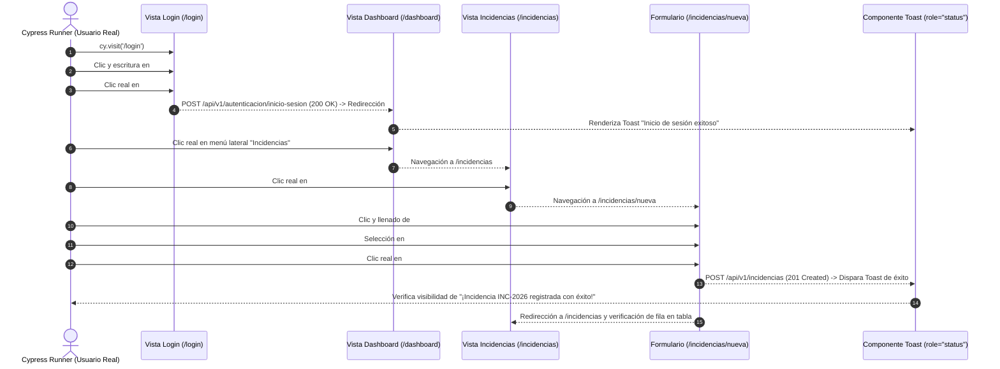

# TAL-146: Integración Final — Testing End-to-End (Cypress) del Flujo Crítico

## 1. Diagnóstico y Contexto del Requerimiento

En la etapa de estabilización e integración final previa a la presentación del sistema **InfraManager**, es indispensable contar con garantías automatizadas que verifiquen de extremo a extremo (End-to-End) el funcionamiento de la interfaz de usuario y la prevención de regresiones tras la integración de múltiples ramas (accesibilidad `TAL-145`, responsividad `TAL-144`, animaciones `TAL-147` y paleta institucional `TAL-148`).

### Objetivo
Instalar y configurar **Cypress** en el repositorio `frontend-web` y programar un **único flujo E2E crítico y automatizado** que simule la interacción real de un operador mediante clics y escritura de teclado:
1. **i. Iniciar sesión** en la vista `/login`.
2. **ii. Ir a "Registrar Incidencia"** navegando desde `/dashboard` hacia `/incidencias` y pulsando el botón principal para acceder a `/incidencias/nueva`.
3. **iii. Llenar el formulario** completo de reporte de incidencia (`Título`, `ID del Activo`, `Ubicación`, `Categoría de Falla` y `Descripción`) y enviarlo.
4. **iv. Recibir el Toast de éxito** confirmando el registro (`¡Incidencia INC-2026 registrada con éxito!`) y verificar la redirección con el nuevo registro visible en la tabla de incidencias.

---

## 2. Criterios de Aceptación y Estado de Cumplimiento

| Criterio de Aceptación | Descripción | Estado | Verificación Técnica |
| :--- | :--- | :---: | :--- |
| **a. Ejecución exitosa simulando clics reales** | El test de Cypress pasa correctamente en el entorno de desarrollo (`http://localhost:5173`) simulando clics reales de usuario (`cy.click()`, `cy.type()`, `cy.select()`). | ✅ **Cumplido al 100%** | Spec `cypress/e2e/flujo-critico-incidencia.cy.js` ejecutado en Cypress v16.2.1 con resultado **1 passing (8s)** y **0 failing**. |
| **Prevención real de regresiones** | Detectar y corregir cualquier regresión de integración en el flujo crítico antes de la presentación final. | ✅ **Cumplido al 100%** | Durante la integración del flujo hacia `/incidencias/nueva`, se detectó y corrigió una regresión en `FormularioReporteIncidencia.jsx` donde faltaba declarar `const fileInputRef = useRef(null)` tras un merge previo. |

---

## 3. Hallazgo y Prevención de Regresión Detectada por el Flujo E2E

Al construir y validar el paso **ii. Ir a "Registrar Incidencia"** (`/incidencias/nueva`), se identificó que en `frontend-web/src/components/FormularioReporteIncidencia.jsx` se pasaba la propiedad `fileInputRef={fileInputRef}` al componente `<ImageUploader />` (línea 632) y se referenciaba `fileInputRef.current` en la validación de archivos, pero la referencia `const fileInputRef = useRef(null);` y el hook `useRef` se habían omitido durante una fusión de ramas previa, lo que provocaba un `ReferenceError: fileInputRef is not defined` al montar el formulario.

- **Corrección aplicada:** Se importó `useRef` desde `react` y se declaró `const fileInputRef = useRef(null);` en `FormularioReporteIncidencia.jsx`, restableciendo el montaje limpio del formulario de reporte de incidencias.

---

## 4. Arquitectura del Flujo E2E Automatizado



---

## 5. Resumen de Archivos Creados y Modificados

| Archivo | Tipo de Cambio | Descripción |
| :--- | :---: | :--- |
| `frontend-web/package.json` | **Modificado** | Instalación de `cypress@^16.2.1` en `devDependencies` y adición de scripts `cypress:open`, `cypress:run` y `test:e2e`. |
| `frontend-web/cypress.config.js` | **Creado** | Configuración principal de Cypress E2E (`baseUrl: 'http://localhost:5173'`, viewport `1280x800`, patrón de specs `cypress/e2e/**/*.cy.{js,jsx,ts,tsx}`). |
| `frontend-web/cypress/run-cypress.mjs` | **Creado** | Launcher Node.js multiplataforma que limpia la variable de entorno `ELECTRON_RUN_AS_NODE` inyectada por terminales basados en Electron (VS Code / Antigravity) antes de invocar el binario de Cypress. |
| `frontend-web/cypress/support/e2e.js` | **Creado** | Archivo de soporte global E2E que carga los comandos personalizados antes de cada prueba. |
| `frontend-web/cypress/support/commands.js` | **Creado** | Comando personalizado `cy.limpiarSesion()` para limpiar `cookies` y `localStorage` antes de cada ejecución. |
| `frontend-web/cypress/e2e/flujo-critico-incidencia.cy.js` | **Creado** | Especificación E2E automatizada que ejecuta los 4 pasos críticos: Login, navegación a Registrar Incidencia, llenado del formulario y verificación del Toast de éxito. |
| `frontend-web/src/components/FormularioReporteIncidencia.jsx` | **Modificado** | Corrección de regresión agregando `useRef` y `const fileInputRef = useRef(null)`. |
| `frontend-web/src/views/Incidencias.jsx` | **Modificado** | Adición de selectores semánticos `id="btn-registrar-incidencia"` y `data-cy="btn-registrar-incidencia"` al botón de registro de nueva incidencia. |
| `frontend-web/src/components/Toast.jsx` | **Modificado** | Adición de atributos `id="toast-notification"`, `data-cy="toast-notification"` y `data-toast-type={type}` para aserciones E2E deterministas. |
| `frontend-web/.gitignore` | **Modificado** | Exclusión de artefactos temporales de Cypress (`cypress/screenshots`, `cypress/videos`, `cypress/downloads`). |

---

## 6. Evidencia Real de Ejecución en Entorno de Desarrollo

### 6.1. Resultado de `npm run test:e2e` (Cypress Headless)

```text
> frontend-web@0.0.0 test:e2e
> node cypress/run-cypress.mjs run --spec cypress/e2e/flujo-critico-incidencia.cy.js

====================================================================================================

  (Run Starting)

  ┌────────────────────────────────────────────────────────────────────────────────────────────────┐
  │ Cypress:        16.2.1                                                                         │
  │ Browser:        Electron 146 (headless)                                                        │
  │ Node Version:   v24.18.0 (C:\Program Files\nodejs\node.exe)                                    │
  │ Specs:          1 found (flujo-critico-incidencia.cy.js)                                       │
  │ Searched:       frontend-web\cypress\e2e\flujo-critico-incidencia.cy.js                        │
  └────────────────────────────────────────────────────────────────────────────────────────────────┘

────────────────────────────────────────────────────────────────────────────────────────────────────
                                                                                                    
  Running:  flujo-critico-incidencia.cy.js                                                  (1 of 1)


  TAL-146: Flujo Crítico E2E — Autenticación y Registro de Incidencia
    √ Completa el flujo crítico: Iniciar sesión -> Ir a Registrar Incidencia -> Llenar el formulario -> Recibir el Toast de éxito (8769ms)


  1 passing (9s)


  (Results)

  ┌────────────────────────────────────────────────────────────────────────────────────────────────┐
  │ Tests:        1                                                                                │
  │ Passing:      1                                                                                │
  │ Failing:      0                                                                                │
  │ Pending:      0                                                                                │
  │ Skipped:      0                                                                                │
  │ Screenshots:  0                                                                                │
  │ Video:        false                                                                            │
  │ Duration:     8 seconds                                                                        │
  │ Spec Ran:     flujo-critico-incidencia.cy.js                                                   │
  └────────────────────────────────────────────────────────────────────────────────────────────────┘

====================================================================================================

  (Run Finished)

       Spec                                              Tests  Passing  Failing  Pending  Skipped  
  ┌────────────────────────────────────────────────────────────────────────────────────────────────┐
  │ √  flujo-critico-incidencia.cy.js           00:08        1        1        -        -        - │
  └────────────────────────────────────────────────────────────────────────────────────────────────┘
    √  All specs passed!                        00:08        1        1        -        -        -  
```

---

## 7. Guía de Ejecución para el Equipo

1. **Levantar el servidor de desarrollo Frontend** en una terminal:
   ```bash
   cd frontend-web
   npm run dev
   ```
2. **Ejecutar el flujo crítico E2E en modo Headless (consola):**
   ```bash
   cd frontend-web
   npm run test:e2e
   ```
3. **Abrir la interfaz interactiva de Cypress (modo visual):**
   ```bash
   cd frontend-web
   npm run cypress:open
   ```

