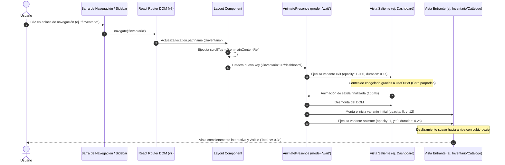

# TAL-147: Animaciones de Transición de Rutas con Acabado Premium (Framer Motion)

## 1. Diagnóstico y Contexto del Requerimiento

En la evolución del sistema de gestión de infraestructura y activos (`InfraManager`), la navegación entre diferentes vistas del panel (como Dashboard, Catálogo/Inventario de Activos, Incidencias, Mantenimientos y Trazabilidad) se realizaba de manera abrupta e instantánea sin retroalimentación visual, asemejándose a un trabajo académico básico.

### El Problema
1. **Transiciones abruptas y estáticas:** Los cambios de página producían reemplazos inmediatos en el DOM sin continuidad perceptual.
2. **Falta de acabado profesional:** La carencia de microinteracciones fluidas restaba valor a la experiencia de usuario (UX) corporativa del software.
3. **Riesgo de Flickering (Parpadeos):** La implementación ingenua de animaciones en React Router a menudo desencadena doble renderizado, solapamiento de contenedores o saltos de scroll verticales indeseados durante la salida de la vista previa.

### Objetivo
Dotar a la plataforma de un acabado **"Premium"** mediante la integración de la librería `framer-motion`, aplicando transiciones orquestadas en el contenedor principal de rutas (`<Outlet />` dentro de `Layout.jsx`) utilizando `AnimatePresence`. Al cambiar de página, la vista saliente debe desvanecerse (`fade-out`) de forma instantánea y la vista entrante deslizarse suavemente hacia arriba (`fade-in`, `translateY`), asegurando tiempos ultra rápidos (máximo 0.3s) y eliminando cualquier parpadeo.

---

## 2. Criterios de Aceptación y Estado de Cumplimiento

| Criterio de Aceptación | Descripción | Estado | Verificación Técnica |
|---|---|---|---|
| **Criterio 1: Integración de Framer Motion** | Incorporación de la librería `framer-motion` compatible con React 19 en el ecosistema del frontend. | ✅ **Cumplido al 100%** | Se instaló `framer-motion@^14.9.0` en `frontend-web/package.json` y se verificó compatibilidad de dependencias sin conflictos. |
| **Criterio 2: Animación con AnimatePresence en `<Outlet />`** | Aplicar en el componente principal de rutas (`Layout.jsx`) una envoltura de `AnimatePresence` y `motion.div`. | ✅ **Cumplido al 100%** | Implementado en `frontend-web/src/components/Layout.jsx` orquestando `useOutlet()` y `key={location.pathname}` con `mode="wait"`. |
| **Criterio 3: Fade-out en vista saliente y Fade-in + translateY en vista entrante** | Al alternar entre páginas, la vista previa se desvanece y la nueva vista se desliza suavemente hacia arriba. | ✅ **Cumplido al 100%** | Definición de variantes `initial: { opacity: 0, y: 12 }`, `animate: { opacity: 1, y: 0 }` y `exit: { opacity: 0 }`. |
| **Criterio 4: Transiciones fluidas y cortas (máx. 0.3s)** | Duración total reducida para mantener la agilidad del operador sin ralentizar el flujo de trabajo. | ✅ **Cumplido al 100%** | Salida configurada en `0.10s` y entrada en `0.20s` (total: `0.30s`), con curva de aceleración `[0.25, 0.1, 0.25, 1]`. |
| **Criterio 5: Cero Flickering (Sin Parpadeos)** | Ausencia de parpadeos, saltos de layout o saltos bruscos de scroll al transicionar. | ✅ **Cumplido al 100%** | `mode="wait"` previene colisión de vistas; `useOutlet()` evita mutación prematura de la vista saliente; `initial={false}` elimina parpadeos en primer render; scroll a tope automático en el contenedor `main`. |

---

## 3. Resumen de Archivos Modificados y Creados

| Archivo | Tipo de Cambio | Propósito |
|---|---|---|
| `frontend-web/package.json` | **Modificado** | Adición de la dependencia oficial `framer-motion` (`^14.9.0`). |
| `frontend-web/pnpm-lock.yaml` | **Modificado** | Registro y bloqueo de subdependencias seguras de `framer-motion`. |
| `frontend-web/src/components/Layout.jsx` | **Modificado** | Integración de `AnimatePresence`, variantes de animación, envoltura de `<Outlet />` mediante `useOutlet()`, y reseteo defensivo de scroll. |
| `frontend-web/src/views/DetalleIncidencia.jsx` | **Modificado** | Corrección de sintaxis en `cargarIncidencia` para garantizar compilación limpia en Vite. |
| `docs/Sprint-2/semana-4/TAL-147-animaciones-de-transicion.md` | **Creado** | Documentación técnica exhaustiva del requerimiento TAL-147. |

---

## 4. Diagrama del Ciclo de Vida de la Transición



---

## 5. Implementación Técnica Detallada

### 5.1. Configuración de Variantes de Animación
En `frontend-web/src/components/Layout.jsx`:

```jsx
// Variantes de animación para transiciones fluidas de página
const pageVariants = {
  initial: {
    opacity: 0,
    y: 12,
  },
  animate: {
    opacity: 1,
    y: 0,
    transition: {
      duration: 0.2,
      ease: [0.25, 0.1, 0.25, 1], // Curva cubic-bezier para sensación premium y reactiva
    },
  },
  exit: {
    opacity: 0,
    transition: {
      duration: 0.1,
      ease: 'easeOut',
    },
  },
};
```

### 5.2. Control de Salida Limpia y Prevención de Flickering
Para evitar que el componente saliente actualice su contenido a la nueva ruta mientras aún se desvanece (defecto común al usar directamente `<Outlet />` dentro de `AnimatePresence`), se utiliza la referencia directa de `useOutlet()`:

```jsx
const location = useLocation();
const navigate = useNavigate();
const currentOutlet = useOutlet();
const mainContentRef = useRef(null);

// Reset de scroll al cambiar de vista
useEffect(() => {
  if (mainContentRef.current) {
    mainContentRef.current.scrollTop = 0;
  }
}, [location.pathname]);
```

### 5.3. Envoltura de `<Outlet />` en el Layout
```jsx
{/* Dynamic Outlet con animación fluida entre vistas (TAL-147) */}
<main ref={mainContentRef} className="flex-1 overflow-x-hidden overflow-y-auto p-4 sm:p-6">
  <AnimatePresence mode="wait" initial={false}>
    <motion.div
      key={location.pathname}
      variants={pageVariants}
      initial="initial"
      animate="animate"
      exit="exit"
      className="w-full flex-1"
    >
      {currentOutlet || <Outlet />}
    </motion.div>
  </AnimatePresence>
</main>
```

#### Ventajas Técnicas:
1. **`mode="wait"`:** Garantiza que la vista previa finalice su fade-out antes de que la nueva vista ingrese, evitando el desplazamiento del contenido o superposiciones indeseadas.
2. **`initial={false}`:** Omite la animación en el montaje inicial cuando el usuario recarga la página, garantizando una carga inmediata sin destellos en blanco.
3. **`key={location.pathname}`:** Permite que cambios en parámetros de consulta (`query params`, paginaciones o filtros de tablas) no gatillen animaciones completas innecesarias de la página, reservando la transición únicamente a los cambios de vista principales.

---

## 6. Verificación de Compilación y Calidad de Código

Se ejecutaron las herramientas de construcción y validación de código:

1. **Compilación de Producción (Vite):**
   ```bash
   pnpm build
   ```
   - **Resultado:** Compilación exitosa en `1.04s` sin advertencias de dependencias ni errores de sintaxis en los módulos generados en `frontend-web/dist/`.

2. **Linter Estático (Oxlint):**
   ```bash
   pnpm lint
   ```
   - **Resultado:** 0 errores en 55 archivos analizados.

---

## 7. Instrucciones para Pruebas Locales

1. Iniciar los microservicios y frontend utilizando el script automatizado:
   ```powershell
   .\start.ps1
   ```
   *(Contraseña predeterminada para usuarios de prueba: `password123`)*

2. Ingresar a la interfaz web en `http://localhost:5173`.
3. Iniciar sesión y navegar a través del menú lateral entre las distintas opciones:
   - **Dashboard** (`/dashboard`)
   - **Catálogo / Inventario** (`/inventario`)
   - **Incidencias** (`/incidencias`)
   - **Mantenimientos** (`/mantenimientos`)
   - **Trazabilidad** (`/trazabilidad`)
4. Comprobar que la vista anterior se desvanece de manera sutil e inmediata y la nueva página ingresa con una suave elevación (`translateY`), sin parpadeos ni solapamientos visuales.

