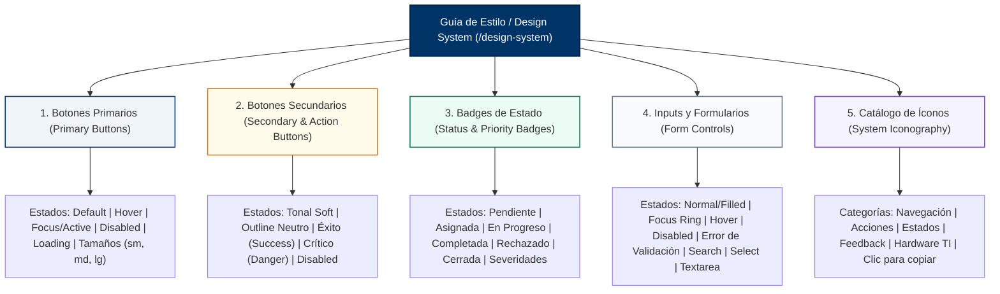

# TAL-171: Diseño de Guía de Estilo de Componentes (Design System)

## 1. Resumen Ejecutivo y Contexto del Requerimiento

En el marco del desarrollo y maduración del frontend de **InfraManager (Universidad Católica de Temuco)**, se requería unificar los criterios visuales, estilos y patrones de interacción entre las diversas vistas de la plataforma (Panel de Control/Dashboard, Gestión de Incidencias, Catálogo de Inventario, Agenda de Mantenimientos y Trazabilidad de Activos).

La dispersión de estilos en botones, colores no homologados o inputs con comportamientos dispares afecta la velocidad de desarrollo y la consistencia del sistema. Para solucionar esto y garantizar el reciclaje ágil de código entre los desarrolladores del equipo, se creó una **ruta secreta temporal** (`/design-system`) que aloja la **Galería Oficial del Sistema de Diseño**, documentando y renderizando en vivo los **5 componentes principales** de la plataforma junto con todos sus estados de interacción.

### Criterios de Aceptación Verificados

| Criterio de Aceptación | Estado | Evidencia y Mecanismo Técnico |
| :--- | :---: | :--- |
| **a. Galería visible con los 5 componentes principales y sus estados (hover, disabled)** | ✅ **Cumplido al 100%** | Implementada en la ruta `/design-system` (componente `src/views/DesignSystem.jsx`). Despliega en vivo: **1. Botones Primarios**, **2. Botones Secundarios**, **3. Badges de Estado**, **4. Inputs y Formularios**, y **5. Catálogo de Íconos del Sistema**, abarcando estados **Default**, **Hover**, **Active/Focus**, **Disabled**, **Loading** y **Error de Validación**, además de un **Playground interactivo** con interruptores de simulación. |
| **Ruta secreta temporal en el frontend** | ✅ **Cumplido al 100%** | Ruta `/design-system` registrada tanto para acceso público directo (evaluación ágil sin requerir sesión) como integrada dentro del `Layout` protegido para operadores logueados (`App.jsx` y `Layout.jsx`). |
| **Reciclaje de código y consistencia** | ✅ **Cumplido al 100%** | Cada tarjeta de componente incorpora un botón **"Copiar Snippet JSX"** que deposita en el portapapeles el bloque de código limpio listo para ser utilizado en nuevas vistas, sincronizado con las notificaciones `Toast`. |

---

## 2. Los 5 Componentes Principales y sus Estados en la Galería

A continuación se detalla la matriz de componentes obligatorios y estados implementados:



### 2.1. Componente 1: Botones Primarios (Primary Buttons)
Representan la acción principal de la pantalla (CTA - *Call To Action*).
- **Tokens de color:** Fondo corporativo UCT `--color-primary` (`#003366`), hover `--color-primary-hover` (`#00254d`), active `--color-primary-active` (`#001936`).
- **Estados expuestos en la galería:**
  1. **Default (Normal):** `bg-primary text-white rounded-lg font-semibold text-sm shadow-sm`.
  2. **Hover:** `hover:bg-primary-hover hover:shadow-md hover:-translate-y-0.5 transition-all`.
  3. **Active & Focus:** `active:bg-primary-active focus-visible:ring-2 focus-visible:ring-primary focus-visible:ring-offset-2`.
  4. **Disabled:** Atributo `disabled`, `opacity-50 cursor-not-allowed pointer-events-none`.
  5. **Loading (Asíncrono):** Spinner circular animado SVG (`animate-spin`) con texto *"Procesando solicitud..."*.
  6. **Escala de tamaños:** `sm` (`text-xs px-2.5 py-1.5`), `md` (`text-sm px-4 py-2.5`), `lg` (`text-base px-6 py-3`).

### 2.2. Componente 2: Botones Secundarios y de Acción (Secondary & Action Buttons)
Acciones alternativas, cancelaciones, filtros y operaciones de severidad diferenciada.
- **Estados y variantes expuestos en la galería:**
  1. **Secundario Tonal (UCT Soft):** `bg-primary-50 text-primary border border-primary-200 hover:bg-primary-100 rounded-lg`. Utilizado en *"Asignar Técnico"*, *"Trazabilidad"*.
  2. **Secundario Outline / Neutro:** `bg-white border border-gray-300 text-gray-700 hover:bg-gray-50 rounded-lg`. Utilizado en *"Volver a Incidencias"*, *"Cancelar"*.
  3. **Acción Positiva / Éxito (Success):** `bg-emerald-700 hover:bg-emerald-800 text-white rounded-lg` y variante tonal `bg-emerald-50 text-emerald-800 border-emerald-200`. Utilizado en *"Finalizar Tarea"*, *"Exportar Excel"*.
  4. **Acción Crítica / Destructiva (Danger):** `bg-red-700 hover:bg-red-800 text-white rounded-lg` y variante tonal `bg-red-50 text-red-700 border-red-200`. Utilizado en *"Rechazar Ticket"*, *"Eliminar Evidencia"*.
  5. **Disabled:** Todos los botones secundarios cuentan con su variante deshabilitada con opacidad atenuada y cursor bloqueado.

### 2.3. Componente 3: Badges de Estado y Prioridad (`StatusBadge`)
Implementa directamente el componente del proyecto `src/components/StatusBadge.jsx` e introduce badges de severidad operativa.
- **Estados operativos expuestos en la galería:**
  - `Pendiente`: Ámbar/Amarillo suave (`bg-yellow-100 text-yellow-800 border-yellow-200`).
  - `Asignada`: Amarillo con indicación de asignación técnica.
  - `En Progreso`: Amarillo/Ámbar de atención continua.
  - `Completada` / `Resuelta`: Verde esmeralda de conformidad (`bg-green-100 text-green-800 border-green-200`).
  - `Rechazado` / `Rechazada`: Rojo de advertencia con motivo técnico (`bg-red-100 text-red-800 border-red-200`).
  - `Cerrada`: Gris neutro de historial finalizado (`bg-gray-100 text-gray-800 border-gray-200`).
- **Niveles de Prioridad y Severidad:**
  - `CRÍTICA`: Badge de alto impacto en rojo (`bg-red-50 text-red-800 border-red-200 font-bold`).
  - `ALTA`: Badge naranja/ámbar (`bg-orange-50 text-orange-800 border-orange-200`).
  - `MEDIA`: Badge amarillo preventivo (`bg-yellow-50 text-yellow-800 border-yellow-200`).
  - `BAJA / OPERATIVO`: Badge esmeralda (`bg-emerald-50 text-emerald-800 border-emerald-200`).
- **Badges como Filtros Reactivos:** Demostración con badges interactivos que alternan estado activo/inactivo con contador numérico de registros.

### 2.4. Componente 4: Inputs y Controles de Formulario (Form Controls)
Garantizan coherencia estética y cumplimiento de accesibilidad WCAG en todos los formularios del sistema (`Login.jsx`, `FormularioReporteIncidencia.jsx`, `PlanificarMantenimientoForm.jsx`, `ModalCierreMantenimiento.jsx`).
- **Estados y controles expuestos en la galería:**
  1. **Input de Texto con Ícono (Default y Filled):** Borde gris `border-gray-300`, hover a `border-gray-400`, foco con anillo institucional `focus:ring-2 focus:ring-primary/20 focus:border-primary`.
  2. **Input en Estado Error:** Borde rojo `border-red-400`, fondo sutil `bg-red-50/20`, texto de error en rojo acompañado de icono de advertencia `<FiAlertCircle />`.
  3. **Input Disabled:** Atributo `disabled`, fondo opaco `disabled:bg-gray-100`, texto atenuado `disabled:text-gray-400` y cursor no permitido.
  4. **Barra de Búsqueda Rápida:** Con icono de lupa a la izquierda, borde redondeado y padding optimizado para filtrado dinámico.
  5. **Select Desplegable:** Con flecha SVG integrada, estilos de foco y opciones tipográficas legibles.
  6. **Textarea Multilínea:** Con contador dinámico de caracteres y soporte para redimensionamiento vertical (`resize-y`).

### 2.5. Componente 5: Catálogo de Íconos del Sistema (Iconography)
Colección clasificada de los íconos de `react-icons/fi` y `react-icons/io5` que se utilizan en la plataforma, categorizados por dominio funcional:
- **Navegación:** `FiHome`, `FiAlertCircle`, `FiBox`, `FiCalendar`, `FiActivity`, `FiUsers`, `FiMenu`, `FiX`, `FiChevronRight`, `FiArrowRight`, `FiArrowLeft`.
- **Acciones y Formularios:** `FiPlus`, `FiEdit`, `FiTrash2`, `FiSave`, `FiSend`, `FiSearch`, `FiFilter`, `FiDownload`, `FiRefreshCw`, `FiExternalLink`, `FiMaximize2`, `FiEye`, `FiEyeOff`.
- **Feedback y Estados:** `FiCheckCircle`, `FiCheck`, `FiAlertTriangle`, `FiClock`, `FiInfo`, `FiShield`, `FiLock`, `FiUnlock`, `FiUserCheck`.
- **Infraestructura y Hardware:** `FiServer`, `FiCpu`, `FiHardDrive`, `FiWifi`, `FiLayers`, `FiTag`, `FiDatabase`, `FiCode`.
- **Interactividad del Catálogo:** Incluye buscador reactivo en vivo por nombre o uso, efecto de elevación al pasar el cursor (`hover:scale-110`), y función de un clic para copiar la sentencia de importación exacta (ej. `import { FiServer } from 'react-icons/fi';`).

---

## 3. Arquitectura de Rutas y Accesibilidad

Para cumplir con la directriz de *"ruta secreta temporal"* sin entorpecer el flujo de producción pero permitiendo al equipo de frontend, evaluadores y QA inspeccionar el sistema:

1. **Ruta Pública Directa (`App.jsx`):**
   ```jsx
   {/* TAL-171: Ruta secreta temporal de Guía de Estilo / Design System (accesible directamente) */}
   <Route path="/design-system" element={<div className="min-h-screen bg-gray-50 p-4 sm:p-6"><DesignSystem /></div>} />
   ```
   Permite ingresar a `http://localhost:5173/design-system` de inmediato sin requerir credenciales ni iniciar sesión.

2. **Ruta Integrada en Layout (`ProtectedRoute`):**
   ```jsx
   <Route path="design-system" element={<DesignSystem />} />
   ```
   Si el usuario ya inició sesión con su cuenta institucional (ej. técnico o administrador), puede navegar dentro de la misma interfaz con el sidebar y topbar corporativos.

3. **Título Dinámico en Topbar (`Layout.jsx`):**
   ```jsx
   if (location.pathname.startsWith('/design-system')) {
     return 'Guía de Estilo y Sistema de Diseño';
   }
   ```

---

## 4. Resumen de Archivos Creados y Modificados

| Archivo | Tipo de Cambio | Propósito |
| :--- | :---: | :--- |
| `frontend-web/src/views/DesignSystem.jsx` | **Creado** | Vista central de la Guía de Estilo con la galería de los 5 componentes principales, estados interactivos, playground dinámico y catálogo de íconos. |
| `frontend-web/src/App.jsx` | **Modificado** | Registro de la ruta `/design-system` en modo público y en modo autenticado bajo `Layout`. |
| `frontend-web/src/components/Layout.jsx` | **Modificado** | Integración del título de vista en el encabezado dinámico para la ruta `/design-system`. |
| `frontend-web/src/components/FormularioReporteIncidencia.jsx` | **Modificado** | Saneamiento de doble declaración de `fileInputRef` para garantizar compilación y linting con 0 errores. |
| `docs/Sprint-2/semana-4/TAL-171-guia-de-estilo-de-componentes.md` | **Creado** | Documentación técnica exhaustiva del requerimiento TAL-171 en el Sprint 2 Semana 4. |

---

## 5. Verificación de Calidad y Compilación

Se ejecutaron las pruebas estáticas y de empaquetado en el frontend:

1. **Linter Estático (`oxlint`):**
   ```bash
   cd frontend-web
   npm run lint
   ```
   - **Resultado:** **0 errores** detectados en los 58 archivos analizados.

2. **Compilación de Producción (`vite build`):**
   ```bash
   cd frontend-web
   npm run build
   ```
   - **Resultado:** Compilación exitosa en **1.02 segundos**, generando los bundles optimizados en `dist/` sin errores de importación ni advertencias de sintaxis.

---

## 6. Instrucciones de Verificación Local

1. Iniciar el servidor de desarrollo del frontend:
   ```bash
   cd frontend-web
   npm run dev
   ```
2. Abrir el navegador en la ruta secreta:
   ```text
   http://localhost:5173/design-system
   ```
3. Verificar:
   - Galería visible de los 5 componentes principales: **Botones Primarios, Botones Secundarios, Badges de Estado, Inputs y Catálogo de Íconos**.
   - Estados **Default, Hover, Active/Focus, Disabled y Loading/Error** visibles y operativos.
   - Interactuar con el **Playground de Estados** activando *"Forzar estado Disabled"* para comprobar el bloqueo reactivo de controles.
   - Hacer clic en *"Copiar Snippet JSX"* en cualquier sección o en cualquier ícono del catálogo para verificar la copia al portapapeles y la confirmación mediante el Toast del sistema.

