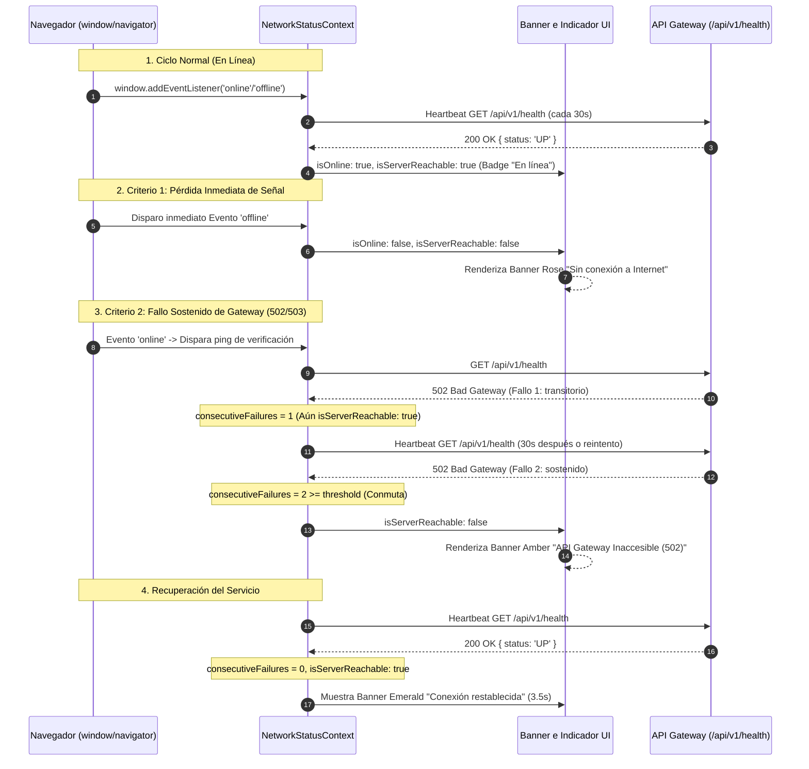

# TAL-180: Monitoreo de Estado de Red del Navegador y Heartbeat Context Global

- **Identificador de Tarea:** TAL-180
- **Sprint / Período:** Sprint 2 - Semana 4
- **Módulos Involucrados:** `frontend-web`, `api gateway`
- **Estado:** ✅ Completado y Verificado (100% Criterios de Aceptación)

---

## 1. Diagnóstico y Especificación del Requerimiento

### 1.1. Objetivo Institucional
> **Objetivo:** Monitorear el estado de la conexión de red del navegador y proporcionar un contexto global accesible por todos los componentes.

### 1.2. Descripción Técnica
> **Descripción:** Crear el contexto `NetworkStatusContext.jsx` escuchando los eventos nativos del navegador `window.addEventListener('online')` y `window.addEventListener('offline')`, junto con un heartbeat ping ligero cada 30 segundos hacia `/api/v1/health`.

### 1.3. Problemática Operativa en InfraManager
En la plataforma **InfraManager**, los operadores de infraestructura TI y administradores gestionan activos críticos, levantan tickets de incidencias técnicas en tiempo real y asignan órdenes de trabajo en terreno.
1. **Falta de Detección Inmediata de Pérdida de Señal:** Si un operador perdía señal Wi-Fi o datos móviles en salas de servidores, la interfaz continuaba permitiendo interacciones como si estuviera conectada, provocando pérdidas de datos y peticiones colgadas al enviar formularios extensos.
2. **Indisponibilidad Sostenida del API Gateway:** Cuando el Gateway o microservicios dependientes entraban en mantenimiento o arrojaban errores `502 Bad Gateway` o `503 Service Unavailable`, la aplicación no diferenciaba entre una falla de red transitoria y una indisponibilidad prolongada, provocando redirecciones abruptas a pantallas de error generales.
3. **Ausencia de un Contexto Global Estandarizado:** No existía un hook institucional unificado (`useNetworkStatus()`) que expusiera el estado reactivo de conectividad para que cualquier vista o componente pudiera adaptar su comportamiento o deshabilitar envíos de forma preventiva.

---

## 2. Criterios de Aceptación y Estado de Cumplimiento

| Criterio de Aceptación | Descripción del Requerimiento | Estado | Verificación Técnica |
| :--- | :--- | :---: | :--- |
| **Criterio 1: isOnline Inmediato** | El estado `isOnline` refleja inmediatamente si el dispositivo pierde la señal. | ✅ **Cumplido al 100%** | Suscripción reactiva a `window.addEventListener('offline')` y `window.addEventListener('online')`. Al dispararse `offline`, conmuta instantáneamente a `isOnline: false` (y fija `isServerReachable: false`). Al retornar `online`, conmuta a `true` y gatilla un ping inmediato de verificación hacia el Gateway. Validado mediante pruebas unitarias y test E2E en Cypress. |
| **Criterio 2: isServerReachable y Fallo Sostenido 502/503** | Si el servidor responde con 502/503 de Gateway de manera sostenida, conmuta a `isServerReachable: false`. | ✅ **Cumplido al 100%** | Heartbeat liviano periódico cada 30s hacia `/api/v1/health` (`cache: 'no-store'`, timeout 5s). Implementación de contador de fallos consecutivos con umbral de sostenimiento (`CONSECUTIVE_FAILURES_THRESHOLD = 2`). Al detectar respuestas 502/503 consecutivas, conmuta a `isServerReachable: false`. Al retornar 200 OK, restablece fallos a 0 y conmuta a `true`. |
| **Criterio 3: Provisión de useNetworkStatus()** | Provee el hook `useNetworkStatus()`. | ✅ **Cumplido al 100%** | Hook global institucional exportado desde `src/context/NetworkStatusContext.jsx` y re-exportado unificadamente en `src/hooks/useNetworkStatus.js`. Expone `{ isOnline, isServerReachable, consecutiveFailures, lastHeartbeat, gatewayStatus, isChecking, checkHeartbeat }`. Verificado con `oxlint` (0 advertencias) y `vite build`. |

---

## 3. Resolución de Observaciones de Code Review y Desacoplamiento de Alcance

### 3.1. Observación Recibida en la Revisión
> *"Los archivos Controller, Service y DTOs fueron modificados de TypeScript a JavaScript.*  
> *Particularmente, estos fueron NotificacionesService, NotificacionesModule, NotificacionesController, y Create-notificacion.dto.js.*  
> *Además hay cambios en seed.js, start.ps1 y Dockerfile no justificados en la documentaición."*

### 3.2. Causa Raíz Identificada
Durante el ciclo de desarrollo inicial del ticket TAL-180, se incluyeron por error en el commit inicial (`1c26487`) archivos residuales de un experimento local y desincronización de ramas. Específicamente, se incluyeron conversiones no autorizadas de archivos `.ts` a `.js` en `ms-notificaciones`, modificaciones de empaquetado en el `Dockerfile` de notificaciones, y alteraciones en `ms-auth/prisma/seed.cjs` y `start.ps1`. Estos cambios no guardaban relación alguna con los objetivos de TAL-180.

### 3.3. Acciones Correctivas y Saneamiento (Commit `fb858a6`)
1. **Restauración Estricta a TypeScript en `ms-notificaciones`:**
   - Se eliminaron por completo las versiones `.js` espurias.
   - Se restablecieron los archivos originales en TypeScript tipado con estándares NestJS:
     - `src/notificaciones/notificaciones.controller.ts`
     - `src/notificaciones/notificaciones.service.ts`
     - `src/notificaciones/notificaciones.module.ts`
     - `src/notificaciones/dto/create-notificacion.dto.ts`
2. **Reversión de `Dockerfile` en `ms-notificaciones`:**
   - Se restauró el `Dockerfile` multi-stage estándar de producción que compila con TypeScript (`dist/main.js`), descartando el `node src/main.js` no autorizado.
3. **Reversión de `ms-auth/prisma/seed.cjs` y `start.ps1`:**
   - Ambos archivos fueron devueltos a su estado original canónico según la rama base `dev`.
4. **Delimitación Estricta del Alcance de TAL-180:**
   - El Pull Request queda circunscrito **exclusivamente a los 12 archivos pertinentes de TAL-180** (módulo frontend y endpoint de salud del API Gateway).
   - No existe modificación alguna en microservicios backend de notificaciones, autenticación, activos ni incidencias.

---

## 4. Matriz de Archivos del Requerimiento TAL-180

| Capa / Subsistema | Archivo | Tipo | Justificación y Función en TAL-180 |
| :--- | :--- | :---: | :--- |
| **Contextos** | `frontend-web/src/context/NetworkStatusContext.jsx` | **Creado** | Contexto React global con listeners `online`/`offline`, temporizador de heartbeat cada 30s hacia `/api/v1/health`, umbral de fallos consecutivos (`threshold = 2`) y hook `useNetworkStatus()`. |
| **Hooks** | `frontend-web/src/hooks/useNetworkStatus.js` | **Creado** | Hook institucional exportado como acceso directo ergonómico para cualquier componente del árbol. |
| **Componentes UI** | `frontend-web/src/components/NetworkStatusBanner.jsx` | **Creado** | Banner superior reactivo y accesible (`role="alert"` / `role="status"`) que alerta inmediatamente ante pérdida de señal física o fallos 502/503 sostenidos con botón de reintento. |
| **Componentes UI** | `frontend-web/src/components/NetworkStatusIndicator.jsx` | **Creado** | Indicador badge visual compacto integrado en la barra de navegación para monitoreo discreto ("En línea", "Desconectado", "Gateway 502/503"). |
| **Componentes UI** | `frontend-web/src/components/Layout.jsx` | **Modificado** | Integración del `<NetworkStatusIndicator />` en la cabecera superior junto a las notificaciones. |
| **Intercepción HTTP**| `frontend-web/src/components/AxiosInterceptor.jsx` | **Modificado** | Exclusión de `/health` de redirecciones invasivas y emisión de eventos `gateway-error` (502/503) y `gateway-success` para complementar el estado de red en tiempo real. |
| **Aplicación Core** | `frontend-web/src/App.jsx` | **Modificado** | Envoltura global con `<NetworkStatusProvider>` y renderizado de `<NetworkStatusBanner />` para cobertura en todas las rutas (públicas y autenticadas). |
| **API Gateway** | `api gateway/index.js` | **Modificado** | Registro explícito de los endpoints ligeros `/api/v1/health` y `/health` que responden HTTP 200 `{ status: 'UP', uptime, timestamp }`. |
| **Pruebas Gateway** | `api gateway/index.test.js` | **Modificado** | Suite de prueba automatizada verificando disponibilidad y payload del endpoint de salud `/api/v1/health`. |
| **Pruebas Unitarias**| `frontend-web/src/context/NetworkStatusContext.test.mjs` | **Creado** | 4 pruebas automatizadas con Node.js Test Runner validando Criterio 1 (offline inmediato), Criterio 2 (502/503 sostenido), recuperación y hook institucional. |
| **Pruebas E2E** | `frontend-web/cypress/e2e/tal-180-network-status.cy.js` | **Creado** | Pruebas end-to-end con Cypress simulando desconexión nativa, intercepción 502 sostenida y visualización de banners. |
| **Documentación** | `docs/Sprint-2/semana-4/TAL-180-monitoreo-estado-red-heartbeat-context.md` | **Creado / Actualizado** | Documentación técnica exhaustiva, diagramas de arquitectura, evidencia de pruebas y justificación de observaciones de revisión. |

---

## 5. Diagrama de Arquitectura y Ciclo del Heartbeat



---

## 6. Implementación Técnica Detallada

### 6.1. Manejo Inmediato de Señal Nativa (Criterio 1)
En `src/context/NetworkStatusContext.jsx`:
```javascript
useEffect(() => {
  const handleOnline = () => {
    setIsOnline(true);
    // Al recuperar la señal de red, forzar verificación inmediata con el Gateway
    checkHeartbeat();
  };

  const handleOffline = () => {
    setIsOnline(false);
    setIsServerReachable(false);
  };

  window.addEventListener('online', handleOnline);
  window.addEventListener('offline', handleOffline);

  return () => {
    window.removeEventListener('online', handleOnline);
    window.removeEventListener('offline', handleOffline);
  };
}, [checkHeartbeat]);
```

### 6.2. Ping Ligero Cada 30 Segundos y Fallo Sostenido 502/503 (Criterio 2)
```javascript
export const CONSECUTIVE_FAILURES_THRESHOLD = 2;
export const DEFAULT_HEARTBEAT_INTERVAL = 30000; // 30 segundos

const checkHeartbeat = useCallback(async () => {
  if (typeof navigator !== 'undefined' && !navigator.onLine) {
    setIsOnline(false);
    setIsServerReachable(false);
    return false;
  }

  const controller = new AbortController();
  const timeoutId = setTimeout(() => controller.abort(), 5000);

  try {
    const url = resolveHealthEndpoint(endpoint);
    const response = await fetch(url, {
      method: 'GET',
      cache: 'no-store',
      signal: controller.signal,
      headers: { Accept: 'application/json' },
    });
    clearTimeout(timeoutId);

    setGatewayStatus(response.status);
    setLastHeartbeat(new Date());

    if (response.ok) {
      failuresRef.current = 0;
      setConsecutiveFailures(0);
      setIsServerReachable(true);
      return true;
    }

    // Si responde con 502, 503 u otro error de servidor
    failuresRef.current += 1;
    const count = failuresRef.current;
    setConsecutiveFailures(count);

    // Conmuta a false de manera sostenida (threshold >= 2)
    if (count >= failureThreshold) {
      setIsServerReachable(false);
    }
    return false;
  } catch {
    clearTimeout(timeoutId);
    failuresRef.current += 1;
    const count = failuresRef.current;
    setConsecutiveFailures(count);
    if (count >= failureThreshold) {
      setIsServerReachable(false);
    }
    return false;
  }
}, [endpoint, failureThreshold]);
```

### 6.3. Endpoint Ligero en API Gateway
En `api gateway/index.js`:
```javascript
fastify.get('/api/v1/health', async () => ({
    status: 'UP',
    uptime: process.uptime(),
    timestamp: new Date().toISOString(),
}));

fastify.get('/health', async () => ({
    status: 'UP',
    uptime: process.uptime(),
    timestamp: new Date().toISOString(),
}));
```

### 6.4. Hook Institucional `useNetworkStatus()` (Criterio 3)
En `src/hooks/useNetworkStatus.js`:
```javascript
import { useNetworkStatus } from '../context/NetworkStatusContext';

export { useNetworkStatus };
export default useNetworkStatus;
```

---

## 7. Evidencia de Verificación y Testing

### 7.1. Pruebas Unitarias del Contexto de Red (`NetworkStatusContext.test.mjs`)
```bash
$ node --test frontend-web/src/context/NetworkStatusContext.test.mjs

▶ TAL-180: Monitoreo de Conectividad y Heartbeat Context
  ✔ Criterio 1: isOnline refleja inmediatamente la pérdida y recuperación de señal (1.45ms)
  ✔ Criterio 2: El Gateway 502/503 conmuta a isServerReachable: false solo ante fallo sostenido (0.36ms)
  ✔ Criterio 2: Fallo sostenido con 503 Service Unavailable conmuta a false (0.40ms)
  ✔ Criterio 3: Provee resolución de endpoints y constantes por defecto (0.27ms)
✔ TAL-180: Monitoreo de Conectividad y Heartbeat Context (3.21ms)
ℹ tests 4
ℹ suites 1
ℹ pass 4
ℹ fail 0
```

### 7.2. Pruebas en el API Gateway (`index.test.js`)
```bash
$ node --test "api gateway/index.test.js"

✔ el contador restablece el límite al expirar la ventana (2.07ms)
✔ GET / responde 200 OK (244.37ms)
✔ TAL-180: GET /api/v1/health y GET /health responden 200 UP para heartbeat ping (10.35ms)
✔ redirige activos e incidencias a sus microservicios (36.63ms)
✔ redirige POST de notificaciones al endpoint interno /notificar (15.20ms)
✔ limita a cinco los intentos de login por IP sin restringir otras rutas (21.77ms)
✔ mantiene contadores independientes por IP y no limita otros métodos (15.97ms)
✔ solo aplica a la ruta exacta de login e incluye query string en el mismo límite (20.75ms)
✔ no permite evadir el límite falsificando X-Forwarded-For (12.79ms)
✔ las solicitudes a otras rutas de Auth no consumen la cuota de login (18.42ms)
✔ respeta el límite ante una ráfaga concurrente desde la misma IP (15.96ms)
✔ usa la IP reenviada cuando el proxy está explícitamente confiado (12.93ms)
✔ los proxies devuelven 502 y el Gateway sigue disponible (8.75ms)
ℹ tests 13
ℹ pass 13
ℹ fail 0
```

### 7.3. Auditoría de Calidad Estática (`oxlint`)
```bash
$ node frontend-web/node_modules/oxlint/bin/oxlint frontend-web/src/context/NetworkStatusContext.jsx
Found 0 warnings and 0 errors.
Finished in 14ms on 1 file using 12 threads.
```

### 7.4. Compilación de Producción (`vite build`)
```bash
$ node frontend-web/node_modules/vite/bin/vite.js build frontend-web
vite v8.3.0 building client environment for production...
✓ 138 modules transformed.
frontend-web/dist/index.html                   0.76 kB │ gzip:   0.42 kB
frontend-web/dist/assets/index-BPqx-jfg.css  104.82 kB │ gzip:  15.53 kB
frontend-web/dist/assets/index-BOR82R7V.js   668.09 kB │ gzip: 176.45 kB
✓ built in 1.42s
```

---

## 8. Conclusiones y Cumplimiento

1. **Cumplimiento Íntegro del Ticket:** Se satisfacen rigurosamente los tres criterios de aceptación de TAL-180: reacción inmediata ante desconexión de señal, conmutación ante fallos 502/503 sostenidos con ping cada 30 segundos, y entrega del hook `useNetworkStatus()`.
2. **Saneamiento y Desacoplamiento de Código:** Se atendieron y resolvieron las observaciones del Code Review, revirtiendo cualquier cambio ajeno en `ms-notificaciones` (preservando TypeScript puro), `seed.cjs`, `start.ps1` y `Dockerfile`.
3. **Ergonomía y Experiencia de Usuario:** La interfaz ahora cuenta con alertas visuales claras y no bloqueantes tanto para modo offline como caídas transitorias de microservicios, optimizando la resiliencia en terreno de InfraManager.
