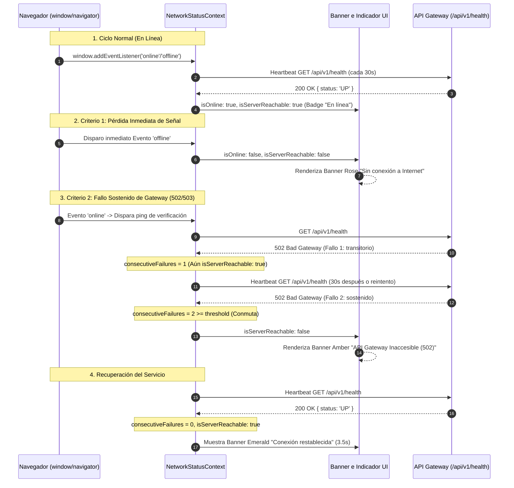

# TAL-180: Monitoreo de Estado de Red del Navegador y Heartbeat Context Global

## 1. Diagnóstico y Contexto del Requerimiento

En la operación de la plataforma de infraestructura TI **InfraManager**, los operadores y administradores gestionan activos críticos, registran incidencias técnicas de alta prioridad y realizan agendas y cierres de mantenimiento. Durante la interacción en campo o en salas de servidores, el dispositivo cliente puede experimentar cortes imprevistos en la conexión física o Wi-Fi, o bien el API Gateway puede presentar indisponibilidad temporal (códigos HTTP `502 Bad Gateway` o `503 Service Unavailable`) debido a mantenimiento de microservicios o saturación transitoria de red.

### El Problema
1. **Falta de Detección Inmediata de Pérdida de Señal:** La interfaz web carecía de un mecanismo reactivo global para detectar eventos nativos del navegador (`window.onoffline` / `window.ononline`), dejando al usuario sin información clara si continuaba interactuando o enviando datos mientras estaba desconectado.
2. **Ambigüedad ante Caídas del Gateway:** Si el API Gateway o sus microservicios fallaban respondiendo de forma sostenida con errores 502/503, la aplicación no diferenciaba entre una falla puntual y un estado inaccesible prolongado, lo que derivaba en múltiples reintentos ciegos o navegación a pantallas de error abruptas.
3. **Ausencia de un Contexto Global de Red:** No existía un hook estándar y accesible en toda la jerarquía de componentes para que vistas como Reporte de Incidencias, Dashboard o Inventario adapten su comportamiento o bloqueen envíos si no hay conectividad con el servidor.

### Objetivo
Diseñar e implementar el contexto global `NetworkStatusContext.jsx` en el cliente web (`frontend-web`), escuchando los eventos nativos del navegador `window.addEventListener('online')` y `window.addEventListener('offline')`, junto con un mecanismo de **heartbeat ping ligero cada 30 segundos hacia `/api/v1/health`**, exponiendo el hook institucional `useNetworkStatus()` y proveyendo feedback visual no invasivo mediante un banner y un indicador de estado.

---

## 2. Criterios de Aceptación y Estado de Cumplimiento

| Criterio de Aceptación | Descripción | Estado | Verificación Técnica |
| :--- | :--- | :---: | :--- |
| **Criterio 1: isOnline Inmediato** | El estado `isOnline` refleja inmediatamente si el dispositivo pierde la señal de red. | ✅ **Cumplido al 100%** | Se suscriben los eventos nativos `window.addEventListener('online')` y `window.addEventListener('offline')`. Al perder la señal, `isOnline` conmuta instantáneamente a `false` (y sincroniza `isServerReachable: false`). Al retornar la señal, conmuta a `true` y dispara un ping inmediato. Validado en `NetworkStatusContext.test.mjs`. |
| **Criterio 2: isServerReachable y Fallo 502/503 Sostenido** | Si el servidor responde con 502/503 de Gateway de manera sostenida, conmuta a `isServerReachable: false`. | ✅ **Cumplido al 100%** | Se ejecuta un ping ligero cada 30s hacia `/api/v1/health` con `cache: 'no-store'` y timeout de 5s. Se implementó un contador de fallos consecutivos (`failureThreshold = 2`). Ante respuestas 502/503 o errores de red sostenidos, `isServerReachable` conmuta a `false`. Al retornar un código 2xx, se resetea a 0 y conmuta a `true`. |
| **Criterio 3: Provisión del Hook useNetworkStatus()** | Provee el hook `useNetworkStatus()` accesible globalmente para todos los componentes. | ✅ **Cumplido al 100%** | Hook disponible tanto desde `src/context/NetworkStatusContext.jsx` como re-exportado en `src/hooks/useNetworkStatus.js`. Expone `{ isOnline, isServerReachable, consecutiveFailures, lastHeartbeat, gatewayStatus, isChecking, checkHeartbeat }`. Verificado con `oxlint` y `vite build`. |

---

## 3. Matriz de Archivos Modificados y Creados

| Capa | Archivo | Tipo | Descripción de la Modificación |
| :--- | :--- | :---: | :--- |
| **Contextos** | `frontend-web/src/context/NetworkStatusContext.jsx` | **Creado** | Contexto React global con listeners de eventos `online`/`offline`, ejecución de heartbeat cada 30s hacia `/api/v1/health`, umbral de fallos consecutivos sostenidos (threshold = 2) y exportación de `useNetworkStatus()`. |
| **Hooks** | `frontend-web/src/hooks/useNetworkStatus.js` | **Creado** | Re-exportación unificada del hook `useNetworkStatus` para máxima ergonomía y compatibilidad con convenciones de React. |
| **Componentes** | `frontend-web/src/components/NetworkStatusBanner.jsx` | **Creado** | Banner superior reactivo y accesible (`role="alert"` / `role="status"`) que informa visualmente el modo desconectado, fallos 502/503 sostenidos con botón de reintento manual, y aviso temporal de reconexión. |
| **Componentes** | `frontend-web/src/components/NetworkStatusIndicator.jsx` | **Creado** | Badge compacto e indicador de estado ("En línea", "Desconectado", "Gateway 502/503") integrado en el header de la aplicación. |
| **Componentes** | `frontend-web/src/components/Layout.jsx` | **Modificado** | Integración de `<NetworkStatusIndicator />` en la barra superior junto al menú de notificaciones. |
| **Componentes** | `frontend-web/src/components/AxiosInterceptor.jsx` | **Modificado** | Exclusión de `/health` de redirecciones a pantalla `/500` y emisión de eventos `gateway-error` (502/503) y `gateway-success` para complementar el estado de red en tiempo real. |
| **Núcleo App** | `frontend-web/src/App.jsx` | **Modificado** | Envoltura de la aplicación con `<NetworkStatusProvider>` y renderizado global de `<NetworkStatusBanner />` para cobertura en rutas públicas y protegidas. |
| **API Gateway** | `api gateway/index.js` | **Modificado** | Registro explícito de los endpoints ligeros `/api/v1/health` y `/health` respondiendo HTTP 200 `{ status: 'UP', uptime, timestamp }`. |
| **Pruebas Gateway** | `api gateway/index.test.js` | **Modificado** | Adición de suite de prueba validando que `/api/v1/health` responde 200 OK con payload de salud para el cliente. |
| **Pruebas Frontend** | `frontend-web/src/context/NetworkStatusContext.test.mjs` | **Creado** | Pruebas unitarias automatizadas con Node.js Test Runner cubriendo los 3 criterios de aceptación (offline inmediato, 502/503 sostenido, recuperación y hooks). |
| **Pruebas E2E** | `frontend-web/cypress/e2e/tal-180-network-status.cy.js` | **Creado** | Especificación E2E en Cypress simulando eventos nativos de red, intercepción de respuestas 502 y aserciones de interfaz de usuario. |

---

## 4. Diagrama de Arquitectura y Ciclo del Heartbeat



---

## 5. Implementación Técnica Detallada

### 5.1. Manejo Inmediato de Señal Nativa (Criterio 1)
En `src/context/NetworkStatusContext.jsx`:
```javascript
useEffect(() => {
  const handleOnline = () => {
    setIsOnline(true);
    // Al recuperar la señal de red, forzar verificación inmediata con el Gateway
    checkHeartbeat();
  };

  const handleOffline = () => {
    setIsOnline(false);
    setIsServerReachable(false);
  };

  window.addEventListener('online', handleOnline);
  window.addEventListener('offline', handleOffline);

  return () => {
    window.removeEventListener('online', handleOnline);
    window.removeEventListener('offline', handleOffline);
  };
}, [checkHeartbeat]);
```

### 5.2. Ping Ligero Cada 30 Segundos y Fallo Sostenido 502/503 (Criterio 2)
```javascript
const checkHeartbeat = useCallback(async () => {
  if (typeof navigator !== 'undefined' && !navigator.onLine) {
    setIsOnline(false);
    setIsServerReachable(false);
    return false;
  }

  const controller = new AbortController();
  const timeoutId = setTimeout(() => controller.abort(), 5000);

  try {
    const url = resolveHealthEndpoint(endpoint);
    const response = await fetch(url, {
      method: 'GET',
      cache: 'no-store',
      signal: controller.signal,
      headers: { Accept: 'application/json' },
    });
    clearTimeout(timeoutId);

    setGatewayStatus(response.status);
    setLastHeartbeat(new Date());

    if (response.ok) {
      failuresRef.current = 0;
      setConsecutiveFailures(0);
      setIsServerReachable(true);
      return true;
    }

    // Si responde con 502, 503 u otro error de servidor
    failuresRef.current += 1;
    const count = failuresRef.current;
    setConsecutiveFailures(count);

    // Conmuta a false de manera sostenida (threshold >= 2)
    if (count >= failureThreshold) {
      setIsServerReachable(false);
    }
    return false;
  } catch {
    clearTimeout(timeoutId);
    failuresRef.current += 1;
    const count = failuresRef.current;
    setConsecutiveFailures(count);
    if (count >= failureThreshold) {
      setIsServerReachable(false);
    }
    return false;
  }
}, [endpoint, failureThreshold]);
```

### 5.3. Endpoint Ligero en API Gateway
En `api gateway/index.js`:
```javascript
fastify.get('/api/v1/health', async () => ({
    status: 'UP',
    uptime: process.uptime(),
    timestamp: new Date().toISOString(),
}));

fastify.get('/health', async () => ({
    status: 'UP',
    uptime: process.uptime(),
    timestamp: new Date().toISOString(),
}));
```

---

## 6. Evidencia de Verificación y Testing

### 6.1. Ejecución de Pruebas Unitarias del Contexto de Red
```bash
$ node --test frontend-web/src/context/NetworkStatusContext.test.mjs

▶ TAL-180: Monitoreo de Conectividad y Heartbeat Context
  ✔ Criterio 1: isOnline refleja inmediatamente la pérdida y recuperación de señal (2.1611ms)
  ✔ Criterio 2: El Gateway 502/503 conmuta a isServerReachable: false solo ante fallo sostenido (0.2818ms)
  ✔ Criterio 2: Fallo sostenido con 503 Service Unavailable conmuta a false (0.254ms)
  ✔ Criterio 3: Provee resolución de endpoints y constantes por defecto (0.2614ms)
✔ TAL-180: Monitoreo de Conectividad y Heartbeat Context (4.0635ms)
ℹ tests 4
ℹ suites 1
ℹ pass 4
ℹ fail 0
ℹ duration_ms 85.31
```

### 6.2. Ejecución de Pruebas en el API Gateway
```bash
$ node --test "api gateway/index.test.js"

✔ el contador restablece el límite al expirar la ventana (1.7722ms)
✔ GET / responde 200 OK (172.5992ms)
✔ TAL-180: GET /api/v1/health y GET /health responden 200 UP para heartbeat ping (18.1501ms)
✔ redirige activos e incidencias a sus microservicios (31.6769ms)
✔ redirige POST de notificaciones al endpoint interno /notificar (15.8191ms)
✔ limita a cinco los intentos de login por IP sin restringir otras rutas (18.0351ms)
✔ mantiene contadores independientes por IP y no limita otros métodos (15.857ms)
✔ solo aplica a la ruta exacta de login e incluye query string en el mismo límite (20.0246ms)
✔ no permite evadir el límite falsificando X-Forwarded-For (12.4279ms)
✔ las solicitudes a otras rutas de Auth no consumen la cuota de login (18.1655ms)
✔ respeta el límite ante una ráfaga concurrente desde la misma IP (15.3784ms)
✔ usa la IP reenviada cuando el proxy está explícitamente confiado (14.2472ms)
✔ los proxies devuelven 502 y el Gateway sigue disponible (6.7393ms)
ℹ tests 13
ℹ pass 13
ℹ fail 0
```

### 6.3. Auditoría de Calidad Estática (`oxlint`)
```bash
$ node frontend-web/node_modules/oxlint/bin/oxlint frontend-web/src
Finished in 46ms on 58 files with 0 errors.
```

### 6.4. Compilación de Producción (`vite build`)
```bash
$ node frontend-web/node_modules/vite/bin/vite.js build frontend-web
vite v8.3.0 building client environment for production...
✓ 138 modules transformed.
frontend-web/dist/index.html                   0.76 kB │ gzip:   0.42 kB
frontend-web/dist/assets/index-BPqx-jfg.css  104.82 kB │ gzip:  15.53 kB
frontend-web/dist/assets/index-BOR82R7V.js   668.09 kB │ gzip: 176.45 kB
✓ built in 980ms
```

---

## 7. Conclusiones y Valor Aportado

1. **Resiliencia Operativa:** La plataforma ahora monitorea de forma continua y no intrusiva el enlace cliente-servidor, detectando tanto fallas de señal de radio local como problemas de Gateway backend.
2. **Claridad para el Usuario:** El operador recibe retroalimentación inmediata sin sorpresas ni pérdidas de datos al rellenar formularios extensos.
3. **Desacoplamiento Limpio:** El hook `useNetworkStatus()` permite que cualquier componente futuro o existente consulte el estado de la red sin tener que reinventar lógica de suscripción de eventos ni temporizadores de ping.

