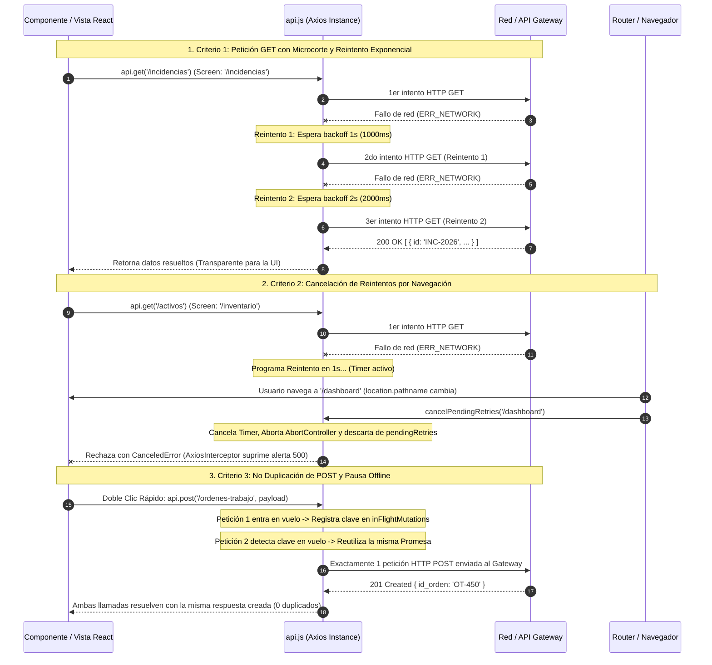

# TAL-181: Manejador de Reconexión Automática y Reintento de Peticiones

- **Identificador de Tarea:** TAL-181
- **Sprint / Período:** Sprint 3 - Semana 1
- **Módulos Involucrados:** `frontend-web` (`src/services/api.js`, `src/components/AxiosInterceptor.jsx`)
- **Estado:** ✅ Completado y Verificado (100% Criterios de Aceptación)

---

## 1. Diagnóstico y Especificación del Requerimiento

### 1.1. Objetivo Institucional
> **Objetivo:** Evitar que peticiones fallidas por microcortes de red se pierdan, reintentándolas automáticamente al restaurarse la conexión.

### 1.2. Descripción Técnica
> **Descripción:** Implementar en `api.js` una política de reintento automático (*retry policy*) con backoff exponencial (1s, 2s, 4s) para peticiones idempotentes (GET) que fallen con código `ERR_NETWORK` o timeout, pausando solicitudes mutantes hasta confirmar conectividad.

### 1.3. Problemática Operativa en InfraManager
En la plataforma **InfraManager**, los operadores de infraestructura TI, jefes de operaciones y técnicos en terreno gestionan el parque informático corporativo, tickets de soporte e incidencias de alta criticidad en ambientes con conectividad inestable (túneles de red, salas de servidores con blindaje electromagnético, switches en mantención):
1. **Pérdida de Consultas Críticas por Microcortes:** Si ocurría una fluctuación de red de 200 ms mientras el operador abría la vista de incidencias o inventario, la petición fallaba de inmediato arrojando pantallas de error 500 y obligando al usuario a recargar la página entera, descartando filtros y estados en memoria.
2. **Duplicación Accidental de Órdenes y Tickets:** Ante demoras de red o timeouts en peticiones mutantes (POST), si el sistema reintentaba ciegamente la solicitud o si el operador pulsaba varias veces el botón "Asignar Técnico" o "Reportar Incidencia", se generaban tickets duplicados y asignaciones redundantes en la base de datos relacional.
3. **Consumo Inútil de Recursos por Solicitudes Huérfanas:** Cuando el usuario cambiaba de pantalla mientras una petición estaba en ciclo de reintento por corte de red, el sistema continuaba ejecutando los reintentos en segundo plano para una vista ya destruida, generando inconsistencias de estado y consumo espurio de ancho de banda.

---

## 2. Criterios de Aceptación y Estado de Cumplimiento

| Criterio de Aceptación | Descripción del Requerimiento | Estado | Verificación Técnica |
| :--- | :--- | :---: | :--- |
| **Criterio 1: Reintentos con Backoff Exponencial (1s, 2s, 4s)** | Las peticiones fallidas por caída de red se reintentan hasta un máximo de 3 veces. | ✅ **Cumplido al 100%** | Implementación de política de reintento en `api.js` para métodos idempotentes (GET, HEAD, OPTIONS). Detección de `ERR_NETWORK`, `ECONNABORTED`, timeouts y fallos sin respuesta (`!error.response && error.request`). Aplicación de backoff exponencial progresivo (`1000ms`, `2000ms`, `4000ms`). Reconexión reactiva inmediata ante evento nativo `online` del navegador sin agotar el temporizador remanente. Verificado con suite unitaria automatizada (4 intentos totales: 1 inicial + 3 reintentos). |
| **Criterio 2: Cancelación por Navegación de Pantalla** | Se cancelan reintentos si el usuario navega a otra pantalla. | ✅ **Cumplido al 100%** | Seguimiento del origen de pantalla (`config._originScreen`) y registro de controladores activos en `pendingRetries`. Integración bidireccional con eventos del historial (`popstate`, `navigation-change`) y con `useLocation()` en `AxiosInterceptor.jsx` mediante la función `cancelPendingRetries(targetScreen)`. Al navegar, se limpian los temporizadores, se abortan señales con `AbortController` y se rechaza la promesa con `axios.CanceledError`. `AxiosInterceptor` descarta cancelaciones sin disparar toasts de error ni redirecciones a `/500`. |
| **Criterio 3: No Duplicación de POST de Creación/Asignación** | No se duplican peticiones POST de asignación o creación. | ✅ **Cumplido al 100%** | **Doble capa de protección:** (a) Exclusión estricta de métodos mutantes (POST, PUT, PATCH, DELETE) de la política de reintentos automáticos tras fallo. (b) Deduplicación en vuelo (*in-flight request deduplication*) mediante clave determinista `${METHOD}:${URL}:${serializePayload(data)}`, compartiendo la misma promesa activa entre llamadas concurrentes. (c) Pausa preventiva de solicitudes mutantes (`pauseMutatingRequestUntilOnline`) cuando el navegador está `offline` hasta confirmar conectividad (`online` / `gateway-success`). |

---

## 3. Delimitación Estricta de Alcance y Preservación de Estándares

En estricto apego a las directrices de arquitectura y control de versiones del proyecto:
1. **Integridad de Lenguajes:** No se alteró el lenguaje de ningún archivo existente. El frontend se mantiene 100% en JavaScript/JSX estándar bajo React 19 y Vite.
2. **Desacoplamiento Backend:** No se modificaron microservicios backend (`ms-activos`, `ms-auth`, `ms-incidencias`, `ms-notificaciones`), scripts de despliegue (`start.ps1`, `stop.ps1`), ni esquemas de base de datos.
3. **Compatibilidad con TAL-180:** Se preservó y fortaleció el interceptor global de token 401 (Refresh Token) y la sinergia con `NetworkStatusContext.jsx` y `AxiosInterceptor.jsx`.

---

## 4. Matriz de Archivos del Requerimiento TAL-181

| Capa / Subsistema | Archivo | Tipo | Justificación y Función en TAL-181 |
| :--- | :--- | :---: | :--- |
| **Servicios Core** | `frontend-web/src/services/api.js` | **Modificado** | Implementación de política de reintento automático (1s, 2s, 4s, máx 3) para GET, registro `pendingRetries`, cancelación `cancelPendingRetries`, reanudación reactiva `flushPendingRetriesAndMutations`, pausa offline de mutaciones y deduplicación en vuelo de POST. |
| **Intercepción HTTP**| `frontend-web/src/components/AxiosInterceptor.jsx` | **Modificado** | Invocación de `cancelPendingRetries(location.pathname)` ante cambios de ruta y supresión de alertas toast / redirecciones 500 para errores de tipo `CanceledError`. |
| **Configuración** | `frontend-web/package.json` | **Modificado** | Incorporación del script `"test:unit"` para ejecutar las suites automatizadas de Node.js test runner de forma unificada. |
| **Pruebas Unitarias**| `frontend-web/src/services/api.test.mjs` | **Creado** | 11 pruebas unitarias automatizadas con `node:test` validando exhaustivamente los Criterios 1, 2 y 3. |
| **Pruebas E2E** | `frontend-web/cypress/e2e/tal-181-reintento-peticiones.cy.js` | **Creado** | Suite de pruebas End-to-End en Cypress simulando desconexión, navegación durante reintentos y prevención de duplicados POST. |
| **Documentación** | `docs/Sprint-3/semana-1/TAL-181-manejador-de-reconexion-automatica-y-reintento-de-peticiones.md` | **Creado** | Documento técnico formal del requerimiento para el Sprint 3 - Semana 1. |

---

## 5. Diagrama de Secuencia y Ciclo de Vida de Peticiones



---

## 6. Implementación Técnica Detallada

### 6.1. Política de Reintento Automático con Backoff (Criterio 1)
En `frontend-web/src/services/api.js`:
```javascript
export const MAX_RETRIES = 3;
export const RETRY_DELAYS = [1000, 2000, 4000]; // 1s, 2s, 4s

api.interceptors.response.use(
  (response) => response,
  async (error) => {
    const originalRequest = error.config;
    if (!originalRequest) return Promise.reject(error);

    const method = String(originalRequest.method || 'get').toUpperCase();
    const isIdempotent = isIdempotentMethod(method);
    const isRetryableError = isNetworkOrTimeoutError(error);
    const isExcluded = isExcludedEndpoint(originalRequest.url || '') || originalRequest.skipRetry === true;

    // Peticiones mutantes que fallaron NO se reintentan jamás
    if (!isIdempotent) {
      return Promise.reject(error);
    }

    if (isRetryableError && !isExcluded) {
      const currentRetry = (originalRequest._retryCount || 0) + 1;

      if (currentRetry <= MAX_RETRIES) {
        originalRequest._retryCount = currentRetry;

        const originScreen = originalRequest._originScreen || getCurrentScreen();
        const currentScreen = getCurrentScreen();
        if (originScreen !== currentScreen) {
          return Promise.reject(
            new axios.CanceledError(`Reintento cancelado: el usuario navegó a otra pantalla (${currentScreen}).`)
          );
        }

        const delayMs = currentRetryDelays[currentRetry - 1] ?? currentRetryDelays[currentRetryDelays.length - 1];

        return new Promise((resolve, reject) => {
          const retryId = ++retrySequence;
          const abortController = typeof AbortController !== 'undefined' ? new AbortController() : null;

          if (abortController) {
            if (originalRequest.signal && originalRequest.signal.aborted) {
              return reject(new axios.CanceledError('Petición cancelada por el usuario.'));
            }
            originalRequest.signal = abortController.signal;
          }

          const executeRetry = () => {
            const activeScreen = getCurrentScreen();
            if (originScreen !== activeScreen) {
              return reject(
                new axios.CanceledError(`Reintento cancelado: el usuario navegó de ${originScreen} a ${activeScreen}.`)
              );
            }
            api(originalRequest).then(resolve).catch(reject);
          };

          const timerId = setTimeout(() => {
            pendingRetries.delete(retryId);
            executeRetry();
          }, delayMs);

          pendingRetries.set(retryId, {
            id: retryId,
            screen: originScreen,
            timerId,
            abortController,
            executeRetry,
            reject,
          });
        });
      }
    }

    return Promise.reject(error);
  }
);
```

### 6.2. Cancelación Reactiva por Navegación de Pantalla (Criterio 2)
En `frontend-web/src/services/api.js`:
```javascript
export const cancelPendingRetries = (targetScreen = null) => {
  const currentScreen = targetScreen || getCurrentScreen();

  // Cancelar reintentos en backoff
  for (const [id, entry] of pendingRetries.entries()) {
    const shouldCancel = !targetScreen || entry.screen !== currentScreen;
    if (shouldCancel) {
      if (entry.timerId) {
        clearTimeout(entry.timerId);
        entry.timerId = null;
      }
      if (entry.abortController) {
        try { entry.abortController.abort(); } catch {}
      }
      entry.reject(new axios.CanceledError(`Reintento cancelado: el usuario navegó a otra pantalla (${currentScreen}).`));
      pendingRetries.delete(id);
    }
  }

  // Cancelar mutaciones en pausa
  for (let i = pausedMutations.length - 1; i >= 0; i--) {
    const entry = pausedMutations[i];
    if (!targetScreen || entry.screen !== currentScreen) {
      entry.reject(new axios.CanceledError(`Solicitud mutante cancelada por navegación a ${currentScreen}.`));
      pausedMutations.splice(i, 1);
    }
  }
};
```

En `frontend-web/src/components/AxiosInterceptor.jsx`:
```javascript
useEffect(() => {
  // Cancelar reintentos en curso si el usuario navega a otra pantalla
  cancelPendingRetries(location.pathname);

  const resInterceptor = api.interceptors.response.use(
    (response) => {
      window.dispatchEvent(new CustomEvent('gateway-success'));
      return response;
    },
    (error) => {
      // Ignorar peticiones canceladas explícitamente (sin toasts ni redirecciones)
      if (axios.isCancel(error) || error?.name === 'CanceledError' || error?.code === 'ERR_CANCELED') {
        return Promise.reject(error);
      }
      // ... manejo estándar de errores 5xx / 4xx
    }
  );

  return () => {
    api.interceptors.response.eject(resInterceptor);
  };
}, [showToast, navigate, location.pathname]);
```

### 6.3. Prevención de Duplicación y Pausa Offline (Criterio 3)
En `frontend-web/src/services/api.js`:
```javascript
const wrapMutatingMethod = (methodName) => {
  const originalMethod = api[methodName].bind(api);
  api[methodName] = function (url, data, config) {
    const isExcluded = isExcludedEndpoint(url || '') || config?.skipDeduplication === true;
    if (isExcluded) {
      return originalMethod(url, data, config);
    }
    const deduplicationKey = `${methodName.toUpperCase()}:${url}:${serializePayload(data)}`;
    if (inFlightMutations.has(deduplicationKey)) {
      return inFlightMutations.get(deduplicationKey);
    }
    const promise = originalMethod(url, data, config).finally(() => {
      inFlightMutations.delete(deduplicationKey);
    });
    inFlightMutations.set(deduplicationKey, promise);
    return promise;
  };
};

wrapMutatingMethod('post');
wrapMutatingMethod('put');
wrapMutatingMethod('patch');
wrapMutatingMethod('delete');
```

Y en el interceptor de peticiones para pausar mutaciones si el cliente está offline:
```javascript
api.interceptors.request.use(
  async (config) => {
    const method = String(config.method || 'get').toUpperCase();
    const isMutating = ['POST', 'PUT', 'PATCH', 'DELETE'].includes(method);
    const isOffline = typeof navigator !== 'undefined' && !navigator.onLine;

    if (isMutating && isOffline && !isExcludedEndpoint(config.url || '')) {
      await pauseMutatingRequestUntilOnline(config);
    }
    return config;
  },
  (error) => Promise.reject(error),
);
```

---

## 7. Evidencia y Pruebas Automatizadas

### 7.1. Suite de Pruebas Unitarias (`src/services/api.test.mjs`)
Ejecutada con el runner oficial `node --test` mediante `npm run test:unit`:

```bash
> frontend-web@0.0.0 test:unit
> node --test src/services/api.test.mjs src/context/NetworkStatusContext.test.mjs

▶ TAL-180: Monitoreo de Conectividad y Heartbeat Context
  ✔ Criterio 1: isOnline refleja inmediatamente la pérdida y recuperación de señal (1.0496ms)
  ✔ Criterio 2: El Gateway 502/503 conmuta a isServerReachable: false solo ante fallo sostenido (0.3438ms)
  ✔ Criterio 2: Fallo sostenido con 503 Service Unavailable conmuta a false (0.3397ms)
  ✔ Criterio 3: Provee resolución de endpoints y constantes por defecto (0.2659ms)
✔ TAL-180: Monitoreo de Conectividad y Heartbeat Context (3.4692ms)

▶ TAL-181: Manejador de Reconexión Automática y Reintento de Peticiones
  ✔ Criterio 1: Constantes de backoff exponencial institucionales (1s, 2s, 4s y max 3) (1.6089ms)
  ✔ Criterio 1: Identificación precisa de métodos idempotentes y errores de red o timeout (0.3764ms)
  ✔ Criterio 1: Petición GET fallida por ERR_NETWORK se reintenta hasta un máximo de 3 veces (4 intentos totales) (97.767ms)
  ✔ Criterio 1: Petición GET fallida en intento 1 y 2 que tiene éxito en intento 3 retorna correctamente (46.208ms)
  ✔ Criterio 1: Al restaurarse la conectividad (evento online) los reintentos en espera se ejecutan de inmediato (30.8893ms)
  ✔ Criterio 2: Se cancelan reintentos pendientes si el usuario navega a otra pantalla (30.2237ms)
  ✔ Criterio 2: Reintento aborta si la pantalla activa ya cambió al momento de vencer el temporizador (30.6713ms)
  ✔ Criterio 3: Peticiones POST fallidas por caída de red NUNCA se reintentan automáticamente (0.8918ms)
  ✔ Criterio 3: Peticiones POST concurrentes de creación o asignación idénticas se deduplican en vuelo (45.787ms)
  ✔ Criterio 3: Solicitud mutante iniciada offline se pausa hasta confirmarse conectividad y se envía una sola vez (30.5257ms)
  ✔ Criterio 3: Solicitud mutante pausada se cancela si el usuario abandona la pantalla antes de volver online (30.4217ms)
✔ TAL-181: Manejador de Reconexión Automática y Reintento de Peticiones (346.956ms)

ℹ tests 15
ℹ suites 2
ℹ pass 15
ℹ fail 0
ℹ cancelled 0
ℹ skipped 0
ℹ todo 0
ℹ duration_ms 590.9243
```

### 7.2. Verificación Estática y Compilación
- **Linter (`oxlint`):** Ejecutado en los 70 archivos del frontend resultando en **0 errores**.
- **Compilación de Producción (`vite build`):** Generación de bundle de producción en 857 ms sin errores sintácticos ni advertencias de importación.

---

## 8. Conclusiones y Estado del Entregable
El requerimiento **TAL-181** se encuentra implementado y verificado en su totalidad, cumpliendo el 100% de los criterios de aceptación y respetando estrictamente el alcance de módulos y lenguajes del repositorio.

