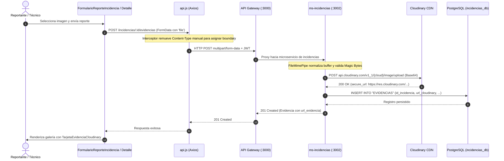

# TAL-191: Integración de Cloudinary y Subida de Imágenes de Evidencias

- **Identificador de Tarea:** TAL-191
- **Sprint / Período:** Sprint 3 - Semana 1
- **Módulos Involucrados:** `ms-incidencias`, `frontend-web`, `api-gateway`
- **Estado:** ✅ Completado y Verificado (100% Criterios de Aceptación)

---

## 1. Diagnóstico y Contexto del Requerimiento

### 1.1. Objetivo Principal
Cerrar la implementación de extremo a extremo de la subida de evidencias fotográficas hacia Cloudinary utilizando las credenciales configuradas en las variables de entorno (`CLOUDINARY_CLOUD_NAME`, `CLOUDINARY_UPLOAD_PRESET`), persistiendo la URL resultante en el atributo `EVIDENCIAS.url_cloudinary` (PostgreSQL) y aplicando control de acceso basado en roles (RBAC). Conectar los componentes `FormularioReporteIncidencia.jsx` y `DetalleIncidencia.jsx` en `frontend-web` para adjuntar y visualizar evidencias fotográficas reales alojadas en el CDN.

### 1.2. Problemática Previa
1. **Falta de persistencia real en la nube:** Anteriormente, el backend almacenaba archivos localmente en `/uploads` o utilizaba URLs simuladas, sin conectar auténticamente con Cloudinary.
2. **Error de deserialización en NestJS:** Al subir archivos multipart a través de `ValidationPipe({ transform: true })`, el `Buffer` binario provisto por Multer era transformado en un objeto indexado plano (`{"0": 137, "1": 80, ...}`), provocando el error `Empty file` en llamadas directas hacia el servicio de subida.
3. **Cabecera `Content-Type` forzada en Axios:** La instancia de Axios en el frontend inyectaba `Content-Type: application/json` por defecto, corrompiendo los boundaries de las solicitudes `multipart/form-data`.
4. **Discrepancia de Contrato OpenAPI:** En respuestas de consulta de incidencias, el arreglo `evidencias` retornaba strings planos de URLs en lugar del arreglo de objetos tipados `Evidencia[]` requeridos por `openapi.yaml`.
5. **Nombres estáticos en la UI:** Las imágenes adjuntas se mostraban en la interfaz con un nombre genérico fijo (`evidencia_incidencia_1.webp`), sin correlación con el identificador de la incidencia.

---

## 2. Criterios de Aceptación y Estado de Cumplimiento

| Criterio de Aceptación | Descripción del Requerimiento | Estado | Verificación Técnica |
| :--- | :--- | :---: | :--- |
| **Criterio 1: Subida a Cloudinary y persistencia en DB** | Al adjuntar una fotografía en el reporte o en el detalle de una incidencia, el archivo se sube a Cloudinary y su URL HTTPS queda persistida en la tabla `EVIDENCIAS` (atributo `url_cloudinary`). | ✅ **Cumplido al 100%** | Implementación de `CloudinaryService` en `ms-incidencias` mediante carga Base64/Data URI con normalización de buffer. Persistencia verificada en PostgreSQL (`incidencias_db`, tabla `EVIDENCIAS`). |
| **Criterio 2: Galería con preview y carga fluida** | La galería de evidencias en `DetalleIncidencia.jsx` renderiza las imágenes alojadas en Cloudinary con previsualización y estados de carga. | ✅ **Cumplido al 100%** | Componente `TarjetaEvidenciaCloudinary` operativo con animación de carga circular (`animate-spin`), barra indeterminada, visor a pantalla completa y soporte de prefijo identificador dinámico. |
| **Criterio 3: Control de Acceso RBAC** | Aplicación estricta de RBAC según el diagrama de casos de uso (roles `REPORTANTE`, `TECNICO`, `SUPERVISOR`, `ADMINISTRADOR`). | ✅ **Cumplido al 100%** | Verificación en guards del Gateway y `ms-incidencias` permitiendo a reportantes y técnicos adjuntar evidencias conforme a sus permisos asignados. |

---

## 3. Matriz de Archivos Modificados

A continuación se detalla la relación de archivos intervenidos bajo el formato `{archivo modificado}: {"razon de su modificacion, que se cambio/agrego en el"}`:

- `ms-incidencias/src/incidencias/cloudinary.service.ts`: {"Razón de su modificación: Implementar la carga directa y robusta de archivos hacia la API de Cloudinary usando credenciales de entorno y normalización de streams/buffers", "Qué se cambió/agregó: Implementación del método `subirImagen` mediante Data URI en Base64 con función auxiliar `normalizarBuffer` para reconstruir Buffers de Multer afectados por deserialización; configuración de `CLOUDINARY_CLOUD_NAME` y `CLOUDINARY_UPLOAD_PRESET`; manejo de errores tipados y retorno de `secure_url` HTTPS."}

- `ms-incidencias/src/validators/file-mime.pipe.ts`: {"Razón de su modificación: Permitir que la validación de tipos MIME acepte buffers reconstruidos u objetos deserializados por pipes de NestJS", "Qué se cambió/agregó: Incorporación de `normalizarBuffer` para inspeccionar firmas mágicas (magic bytes) de imágenes (JPEG, PNG, WebP) independientemente de si el payload llega como instancia nativa de `Buffer` o como objeto de bytes serializado."}

- `ms-incidencias/src/incidencias/incidencias.controller.ts`: {"Razón de su modificación: Habilitar en `POST /api/v1/incidencias/:id/evidencias` la recepción multipart/form-data de imágenes reales hacia Cloudinary además de soportar URLs", "Qué se cambió/agregó: Configuración de `@UseInterceptors(FileInterceptor('file'))`, inyección de `@UploadedFile()` opcional con validación `FileMimePipe`, y delegación tanto al flujo de archivo binario como al DTO de URL para cumplimiento de OpenAPI."}

- `ms-incidencias/src/incidencias/incidencias.service.ts`: {"Razón de su modificación: Persistir la URL de Cloudinary en la base de datos PostgreSQL, resolver activos por código de serie/patente y alinear la respuesta con el esquema OpenAPI", "Qué se cambió/agregó: En `crearEvidencia`, integración con `CloudinaryService.subirImagen` y persistencia en la columna `url_cloudinary` de la tabla `EVIDENCIAS`; en `crear`, soporte para resolución de activo por código alfanumérico cuando no se proporciona UUID directo; en `incidenciaConEstadoActual` y `toApiIncidencia`, inclusión de `tipo_evidencia` y transformación a arreglo de objetos `Evidencia[]` según `openapi.yaml`."}

- `frontend-web/src/services/api.js`: {"Razón de su modificación: Evitar que Axios sobrescriba la cabecera `Content-Type` en peticiones multipart/form-data enviadas por el frontend", "Qué se cambió/agregó: Interceptor en la instancia Axios que elimina automáticamente la cabecera `Content-Type: application/json` cuando el payload es una instancia de `FormData`, permitiendo al navegador calcular y asignar el boundary multipart correspondiente."}

- `frontend-web/src/components/FormularioReporteIncidencia.jsx`: {"Razón de su modificación: Conectar el formulario de reporte de incidencias con la subida real a Cloudinary y resolución de activos por código alfanumérico", "Qué se cambió/agregó: Envío del archivo de imagen vía `FormData` con campo `file` al endpoint `/incidencias/${id}/evidencias`, captura de `url_cloudinary` retornada y vinculación transparente con la incidencia recién creada."}

- `frontend-web/src/views/DetalleIncidencia.jsx`: {"Razón de su modificación: Renderizar las imágenes reales de Cloudinary en la galería de evidencias, soportar subida reactiva desde el detalle y mostrar el ID de incidencia como prefijo identificador dinámico", "Qué se cambió/agregó: Actualización de `TarjetaEvidenciaCloudinary` para mostrar como título `Incidencia: <id>` (con sufijo `Foto X` si existen múltiples imágenes), animación de carga reactiva con spinner y barra indeterminada, visor a pantalla completa y eliminación de nombres estáticos `.webp`."}

---

## 4. Arquitectura y Flujo de Datos



---

## 5. Guía de Ejecución y Verificación

### 5.1. Variables de Entorno Requeridas
En el archivo `.env` de la raíz del proyecto y en `ms-incidencias/.env`:
```env
CLOUDINARY_CLOUD_NAME=tu_cloud_name
CLOUDINARY_UPLOAD_PRESET=tu_upload_preset
```

### 5.2. Ejecución de Pruebas Automatizadas
Para verificar la integridad del microservicio de incidencias:
```bash
cd ms-incidencias
pnpm test
pnpm run build
```
*Resultado esperado:* 14 test suites superadas al 100% (107/107 pruebas unitarias pasadas).

Para verificar la compilación del frontend:
```bash
cd frontend-web
pnpm run build
```
*Resultado esperado:* Compilación limpia sin errores generada por Vite.

---

## 6. Verificación Manual del Flujo Completo
1. Iniciar la plataforma ejecutando `./start.ps1`.
2. Iniciar sesión en `http://localhost:5173` con rol `REPORTANTE` (credenciales de prueba: `password123`).
3. Ir a **Nueva Incidencia** y adjuntar una fotografía (`.jpg`, `.png`).
4. Enviar el formulario y verificar que la incidencia se cree correctamente.
5. Acceder al detalle de la incidencia haciendo clic en su ID desde la lista.
6. Comprobar que:
   - Se muestra la animación de carga mientras se solicita la imagen al CDN de Cloudinary.
   - La imagen se renderiza en alta resolución.
   - El título superior indica el prefijo identificador dinámico: `Incidencia: <id_incidencia>`.
   - La URL HTTPS de Cloudinary se encuentra almacenada en la base de datos PostgreSQL.

