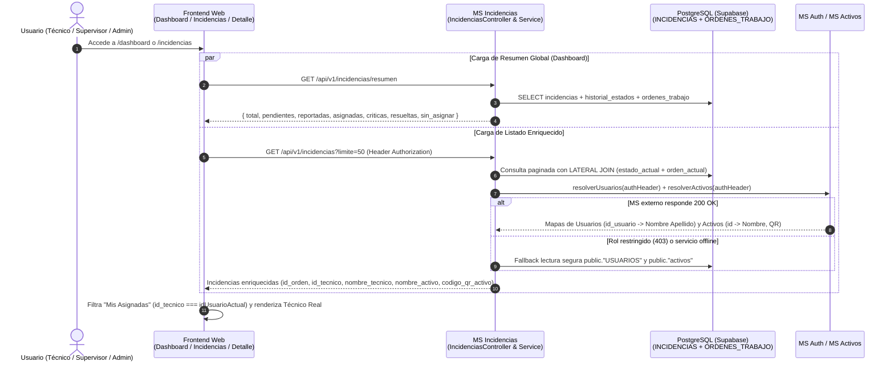

# TAL-201 — Enriquecimiento de Técnico Real, Filtro "Mis Asignadas" en Incidencias y Conteo Global del Dashboard

**Sprint:** 3 — Semana 1  
**Responsable:** Benjamín Soto (`TAL-201`)  
**Estimación:** `3.0h`  
**Módulos intervenidos:** `ms-incidencias` (NestJS + Prisma / PostgreSQL) y `frontend-web` (React 19 + Vite)  
**Estado:** Implementado y Verificado (`14/14` suites Jest en verde, `0` errores de Linter, Build de producción exitoso)

---

## 1. Diagnóstico Técnico y Contexto del Problema

Durante la revisión e integración de las entregas del Sprint 2 hacia el inicio del Sprint 3, se detectaron tres brechas de consistencia funcional entre la base de datos PostgreSQL (`INCIDENCIAS`, `ORDENES_TRABAJO`, `USUARIOS`, `activos`) y las vistas operativas del frontend:

1. **Pérdida de datos de la Orden de Trabajo y nombres reales en `ms-incidencias` (`IncidenciasService`):**
   - Aunque la consulta base `incidenciaConEstadoActual` en [`incidencias.service.ts`](file:///c:/Users/bsd28/Documents/GitHub/Taller-Integracion-II/ms-incidencias/src/incidencias/incidencias.service.ts) ya incluía la relación `ordenes_trabajo` (`take: 1`, ordenada por `fecha_creacion: 'desc'`), el método de serialización `toApiIncidencia()` omitía por completo dicha relación al construir el DTO de respuesta.
   - Asimismo, los métodos `resolverUsuarios()` y `resolverActivos()` solo se invocaban durante la exportación a Excel/CSV (`TAL-117`), pero **no** en los endpoints de consulta habitual (`GET /api/v1/incidencias` y `GET /api/v1/incidencias/:id_incidencia`). Además, `resolverUsuarios()` no contemplaba el campo `id_usuario` devuelto por `ms-auth` ni reenviaba el encabezado `Authorization` del solicitante.
2. **Desconexión de la pestaña `"Mis Asignadas"` y visualización truncada del técnico en `Incidencias.jsx` y `DetalleIncidencia.jsx`:**
   - En [`Incidencias.jsx`](file:///c:/Users/bsd28/Documents/GitHub/Taller-Integracion-II/frontend-web/src/views/Incidencias.jsx), el identificador de sesión se leía únicamente como `usuarioAutenticado?.id_usuario` (sin fallback a `.id` o `.userId`), y la columna de asignación aplicaba `.substring(0, 8)` asumiendo que `tecnico_asignado` era un UUID crudo.
   - En [`DetalleIncidencia.jsx`](file:///c:/Users/bsd28/Documents/GitHub/Taller-Integracion-II/frontend-web/src/views/DetalleIncidencia.jsx), el campo `asignado` caía en un valor estático (`'Carlos Ruiz'`) cuando no existía caché en `localStorage`, impidiendo reflejar el técnico real de PostgreSQL o el estado `'Sin asignar'`.
3. **Conteo de métricas del Dashboard limitado a la primera página del scroll infinito (`limit=15`):**
   - En [`Dashboard.jsx`](file:///c:/Users/bsd28/Documents/GitHub/Taller-Integracion-II/frontend-web/src/views/Dashboard.jsx), el cálculo de tarjetas (`resumenMetricas`) iteraba exclusivamente sobre el arreglo `incidencias` cargado por la primera página de `useInfiniteScroll` (`limit=15`), e ignoraba los estados activos `'Asignada'` y `'En Progreso'` dentro del indicador de pendientes/en atención.

---

## 2. Alineación con Diagramas Oficiales y Desarrollo Progresivo

- **Diagrama MER Definitivo (`docs/diagramas/Diagrama mer definitivo.png`):** Respeta estrictamente la relación `1:N` entre `INCIDENCIAS` y `ORDENES_TRABAJO` (`id_orden`, `id_incidencia`, `id_tecnico`, `diagnostico_tecnico`, `fecha_creacion`), extrayendo la orden activa más reciente sin alterar el esquema Prisma ni requerir migraciones destructivas.
- **Diagrama de Arquitectura de Software (`docs/diagramas/Diagrama de software.png`):** Mantiene el acoplamiento débil entre microservicios enriqueciendo datos en `ms-incidencias` mediante llamadas HTTP autenticadas hacia `ms-auth` (`/auth/usuarios`) y `ms-activos` (`/api/v1/activos`), incorporando además un fallback de lectura SQL segura sobre el esquema compartido de Supabase para garantizar disponibilidad incluso cuando consulta un rol sin permisos de administración global (`TECNICO` o `REPORTANTE`).
- **Implementación Progresiva (No disruptiva):**
  - Se conservaron **todos** los campos previos de `toApiIncidencia()` para no romper contratos existentes (`TAL-115` Prioridad Dinámica, `TAL-117` Exportación Excel/CSV, `TAL-194` Asignación de Técnico).
  - Cuando una incidencia **no** tiene orden de trabajo asignada, `tecnico_asignado`, `nombre_tecnico`, `id_tecnico` e `id_orden` retornan `null` (valor *falsy*), preservando intacto el filtro de incidencias disponibles (`!inc.tecnico_asignado`) en [`AsignarTecnico.jsx`](file:///c:/Users/bsd28/Documents/GitHub/Taller-Integracion-II/frontend-web/src/views/AsignarTecnico.jsx).

---

## 3. Flujo de Enriquecimiento y Sincronización (`Mermaid`)



---

## 4. Matriz de Archivos Modificados y Rutas Afectadas

| Archivo | Capa | Tipo de Cambio | Descripción Técnica |
| :--- | :--- | :--- | :--- |
| [`ms-incidencias/src/incidencias/dto/listar-incidencias-query.dto.ts`](file:///c:/Users/bsd28/Documents/GitHub/Taller-Integracion-II/ms-incidencias/src/incidencias/dto/listar-incidencias-query.dto.ts) | Backend DTO | Modificado | Se añadieron los filtros opcionales validados `@IsUUID()` para `id_tecnico` e `id_reportante` y se eliminó el valor por defecto `limit = 20` que eclipsaba `?limite=50`. |
| [`ms-incidencias/src/incidencias/incidencias.controller.ts`](file:///c:/Users/bsd28/Documents/GitHub/Taller-Integracion-II/ms-incidencias/src/incidencias/incidencias.controller.ts) | Backend Controller | Modificado | Se expuso `GET /api/v1/incidencias/resumen` y se inyectó `@Headers('authorization')` opcional en `listar()` y `obtener()`. |
| [`ms-incidencias/src/incidencias/incidencias.service.ts`](file:///c:/Users/bsd28/Documents/GitHub/Taller-Integracion-II/ms-incidencias/src/incidencias/incidencias.service.ts) | Backend Service | Modificado | Se implementó `obtenerResumenMetricas()` (separando `resueltas` de `cerradas`), se enriqueció `toApiIncidencia()` con datos de `ordenes_trabajo` y cruce de nombres reales, y se reforzaron `resolverUsuarios()` y `resolverActivos()`. |
| [`ms-incidencias/src/incidencias/incidencias.service.spec.ts`](file:///c:/Users/bsd28/Documents/GitHub/Taller-Integracion-II/ms-incidencias/src/incidencias/incidencias.service.spec.ts) | Backend Tests | Modificado | Se agregaron pruebas unitarias para `TAL-201` validando el enriquecimiento de `obtener()`, el cálculo global de `obtenerResumenMetricas()` y la separación entre `Resuelta` y `Cerrada`. |
| [`frontend-web/src/views/Incidencias.jsx`](file:///c:/Users/bsd28/Documents/GitHub/Taller-Integracion-II/frontend-web/src/views/Incidencias.jsx) | Frontend Vista | Modificado | Se implementó `obtenerNombreTecnicoReal()`, se restringió `esIncidenciaAsignadaAMi()` exclusivamente a asignaciones reales de técnico (evitando sumar incidencias sin asignar creadas por el usuario), y se sincronizó el conteo `Todas` con `/incidencias/resumen` y el evento `incidencia-creada`. |
| [`frontend-web/src/views/DetalleIncidencia.jsx`](file:///c:/Users/bsd28/Documents/GitHub/Taller-Integracion-II/frontend-web/src/views/DetalleIncidencia.jsx) | Frontend Vista | Modificado | Se eliminó el fallback estático `'Carlos Ruiz'`, consumiendo `nombre_tecnico`, `id_tecnico`, `id_orden`, `diagnostico_tecnico` y `nombre_activo` reales desde el backend. |
| [`frontend-web/src/views/Dashboard.jsx`](file:///c:/Users/bsd28/Documents/GitHub/Taller-Integracion-II/frontend-web/src/views/Dashboard.jsx) | Frontend Vista | Modificado | Se conectó a `GET /incidencias/resumen` y al evento `incidencia-creada` para mostrar los contadores globales reales (*Total*, *Pendientes / En Atención*, *Críticas*, *Órdenes Resueltas* sin mezclar estado *Cerrada*) y nombres enriquecidos en la tabla. |
| [`frontend-web/src/components/FormularioReporteIncidencia.jsx`](file:///c:/Users/bsd28/Documents/GitHub/Taller-Integracion-II/frontend-web/src/components/FormularioReporteIncidencia.jsx) | Frontend Componente | Modificado | Emite el evento global `incidencia-creada` al crear un reporte para actualizar reactivamente los contadores de `Dashboard.jsx` e `Incidencias.jsx`. |

---

## 5. Detalle de Cambios por Componente

### 5.1. Backend (`ms-incidencias`)

- **Rutas afectadas / nuevas:**
  - `GET /api/v1/incidencias` — Ahora soporta `?id_tecnico=<uuid>&id_reportante=<uuid>` en el `LATERAL JOIN` hacia `ORDENES_TRABAJO` y retorna cada incidencia enriquecida con:
    - `id_orden`, `id_tecnico`, `nombre_tecnico`, `tecnico_asignado`, `fecha_asignacion`, `diagnostico_tecnico` y el objeto estructurado `orden_trabajo`.
    - `nombre_reportante`, `nombre_activo` y `codigo_qr_activo`.
  - `GET /api/v1/incidencias/resumen` *(Nueva ruta)* — Calcula sobre el universo completo de `INCIDENCIAS` en PostgreSQL:
    ```json
    {
      "total": 42,
      "pendientes": 18,
      "reportadas": 10,
      "asignadas": 8,
      "criticas": 6,
      "resueltas": 24,
      "sin_asignar": 10
    }
    ```
  - `GET /api/v1/incidencias/:id_incidencia` — Retorna el detalle individual enriquecido con los nombres reales de técnico, reportante y activo.

### 5.2. Frontend (`frontend-web`)

- **Vista de Incidencias ([`Incidencias.jsx`](file:///c:/Users/bsd28/Documents/GitHub/Taller-Integracion-II/frontend-web/src/views/Incidencias.jsx)):**
  - Normalización del usuario autenticado (`id_usuario || id || userId`) y del rol (`TECNICO`, `SUPERVISOR`, `ADMINISTRADOR`, `REPORTANTE`).
  - La función `esIncidenciaAsignadaAMi(inc)` evalúa para el rol `TECNICO` la coincidencia exacta `inc.id_tecnico === idUsuarioActual` (con respaldo por `orden_trabajo.id_tecnico` y nombre completo), habilitando tanto el contador de la pestaña `"Mis Asignadas"` como el botón **"Finalizar Tarea"**.
  - Se reemplazó el truncado `.substring(0, 8)` sobre `tecnico_asignado` por `obtenerNombreTecnicoReal(inc)`, mostrando el nombre completo del técnico asignado o `"Sin asignar"`.
- **Vista de Detalle de Incidencia ([`DetalleIncidencia.jsx`](file:///c:/Users/bsd28/Documents/GitHub/Taller-Integracion-II/frontend-web/src/views/DetalleIncidencia.jsx)):**
  - Consume directamente `nombre_tecnico`, `id_tecnico`, `id_orden`, `nombre_activo` y `codigo_qr_activo` desde `GET /incidencias/:idIncidencia`.
  - Valida `esTecnicoAsignado` comparando `incidencia.id_tecnico === idUsuarioSesion` además del nombre en sesión, y transfiere el `id_orden` real al `ModalCierreMantenimiento`.
- **Panel de Control Operativo ([`Dashboard.jsx`](file:///c:/Users/bsd28/Documents/GitHub/Taller-Integracion-II/frontend-web/src/views/Dashboard.jsx)):**
  - Consulta `GET /incidencias/resumen` al montar la vista y despliega 4 tarjetas globales (*Total Incidencias*, *Pendientes / En Atención*, *Incidencias Críticas* y *Órdenes Resueltas*), manteniendo un cálculo local de respaldo que incluye todos los estados activos (`Reportada`, `Pendiente`, `Asignada`, `En Progreso`).

---

## 6. Criterios de Aceptación y Verificación

| # | Criterio de Aceptación (Jira `TAL-201`) | Estado | Evidencia de Cumplimiento |
| :-: | :--- | :-: | :--- |
| **1** | El listado y detalle de Incidencias muestran el nombre real del técnico asignado proveniente de la orden de trabajo en PostgreSQL (o `"Sin asignar"` cuando no tiene orden). | Cumplido | `toApiIncidencia()` cruza `ordenes_trabajo[0].id_tecnico` con `resolverUsuarios()` y expone `nombre_tecnico` y `tecnico_asignado`. Vistas actualizadas sin truncado de 8 caracteres ni valores harcodeados. |
| **2** | La pestaña `"Mis Asignadas"` muestra con precisión todas las incidencias asignadas al técnico con sesión activa. | Cumplido | `esIncidenciaAsignadaAMi()` en `Incidencias.jsx` compara `inc.id_tecnico === idUsuarioActual` y actualiza el contador del `StatusFilter` y la grilla reactiva. |
| **3** | Los contadores del Dashboard reflejan el total real de incidencias, críticas, activas/pendientes (`Reportada`, `Asignada`, `En Progreso`) y resueltas/cerradas de la base de datos. | Cumplido | Nuevo endpoint `GET /api/v1/incidencias/resumen` consumido en `Dashboard.jsx` con desglose completo independiente del límite `limit=15` del scroll infinito. |

### Resultados de Pruebas Automatizadas, Linter y Compilación

1. **Pruebas Unitarias en `ms-incidencias` (Jest):**
   - `14 passed, 14 total` suites (`109 passed, 109 total` tests), incluyendo la nueva suite `TAL-201: Enriquecimiento de Técnico Real, Mis Asignadas y Resumen Dashboard` en [`incidencias.service.spec.ts`](file:///c:/Users/bsd28/Documents/GitHub/Taller-Integracion-II/ms-incidencias/src/incidencias/incidencias.service.spec.ts).
2. **Verificación de Tipos y Linter (`tsc` + `oxlint`):**
   - `ms-incidencias`: `0 errors` en `oxlint` y `tsc -p tsconfig.build.json --noEmit`.
   - `frontend-web`: `0 errors` en `oxlint`.
3. **Build de Producción (`vite build` & `nest build`):**
   - `frontend-web`: `✓ built in 1.39s` (`138 modules transformed`).
   - `ms-incidencias`: `nest build` completado con código de salida `0`.

---

## 7. Auditoría de Conformidad con el Contrato API (`openapi.yaml` v1.3.0)

Se verificó cada endpoint, esquema de respuesta y convención de nombres frente al contrato central [`openapi.yaml`](file:///c:/Users/bsd28/Documents/GitHub/Taller-Integracion-II/openapi.yaml) (`SCGI API v1.3.0`, acordado entre TI2 y TI4):

| Regla / Especificación de `openapi.yaml` | Verificación en `TAL-201` | Estado |
| :--- | :--- | :-: |
| **Prefijo base y Seguridad (`RNF3` / `RNF4`):** Todas las rutas bajo `/api/v1` protegidas con `autenticacionJwt` (`Bearer <token>`). | `IncidenciasController` mantiene `@Controller('incidencias')` bajo el prefijo global `/api/v1` (`configureHttp`) y `@UseGuards(JwtAuthGuard, RolesGuard)`. | Cumple |
| **Nomenclatura de campos (`openapi.yaml` l. 21-23):** Nombres en español, `snake_case`, sin tildes ni `ñ`. | Todos los campos expuestos (`id_orden`, `id_tecnico`, `nombre_tecnico`, `tecnico_asignado`, `fecha_asignacion`, `diagnostico_tecnico`, `orden_trabajo`, `nombre_reportante`, `nombre_activo`, `codigo_qr_activo`, `sin_asignar`) cumplen estrictamente la regla. | Cumple |
| **Esquema `Incidencia` (`openapi.yaml` l. 1212-1252):** Campos obligatorios `id_incidencia`, `id_activo`, `id_reportante`, `titulo`, `descripcion`, `estado` (`{ id_estado, nombre_estado }`) y `fecha_creacion`. | `toApiIncidencia()` conserva el 100% de las propiedades requeridas con sus tipos exactos (`uuid`, `string`, `EstadoIncidencia`, `date-time`) y añade únicamente propiedades opcionales no disruptivas. | Cumple |
| **Parámetros de consulta en `GET /api/v1/incidencias` (`openapi.yaml` l. 434-457):** `id_activo` (`uuid`), `id_estado` (`integer`), `limite` (`1..50`, default `20`). | `ListarIncidenciasQueryDto` mantiene intactos `id_activo`, `id_estado` y `limite` (`@Min(1) @Max(50)`), agregando `id_tecnico` e `id_reportante` como filtros `@IsOptional() @IsUUID()`. | Cumple |
| **Esquema de Errores (`openapi.yaml` l. 942-970):** Respuesta estandarizada `Error` con `{ statusCode, mensaje, message, timestamp, path }`. | Mantenido sin alteraciones a través de `OpenApiExceptionFilter` para códigos `400`, `401`, `403`, `404` y `500`. | Cumple |
| **Compatibilidad de `evidencias` en `DetalleIncidencia.jsx`:** Soporte dual para arreglo de strings URL o esquema `Evidencia` (`{ id_evidencia, id_incidencia, tipo, url_evidencia, fecha_creacion }`). | `DetalleIncidencia.jsx` normaliza cada ítem de `evidencias` aceptando tanto `string` como el objeto `Evidencia` (`evItem.url_evidencia`). | Cumple |


