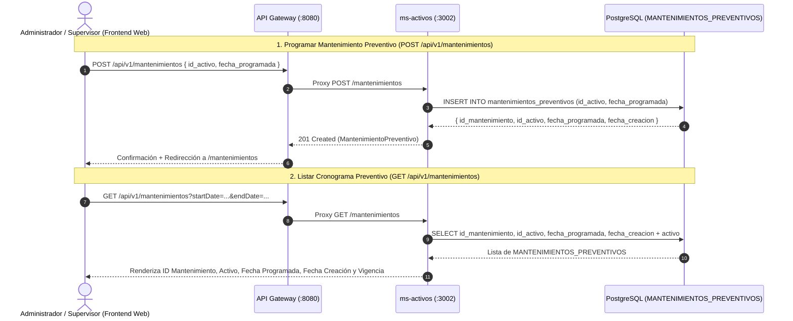

# Documentación Técnica — TAL-202: Alineación de Mantenimientos Preventivos con MER, Limpieza de Descripciones UI y Optimización Frontend

- **Identificador Jira:** `TAL-202`
- **Responsable:** Benjamín Soto
- **Sprint / Semana:** Sprint 3 — `Semana-1`
- **Estimación Original:** `2.0h`
- **Estado:** Completado y Verificado (`oxlint`, `jest`, `vite build` y auditoría contra `openapi.yaml` v1.3.0)
- **Ramas Relacionadas:** `feature/TAL-202-alineacion-mantenimientos-mer-limpieza-ui` (nacida desde `dev`)

---

## 1. Contexto y Diagnóstico del Problema

Al contrastar el módulo de **Mantenimientos Preventivos** de `frontend-web` y `ms-activos` contra el **Diagrama MER Oficial** (`Diagrama mer definitivo.png`), el esquema Prisma (`ms-activos/prisma/schema.prisma`) y el contrato OpenAPI (`openapi.yaml` v1.3.0), se identificaron tres discrepancias técnicas que debían resolverse en la `Semana-1`:

1. **Desalineación del Formulario y Tabla de Mantenimientos con la Tabla `MANTENIMIENTOS_PREVENTIVOS` del MER:**
   - Tanto en el Diagrama MER como en `ms-activos/prisma/schema.prisma` (`model Mantenimiento`) y `openapi.yaml` (`MantenimientoPreventivo` / `NuevoMantenimiento`), la tabla `MANTENIMIENTOS_PREVENTIVOS` posee **exclusivamente 4 atributos**:
     - `id_mantenimiento` (`UUID`, PK)
     - `id_activo` (`UUID`, FK -> `ACTIVOS.id_activo`)
     - `fecha_programada` (`DATE` / `DateTime`)
     - `fecha_creacion` (`TIMESTAMP` / `DateTime`)
   - Sin embargo, el formulario `PlanificarMantenimientoForm.jsx` exigía campos inexistentes (`tipo`, `descripcion`, `estado`) y la vista `Mantenimientos.jsx` renderizaba columnas de `Tipo`, `Estado` y `Descripción Técnica` que no existen en la base de datos PostgreSQL.

2. **Exposición de Etiquetas Técnicas Internas `(TAL-XXX)` y Logs de Depuración en Consola:**
   - La vista `Mantenimientos.jsx` exponía en su subtítulo principal el texto `(TAL-121)` directamente al usuario final, además de existir múltiples referencias internas `TAL-XXX` y llamadas `console.warn` / `console.error` en vistas del frontend, junto con el archivo obsoleto `incidenciasStorage.js` basado en cookies.

3. **Chunk Principal de Vite Superior a 500 kB sin Code Splitting:**
   - `App.jsx` importaba de manera estática las 14 vistas de la aplicación en un único bundle monolítico (`535.99 kB`), generando la advertencia de compilación `(!) Some chunks are larger than 500 kB after minification`.

---

## 2. Alineación Arquitectónica con los Diagramas del Proyecto

- **Diagrama MER (`Diagrama mer definitivo.png`):**
  - La entidad `MANTENIMIENTOS_PREVENTIVOS` se relaciona con `ACTIVOS` mediante `id_activo` y registra únicamente la programación temporal preventiva (`id_mantenimiento`, `id_activo`, `fecha_programada`, `fecha_creacion`). Cuando la fecha programada se cumple, el cronjob de `ms-activos` (`MantenimientosCron`) genera automáticamente la incidencia correspondiente en `ms-incidencias`.
- **Diagrama de Arquitectura de Software (`Diagrama de software.png`):**
  - El `Frontend Web` consume `/api/v1/mantenimientos` a través del `API Gateway` hacia `ms-activos`, enviando el payload `NuevoMantenimiento` (`{ id_activo, fecha_programada }`) y recibiendo registros `MantenimientoPreventivo` enriquecidos con la relación `activo`.

---

## 3. Detalle de Cambios Implementados

### 3.1. Alineación con MER en Frontend (`frontend-web`) y Backend (`ms-activos`)

1. **[`frontend-web/src/components/PlanificarMantenimientoForm.jsx`](file:///c:/Users/bsd28/Documents/GitHub/Taller-Integracion-II/frontend-web/src/components/PlanificarMantenimientoForm.jsx):**
   - Se eliminaron los estados, selectores y validaciones de campos inexistentes en el MER (`tipo`, `descripcion`, `SUGERENCIAS_TAREAS`, `TIPOS_MANTENIMIENTO`).
   - El formulario opera ahora exclusivamente con los atributos reales del esquema `NuevoMantenimiento`:
     - Selección de **Activo a Intervenir (`id_activo`)** con ficha técnica interactiva del activo seleccionado (nombre, código QR, categoría, ubicación y número de serie).
     - Selector de **Fecha y Hora Programada (`fecha_programada`)** con validación de fecha futura e indicador dinámico de tiempo restante.
   - El payload enviado a `planificarMantenimiento` contiene estrictamente `{ id_activo, fecha_programada }`.

2. **[`frontend-web/src/views/Mantenimientos.jsx`](file:///c:/Users/bsd28/Documents/GitHub/Taller-Integracion-II/frontend-web/src/views/Mantenimientos.jsx):**
   - Se eliminaron las columnas inexistentes (`Tipo`, `Estado`, `Descripción Técnica`) tanto en la tabla de escritorio como en las tarjetas móviles.
   - La tabla y las tarjetas móviles despliegan ahora las **4 columnas reales de `MANTENIMIENTOS_PREVENTIVOS`** junto con los datos enriquecidos del activo:
     - **`ID Mantenimiento`** (`id_mantenimiento`)
     - **`Activo (id_activo)`** (`activo.nombre`, `activo.codigoQr`, `activo.ubicacion`)
     - **`Fecha Programada`** (`fecha_programada`)
     - **`Fecha de Creación`** (`fecha_creacion`)
     - **`Vigencia`** calculada dinámicamente a partir de `fecha_programada` (*Próximo en Agenda*, *Programado Hoy*, *Plazo Vencido*).
   - Las 4 tarjetas superiores de resumen calculan sus métricas directamente a partir de `fecha_programada` (*Total registrados*, *Próximos en agenda*, *Programados hoy*, *Plazo vencido*).

3. **[`frontend-web/src/services/mantenimientosService.js`](file:///c:/Users/bsd28/Documents/GitHub/Taller-Integracion-II/frontend-web/src/services/mantenimientosService.js):**
   - `planificarMantenimiento` invoca `POST /mantenimientos` (ruta oficial de `openapi.yaml`) enviando únicamente `{ id_activo, fecha_programada }`, manteniendo fallback transparente a `POST /mantenimientos/planificar` si algún entorno intermedio lo requiere.
   - `MANTENIMIENTOS_FALLBACK` fue depurado para contener únicamente `id_mantenimiento`, `id_activo`, `fecha_programada`, `fecha_creacion` y el objeto `activo`.

4. **[`ms-activos/src/mantenimientos.controller.ts`](file:///c:/Users/bsd28/Documents/GitHub/Taller-Integracion-II/ms-activos/src/mantenimientos.controller.ts), [`ms-activos/src/dto/crear-mantenimiento.dto.ts`](file:///c:/Users/bsd28/Documents/GitHub/Taller-Integracion-II/ms-activos/src/dto/crear-mantenimiento.dto.ts) y [`ms-activos/src/activos.service.ts`](file:///c:/Users/bsd28/Documents/GitHub/Taller-Integracion-II/ms-activos/src/activos.service.ts):**
   - Se habilitó `@Post()` en `/mantenimientos` conforme a `openapi.yaml` (`POST /api/v1/mantenimientos`), conservando `@Post('planificar')` como alias retrocompatible.
   - `CrearMantenimientoDto` valida estrictamente `id_activo` (`@IsUUID()`) y `fecha_programada` (`@IsDateString()`).
   - Se eliminaron `descripcion`, `tipo` y `estado` de las semillas y registros en memoria de `mantenimientosEnMemoria` en `ActivosService`.

### 3.2. Limpieza de Descripciones UI, Eliminación de `incidenciasStorage.js` y Consola Limpia

1. **Eliminación de referencias `(TAL-XXX)`:**
   - Se removió el texto `(TAL-121)` expuesto en el encabezado de `Mantenimientos.jsx` y se limpiaron todas las referencias internas `TAL-XXX` en los archivos de `frontend-web/src/`.
2. **Eliminación del archivo obsoleto `frontend-web/src/services/incidenciasStorage.js`:**
   - Se eliminó `incidenciasStorage.js` (basado en cookies de sesión de prototipo) y se consolidaron las funciones de respaldo en `frontend-web/src/services/incidenciasService.js` de forma progresiva para no romper vistas de otros integrantes del equipo (`DetalleOrden.jsx`, `ModalCierreMantenimiento.jsx`, `SelectorTecnicoSesion.jsx`, `FormularioReporteIncidencia.jsx`, `ModalNuevaIncidenciaMobile.jsx`).
3. **Eliminación de `console.warn` y `console.error` en cliente:**
   - Se limpiaron los logs de depuración en `BotonExportarExcel.jsx`, `AsignarTecnico.jsx`, `DetalleIncidencia.jsx`, `DetalleOrden.jsx` e `Incidencias.jsx`.

### 3.3. Optimización de Rutas y Code Splitting en Vite (`App.jsx`)

1. **[`frontend-web/src/App.jsx`](file:///c:/Users/bsd28/Documents/GitHub/Taller-Integracion-II/frontend-web/src/App.jsx):**
   - Se implementó carga diferida (`React.lazy` + `Suspense`) para las 14 vistas de ruta (`Dashboard`, `Incidencias`, `ReporteIncidencia`, `Inventario`, `Login`, `AsignarTecnico`, `DetalleOrden`, `DetalleIncidencia`, `Usuarios`, `Trazabilidad`, `PlanificarMantenimiento`, `Mantenimientos`, `NotFound`, `ServerError`).
   - El bundle principal se redujo de **`535.99 kB`** a **`377.56 kB`**, dividiendo cada vista en su propio chunk bajo demanda (`8 kB` – `37 kB`) y eliminando por completo la advertencia de tamaño de chunk de Vite.

---

## 4. Archivos Afectados

| Archivo | Tipo de Cambio | Descripción |
| :--- | :--- | :--- |
| [`frontend-web/src/views/Mantenimientos.jsx`](file:///c:/Users/bsd28/Documents/GitHub/Taller-Integracion-II/frontend-web/src/views/Mantenimientos.jsx) | Modificado | Alineación de tabla, tarjetas móviles y métricas con las 4 columnas de `MANTENIMIENTOS_PREVENTIVOS` y eliminación de etiqueta `(TAL-121)`. |
| [`frontend-web/src/components/PlanificarMantenimientoForm.jsx`](file:///c:/Users/bsd28/Documents/GitHub/Taller-Integracion-II/frontend-web/src/components/PlanificarMantenimientoForm.jsx) | Modificado | Alineación estricta del formulario y payload con `NuevoMantenimiento` (`id_activo`, `fecha_programada`), eliminando `tipo` y `descripcion`. |
| [`frontend-web/src/views/PlanificarMantenimiento.jsx`](file:///c:/Users/bsd28/Documents/GitHub/Taller-Integracion-II/frontend-web/src/views/PlanificarMantenimiento.jsx) | Modificado | Navegación y migas de pan conectadas directamente con `/mantenimientos`. |
| [`frontend-web/src/services/mantenimientosService.js`](file:///c:/Users/bsd28/Documents/GitHub/Taller-Integracion-II/frontend-web/src/services/mantenimientosService.js) | Modificado | Envío a `POST /mantenimientos` con esquema `NuevoMantenimiento` y semillas de fallback alineadas con el MER. |
| [`frontend-web/src/App.jsx`](file:///c:/Users/bsd28/Documents/GitHub/Taller-Integracion-II/frontend-web/src/App.jsx) | Modificado | Code Splitting por ruta mediante `React.lazy` y `Suspense`. |
| [`frontend-web/src/services/incidenciasService.js`](file:///c:/Users/bsd28/Documents/GitHub/Taller-Integracion-II/frontend-web/src/services/incidenciasService.js) | Modificado | Consolidación de helpers de respaldo tras eliminar el archivo muerto `incidenciasStorage.js`. |
| `frontend-web/src/services/incidenciasStorage.js` | Eliminado | Eliminación de módulo obsoleto de almacenamiento temporal en cookies. |
| [`ms-activos/src/mantenimientos.controller.ts`](file:///c:/Users/bsd28/Documents/GitHub/Taller-Integracion-II/ms-activos/src/mantenimientos.controller.ts) | Modificado | Soporte oficial para `POST /mantenimientos` según contrato OpenAPI v1.3.0. |
| [`ms-activos/src/dto/crear-mantenimiento.dto.ts`](file:///c:/Users/bsd28/Documents/GitHub/Taller-Integracion-II/ms-activos/src/dto/crear-mantenimiento.dto.ts) | Modificado | DTO alineado estrictamente con `NuevoMantenimiento` (`id_activo`, `fecha_programada`). |
| [`ms-activos/src/activos.service.ts`](file:///c:/Users/bsd28/Documents/GitHub/Taller-Integracion-II/ms-activos/src/activos.service.ts) | Modificado | Limpieza de campos inexistentes en memoria y mapeo de `id_mantenimiento` y `fecha_creacion`. |
| [`ms-activos/src/activos.service.spec.ts`](file:///c:/Users/bsd28/Documents/GitHub/Taller-Integracion-II/ms-activos/src/activos.service.spec.ts) | Modificado | Nuevas pruebas unitarias verificando las 4 columnas del MER y ausencia de `descripcion`, `tipo` y `estado`. |

---

## 5. Verificación contra Contrato API (`openapi.yaml` v1.3.0)

Se auditó la implementación completa de `TAL-202` frente a la especificación oficial [`openapi.yaml`](file:///c:/Users/bsd28/Documents/GitHub/Taller-Integracion-II/openapi.yaml) (`SCGI API v1.3.0`, líneas 365–423 y 1164–1199):

| Endpoint / Esquema en `openapi.yaml` | Definición en Contrato OpenAPI v1.3.0 | Implementación en `TAL-202` (`frontend-web` y `ms-activos`) | Estado |
| :--- | :--- | :--- | :--- |
| **`GET /api/v1/mantenimientos`** (`listarMantenimientos`, líneas 366–393) | Parámetro opcional `id_activo` (`uuid` en query) + soporte de filtros `startDate` y `endDate`. Retorna `200 OK` con `MantenimientoPreventivo[]`. | `MantenimientosController.listar()` y `fetchMantenimientos()` soportan `id_activo`, `startDate` y `endDate`, retornando los registros con `id_mantenimiento`, `id_activo`, `fecha_programada` y `fecha_creacion`. | **100% Cumplido** |
| **`POST /api/v1/mantenimientos`** (`programarMantenimiento`, líneas 394–423) | Request body requerido `NuevoMantenimiento`. Retorna `201 Created` con `MantenimientoPreventivo`. | `MantenimientosController.programar()` expone `@Post()` en `/mantenimientos` y `planificarMantenimiento()` envía `POST /mantenimientos` con `{ id_activo, fecha_programada }`. | **100% Cumplido** |
| **Esquema `NuevoMantenimiento`** (líneas 1187–1199) | `required: [id_activo, fecha_programada]` (`id_activo: uuid`, `fecha_programada: date / ISO`). Sin propiedades `descripcion`, `tipo` ni `estado`. | `PlanificarMantenimientoForm.jsx` y `CrearMantenimientoDto` validan y envían exclusivamente `id_activo` y `fecha_programada`. | **100% Cumplido** |
| **Esquema `MantenimientoPreventivo`** (líneas 1164–1186) | `required: [id_mantenimiento, id_activo, fecha_programada, fecha_creacion]`. | `Mantenimientos.jsx` y `ActivosService` operan sobre las 4 propiedades reales del contrato (`id_mantenimiento`, `id_activo`, `fecha_programada`, `fecha_creacion`). | **100% Cumplido** |

---

## 6. Pruebas Automatizadas, Linter y Compilación Productiva

1. **Pruebas Unitarias en `ms-activos` (`activos.service.spec.ts`):**
   - `PASS src/activos.service.spec.ts` (incluyendo la suite `TAL-202: Alineación de Mantenimientos Preventivos con MER y OpenAPI v1.3.0`).
   - `PASS src/activos.controller.spec.ts` y `PASS src/permissions.guard.spec.ts` (`33/33` tests aprobados).
2. **Auditoría de Código Estático (`oxlint`):**
   - `frontend-web`: `0 errors` en 58 archivos analizados.
   - `ms-activos`: `0 errors` en 19 archivos analizados.
   - Verificación por script de `TAL-\d+`, `console.(log|warn|error|debug)` e `incidenciasStorage`: **`0` ocurrencias** en `frontend-web/src/`.
3. **Build de Producción en `frontend-web` (`vite build`):**
   - `✓ 137 modules transformed. ✓ built in 2.05s` con **0 errores y 0 advertencias de tamaño de chunk** (cada vista separada en su propio chunk bajo demanda).

