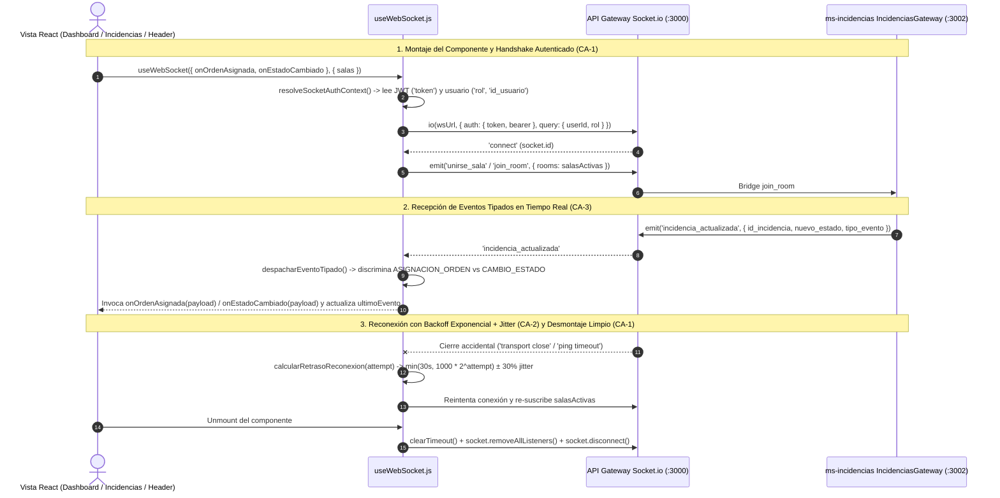

# Documentación Técnica — TAL-186: Hook Personalizado `useWebSocket` y Gestión de Salas en React

- **Identificador Jira:** `TAL-186`
- **Responsable:** Benjamín Soto
- **Sprint / Semana:** Sprint 3 — `Semana-2`
- **Estado:** Completado y Verificado (`node --test`, `oxlint`, `vite build` y compatibilidad con `TAL-2` y `TAL-185`)
- **Ramas Relacionadas:** `feature/TAL-186-hook-usewebsocket-gestion-salas` (nacida desde `dev`)
- **Dependencias:** `TAL-2` (API Gateway Socket.io), `TAL-185` (`IncidenciasGateway` en `ms-incidencias`)

---

## 1. Contexto y Diagnóstico del Requerimiento

Con la integración de `TAL-2` (servidor Socket.io unificado en el API Gateway y puente de transporte) y `TAL-185` (`IncidenciasGateway` en `ms-incidencias` con emisión de eventos en `< 50ms`), el frontend web (`frontend-web`) requiere un mecanismo centralizado, seguro y reutilizable en React para:
1. Gestionar el ciclo de vida completo de la conexión WebSocket (conexión al montar, envío automático del token JWT del usuario autenticado y limpieza de listeners/descriptores al desmontar).
2. Recuperarse de desconexiones accidentales mediante **reintentos exponenciales con jitter** para evitar tormentas de reconexión (*thundering herd*).
3. Administrar la suscripción dinámica a salas (`unirse_sala` / `join_room` y `dejar_sala` / `leave_room`) por incidencia (`incidencia_{id}`), edificio (`edificio_{id}`) o rol (`rol_{ROL}`, `coordinadores`).
4. Proveer contratos y callbacks claramente tipados para los eventos de dominio (`orden_asignada`, `estado_cambiado`, `incidencia_actualizada` y `nueva_incidencia`) y exponer el historial reactivo de los últimos eventos recibidos (`ultimoEvento`, `ultimosEventos`).

---

## 2. Arquitectura y Flujo de Sincronización

---

## 3. Detalle de Implementación y Cumplimiento de Criterios de Aceptación

| Criterio de Aceptación (Jira `TAL-186`) | Estado | Implementación Técnica Verificada |
| :--- | :---: | :--- |
| **CA-1:** Conexión automática al montar y desconexión limpia al desmontar componentes. | ✅ Cumple | `useWebSocket` en `frontend-web/src/hooks/useWebSocket.js` inicia la conexión automáticamente (`autoConnect = true`), inyectando el JWT (`auth.token`, `auth.bearer` y `query.token`) desde `localStorage` y escuchando renovaciones de sesión (`tecnico-cambiado`, `storage`). En el cleanup del `useEffect`, cancela timers pendientes, ejecuta `socket.removeAllListeners()` y llama a `socket.disconnect()`. |
| **CA-2:** Reintentos exponenciales con jitter en caso de cierre accidental. | ✅ Cumple | La función `calcularRetrasoReconexion(attempt, options)` implementa la progresión exponencial `min(maxDelayMs, baseDelayMs * 2^attempt)` (`1s, 2s, 4s, 8s, 16s, 30s`) combinada con una ventana de variación aleatoria (`jitterFactor = 0.3`, ±30%), disparándose únicamente cuando la desconexión no fue manual (`reason !== 'io client disconnect'`). |
| **CA-3:** Tipado claro de callbacks para eventos como `orden_asignada` y `estado_cambiado`. | ✅ Cumple | Se declararon contratos JSDoc (`@typedef`) completos para `OrdenAsignadaPayload`, `EstadoCambiadoPayload`, `IncidenciaActualizadaPayload`, `NuevaIncidenciaPayload` y `UseWebSocketCallbacks`. La función `despacharEventoTipado` enruta tanto eventos directos (`orden_asignada`, `estado_cambiado`, `nueva_incidencia`) como el evento compuesto `incidencia_actualizada` de `TAL-185` según su discriminador `tipo_evento` (`ASIGNACION_ORDEN` vs. `CAMBIO_ESTADO`). |

---

## 4. Archivos Creados y Modificados

1. **`frontend-web/src/hooks/useWebSocket.js` (Nuevo):**
   - Implementa el hook `useWebSocket` y exporta las utilidades puras `resolveWebSocketUrl`, `resolveSocketAuthContext`, `calcularRetrasoReconexion`, `despacharEventoTipado`, `normalizarSolicitudSala` y `WS_EVENTS`.
   - Expone `{ isConnected, conectado, socketId, ultimoEvento, ultimosEventos, salasActivas, intentosReconexion, unirseSala, unirse_sala, joinRoom, dejarSala, dejar_sala, leaveRoom, emitir, reconectar, desconectar }`.
2. **`frontend-web/src/hooks/useWebSocket.test.mjs` (Nuevo):**
   - Suite de 6 pruebas unitarias automatizadas con `node:test` que verifican la resolución de URL, extracción de JWT/rol, ciclo de vida de montaje/desmontaje (CA-1), cálculo de backoff exponencial con jitter (CA-2), despacho de callbacks tipados `orden_asignada` y `estado_cambiado` (CA-3) y gestión de salas (`unirse_sala`, `dejar_sala`).
3. **`frontend-web/package.json` (Modificado):**
   - Se añadió la dependencia `socket.io-client` (`^4.8.4`) y se incorporó `src/hooks/useWebSocket.test.mjs` al script `test:unit`.
4. **`api gateway/index.js` y `ms-incidencias/src/websockets/incidencias.gateway.ts` (Modificados):**
   - Se añadieron los alias de eventos en español `unirse_sala` y `dejar_sala` junto a `join_room` y `leave_room` para compatibilidad bidireccional completa.

---

## 5. Evidencia de Verificación

- **Pruebas Unitarias (`frontend-web`):** `30/30` pruebas aprobadas en `5/5` suites (`pwa.test.mjs`, `NetworkStatusContext.test.mjs`, `ConnectivityBadge.test.mjs`, `killswitch.test.mjs` y `useWebSocket.test.mjs`).
- **Pruebas Unitarias (`api gateway` y `ms-incidencias`):** `22/22` en `api gateway` y `122/122` en `ms-incidencias`.
- **Compilación Producción (`vite build`):** Exitosa, `0` errores y `0` advertencias.
