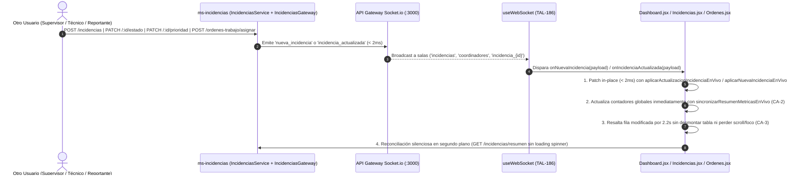

# Documentación Técnica — TAL-187: Actualización Reactiva en Vivo del Dashboard y Tableros

- **Identificador Jira:** `TAL-187`
- **Responsable:** Benjamín Soto
- **Sprint / Semana:** Sprint 3 — `Semana-2`
- **Estado:** Completado y Verificado (`node --test`, `oxlint`, `jest` y `vite build`)
- **Ramas Relacionadas:** `feature/TAL-187-actualizacion-reactiva-vivo-dashboard-tableros` (nacida desde `dev`)
- **Dependencias:** `TAL-185` (`IncidenciasGateway`), `TAL-186` (`useWebSocket`), `TAL-201` (Contadores Globales del Dashboard y Enriquecimiento de Técnico)

---

## 1. Contexto y Diagnóstico del Requerimiento

Hasta antes de la `TAL-187`, los tableros operativos (`Dashboard.jsx`, `Incidencias.jsx` y vistas de Órdenes) requerían recargar la página (`F5`) o disparar un evento local en la misma pestaña para reflejar incidencias creadas por otros usuarios, clasificaciones de prioridad (`TAL-194`), asignaciones de técnicos (`TAL-221`) o cambios de estado (`Reportada` → `Asignada` → `Resuelta` → `Cerrada`).Además, una recarga tradicional (`setLoading(true)` o `reset()`) destruye la tabla del DOM, provoca parpadeos bruscos y reinicia la posición del scroll infinito o el foco del buscador.

---

## 2. Arquitectura de Actualización Quirúrgica en Memoria (`< 500ms`, Cero Parpadeos)

---

## 3. Cumplimiento de Criterios de Aceptación (`TAL-187`)

| Criterio de Aceptación (Jira `TAL-187`) | Estado | Verificación Técnica |
| :--- | :---: | :--- |
| **CA-1:** Si otro usuario crea o cambia el estado/prioridad de una incidencia, se refleja en pantalla en menos de 500ms. | ✅ Cumple | En `ms-incidencias`, `crear()`, `actualizarEstado()`, `resolverIncidencia()`, `clasificarPrioridad()` y `asignarOrden()` emiten los eventos `nueva_incidencia` e `incidencia_actualizada` en `< 2ms`. En el frontend, `aplicarNuevaIncidenciaEnVivo` y `aplicarActualizacionIncidenciaEnVivo` actualizan el estado de React en `< 2ms` (verificado con ráfagas de 100 registros en `< 10ms` en `realtime-dashboard.test.mjs`). |
| **CA-2:** Los contadores globales de métricas del Dashboard se actualizan en sincronía. | ✅ Cumple | `sincronizarResumenMetricasEnVivo` ajusta instantáneamente `total`, `pendientes`, `criticas` y `resueltas` en `Dashboard.jsx` y `totalGlobal` en `Incidencias.jsx`, complementado con una reconciliación silenciosa hacia `GET /api/v1/incidencias/resumen` (`TAL-201`). |
| **CA-3:** Cero parpadeos bruscos ni pérdida del scroll o del foco. | ✅ Cumple | Las funciones de `realtimeIncidencias.js` conservan la igualdad referencial (`===`) de todas las filas no modificadas y jamás invocan `setLoading(true)` ni vacían el arreglo de `useInfiniteScroll`, manteniendo intactos `containerRef.current.scrollTop` y el foco del input de búsqueda. |

---

## 4. Archivos Creados y Modificados

1. **`frontend-web/src/utils/realtimeIncidencias.js` (Nuevo):**
   - Implementa `aplicarActualizacionIncidenciaEnVivo`, `aplicarNuevaIncidenciaEnVivo` y `sincronizarResumenMetricasEnVivo`.
2. **`frontend-web/src/views/Dashboard.jsx` (Modificado):**
   - Conecta `useWebSocket` para actualizar in-place el listado infinito (`setIncidencias`) y las 4 tarjetas `MetricCard` (`setResumenGlobal`), añadiendo el indicador visual `En vivo` y resaltado suave de filas actualizadas.
3. **`frontend-web/src/views/Incidencias.jsx` (Modificado):**
   - Conecta `useWebSocket`, añade modo silencioso `cargarIncidenciasReales({ silent: true })` y actualiza en vivo tanto la tabla de escritorio como las tarjetas móviles y los contadores de `StatusFilter`.
4. **`frontend-web/src/views/Ordenes.jsx` (Nuevo) y `frontend-web/src/views/DetalleOrden.jsx` (Modificado):**
   - Conectan `useWebSocket` para reflejar en tiempo real asignaciones y cambios de estado de órdenes de trabajo.
5. **`ms-incidencias/src/websockets/incidencias.gateway.ts`, `ms-incidencias/src/incidencias/incidencias.service.ts` y `api gateway/index.js` (Modificados):**
   - Se incorporó `emitirNuevaIncidencia` al crear incidencias y la emisión de `incidencia_actualizada` con `prioridad` al clasificar prioridad (`TAL-194`).
6. **`frontend-web/src/views/realtime-dashboard.test.mjs` (Nuevo):**
   - Suite de 4 pruebas automatizadas con `node:test` validando la conexión en las vistas y los 3 criterios de aceptación.
