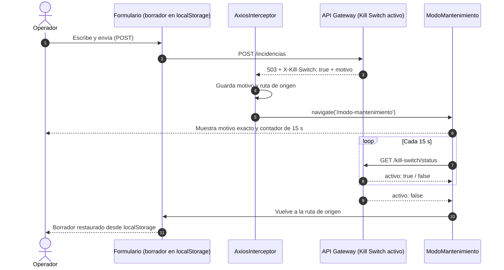

# TAL-188: Pantalla Global de Bloqueo por Mantenimiento (Kill Switch Activo)

- **Identificador de Tarea:** TAL-188
- **Sprint / Período:** Sprint 3 - Semana 2
- **Módulos Involucrados:** `frontend-web` (consume el Kill Switch del `api gateway` implementado en TAL-4, sin modificarlo)
- **Estado:** ✅ Completado y Verificado (100% Criterios de Aceptación)

---

## 1. Diagnóstico y Especificación del Requerimiento

> **Objetivo:** Interceptar las respuestas 503 de emergencia del servidor y presentar una vista amigable de mantenimiento.
>
> **Descripción:** Construir la vista `ModoMantenimiento.jsx` y enlazarla con el interceptor global de Axios. Si el backend responde 503 con cabecera de suspensión, la aplicación redirige temporalmente a esta pantalla con mensaje oficial y contador de reintento.

### Problemática
Con el Kill Switch de TAL-4 activo, el API Gateway responde `503` + `X-Kill-Switch: true` a toda operación de escritura (POST/PUT/PATCH/DELETE) de los servicios afectados. Antes de esta tarea el frontend trataba ese 503 como una falla genérica: mostraba un toast, redirigía a `/500` ("Error en los servicios") y marcaba el Gateway como caído en `NetworkStatusContext`, confundiendo al operador y sin conservar lo que estaba escribiendo.

---

## 2. Criterios de Aceptación y Estado de Cumplimiento

| Criterio | Estado | Verificación Técnica |
| :--- | :---: | :--- |
| **1. Despliega el motivo exacto enviado por el backend** (ej. "Mantenimiento eléctrico") | ✅ | `AxiosInterceptor.jsx` detecta el 503 de suspensión (`isKillSwitchError`: status 503 + cabecera `x-kill-switch: true` o `killSwitch: true` en el cuerpo), extrae `motivo`/`mensaje` sin alterarlo (`extraerMotivo`) y navega a `/modo-mantenimiento`. `ModoMantenimiento.jsx` lo renderiza textualmente en `#motivo-mantenimiento`. El motivo y la ruta de retorno se respaldan en `sessionStorage` para sobrevivir a una recarga. |
| **2. Comprueba automáticamente cada 15 segundos si el servicio se reanudó** | ✅ | La vista muestra un contador regresivo (`KILL_SWITCH_POLL_SECONDS = 15`) y consulta `GET /api/v1/kill-switch/status` (lectura, no bloqueada por el Gateway). Si `activo: false`, vuelve automáticamente a la pantalla de origen; si sigue activo, actualiza el motivo mostrado. Incluye botón "Comprobar ahora" y aviso si la consulta falla (se reintenta sola). |
| **3. No borra los borradores locales en formularios** | ✅ | Nuevo hook `useDraftState` que persiste los campos en `localStorage` (`draft:<form>:<campo>`). Se aplicó a Reporte de Incidencia (web y modal móvil), Planificar Mantenimiento y Asignar Técnico. Ni el interceptor ni la vista de mantenimiento eliminan datos; los borradores solo se limpian tras un envío exitoso o al pulsar "Limpiar". Al volver desde mantenimiento, los formularios restauran lo escrito. |

---

## 3. Alcance y Preservación de Estándares

- Todos los archivos nuevos y modificados permanecen en **JavaScript/JSX**; no se cambió el lenguaje de ningún archivo existente.
- No se modificó el backend ni el API Gateway: se reutilizan la cabecera `X-Kill-Switch` (ya expuesta por CORS) y el endpoint `/api/v1/kill-switch/status` de TAL-4.
- El 503 de Kill Switch **ya no** dispara el toast genérico, la redirección a `/500` ni el evento `gateway-error` (el Gateway sigue vivo; solo suspende escrituras).
- Las consultas a `/kill-switch` se tratan como segundo plano (silenciosas, igual que `/health`) y sin reintentos automáticos (`skipRetry`).

---

## 4. Matriz de Archivos

| Archivo | Tipo | Función |
| :--- | :---: | :--- |
| `frontend-web/src/views/ModoMantenimiento.jsx` | Creado | Vista de bloqueo: motivo oficial, contador de 15 s, sondeo del estado, retorno automático y aviso de borradores a salvo. |
| `frontend-web/src/services/killSwitchService.js` | Creado | Detección del 503 de suspensión, extracción del motivo, respaldo en `sessionStorage` y consulta de estado. |
| `frontend-web/src/hooks/useDraftState.js` | Creado | `useState` con persistencia en `localStorage` y `clearDrafts(formId)`. |
| `frontend-web/src/components/AxiosInterceptor.jsx` | Modificado | Redirección a `/modo-mantenimiento` ante Kill Switch; excluye `/kill-switch` de alertas. |
| `frontend-web/src/App.jsx` | Modificado | Ruta global `/modo-mantenimiento`. |
| `frontend-web/src/components/FormularioReporteIncidencia.jsx` | Modificado | Borradores locales; se limpian tras envío exitoso. |
| `frontend-web/src/components/ModalNuevaIncidenciaMobile.jsx` | Modificado | Borradores locales; con Kill Switch conserva el borrador y no guarda incidencia local falsa. |
| `frontend-web/src/components/PlanificarMantenimientoForm.jsx` | Modificado | Borradores locales. |
| `frontend-web/src/views/AsignarTecnico.jsx` | Modificado | Borradores locales; no reintenta el endpoint alterno si hay Kill Switch. |
| `frontend-web/src/killswitch.test.mjs` | Creado | 7 pruebas unitarias (`node --test`). |
| `frontend-web/cypress/e2e/tal-188-modo-mantenimiento.cy.js` | Creado | Spec E2E de los 3 criterios. |
| `frontend-web/package.json` | Modificado | Se agrega la suite a `test:unit`. |
| `docs/Sprint-3/semana-2/TAL-188-pantalla-bloqueo-mantenimiento-kill-switch.md` | Creado | Este documento. |

---

## 5. Flujo

---

## 6. Evidencia

- `npm --prefix frontend-web run test:unit` → **24 pruebas pasando, 0 fallos** (7 nuevas de TAL-188).
- `npm --prefix frontend-web run lint` → **0 errores** (solo advertencias previas del proyecto).
- `npm --prefix frontend-web run build` → build exitoso.
- Verificación E2E (Cypress) requiere el servidor de desarrollo levantado; el spec queda disponible en `cypress/e2e/tal-188-modo-mantenimiento.cy.js`.
