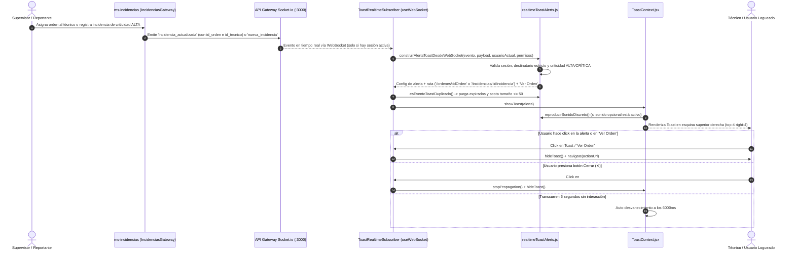

# Documentación Técnica — TAL-189: Sistema de Notificaciones Toast Flotantes en Tiempo Real

- **Identificador de Tarea:** `TAL-189`
- **Sprint / Período:** Sprint 3 — Semana 2
- **Módulos Involucrados:** `frontend-web` y `ms-incidencias` (integrado con `useWebSocket` de `TAL-186` e `IncidenciasGateway` de `TAL-185`)
- **Estado:** ✅ Completado y Verificado (100% Criterios de Aceptación)

---

## 1. Diagnóstico y Especificación del Requerimiento

> **Objetivo:** Disparar avisos emergentes visibles en pantalla cuando sucedan eventos de alta prioridad dirigidos al usuario actual.
>
> **Descripción:** Integrar el canal de eventos WebSocket con el componente Toast existente. Si se recibe una alerta de criticidad ALTA o se asigna una orden al técnico logueado, aparece un Toast interactivo con botón `'Ver Orden'` que redirige directamente al ticket.

### Problemática Previa
El componente `Toast.jsx` y su proveedor `ToastContext.jsx` únicamente soportaban mensajes estáticos locales (con una duración fija de 3 segundos en la esquina inferior derecha), carecían de conexión con el canal WebSocket en tiempo real, no permitían cierre manual, no ofrecían sonido discreto opcional ni contaban con interactividad para navegar hacia la orden de trabajo o ticket cuando ocurría una alerta de criticidad alta o una asignación al técnico en sesión.

---

## 2. Criterios de Aceptación y Verificación Técnica

| Criterio de Aceptación (`TAL-189`) | Estado | Verificación Técnica |
| :--- | :---: | :--- |
| **1. Las alertas emergentes aparecen en la esquina superior derecha con sonido discreto opcional.** | ✅ Cumple | `Toast.jsx` se posiciona en la esquina superior derecha (`fixed top-4 right-4 z-50`). La utilidad `reproducirSonidoDiscreto()` en `realtimeToastAlerts.js` sintetiza un pulso armónico suave mediante **Web Audio API** (`AudioContext`), controlado por la preferencia persistente en `localStorage` (`inframanager:toast_sound_enabled`) y por el botón de silenciamiento `#toast-sound-toggle` integrado en la alerta. |
| **2. Al hacer click en la alerta, navega a la orden de trabajo correspondiente.** | ✅ Cumple | Tanto el contenedor interactivo del Toast (`onClick`) como el botón explícito **`Ver Orden`** (`data-cy="toast-ver-orden"`) invocan `navigate(actionUrl)` hacia la ruta correspondiente a cada entidad (`resolverRutaOrdenTrabajo`): `/ordenes/:idOrden` cuando el evento porta `id_orden`, o `/incidencias/:idIncidencia` cuando corresponde a una incidencia directa sin orden asignada, sin alterar `DetalleOrden.jsx`. |
| **3. Soporta cierre manual y auto-desvanecimiento tras 6 segundos.** | ✅ Cumple | Se configuró `TOAST_AUTO_DISMISS_MS = 6000` (6 segundos) en `ToastContext.jsx` con limpieza estricta de temporizadores (`clearTimeout(timerRef.current)`). Se incorporó el botón de cierre manual (`#toast-close-btn` / `data-cy="toast-close-btn"`) que detiene la propagación del click (`e.stopPropagation()`) y ejecuta `hideToast()` inmediatamente. |

---

## 3. Arquitectura, Gestión de Sesión, Permisos y Flujo en Tiempo Real

### Decisiones de Seguridad y Ciclo de Vida
1. **Gestión del inicio y cierre de sesión (`ToastRealtimeSubscriber`):** `Toast.jsx` evalúa si existe una sesión autenticada activa (`token` y `usuario` válidos) y monta el subcomponente `ToastRealtimeSubscriber` con `key={sessionKey}` únicamente cuando `sesionActiva === true`. Al cerrar sesión o cambiar de usuario, el subcomponente se desmonta cerrando limpiamente la conexión WebSocket, vaciando el mapa de deduplicación y ocultando alertas previas.
2. **Suscripción de salas basada en permisos (`resolverSalasSuscripcionToast`):** Los usuarios autenticados se suscriben a la sala base `incidencias`. La suscripción a la sala `coordinadores` se restringe exclusivamente a usuarios que posean los permisos `ordenes:asignar` o `incidencias:clasificar_prioridad`.
3. **Filtrado estricto de destinatarios:** En `construirAlertaToastDesdeWebSocket`, cualquier evento de asignación (`orden_asignada` / `ASIGNACION_ORDEN`) o evento con un técnico destinatario explícito distinto al técnico logueado es descartado (`null`), incluso si su criticidad es `ALTA` o `CRÍTICA`, evitando notificar a técnicos ajenos a la orden.
4. **Rutas por entidad (`resolverRutaOrdenTrabajo`):** En `ms-incidencias` se incluye `id_orden` en el payload WebSocket al emitir asignaciones. En el frontend, si el evento incluye `id_orden` se navega a `/ordenes/:idOrden`, y si solo incluye `id_incidencia` se navega a `/incidencias/:idIncidencia`, sin usar `id_incidencia` como sustituto de `id_orden`.
5. **Deduplicación acotada en memoria (`esEventoToastDuplicado`):** El mapa de deduplicación purga automáticamente las entradas expiradas (`TOAST_DEDUPE_WINDOW_MS = 2000ms`) en cada evaluación y mantiene un límite máximo estricto (`TOAST_MAX_DEDUPE_ENTRIES = 50`).

---

## 4. Preservación de Lenguajes y Estándares

- Todos los archivos creados y modificados en `frontend-web` mantienen su lenguaje original (**JavaScript / JSX**).
- Los dos archivos modificados en `ms-incidencias` (`incidencias.gateway.ts` y `ordenes-trabajo.service.ts`) mantienen su lenguaje original (**TypeScript**).
- Se preservó al 100% la retrocompatibilidad con las llamadas existentes a `showToast(mensaje, tipo)` y los selectores E2E (`#toast-notification`, `data-cy="toast-notification"`, `data-toast-type`).

---

## 5. Matriz de Archivos Creados y Modificados

| Archivo | Acción | Descripción |
| :--- | :---: | :--- |
| `frontend-web/src/utils/realtimeToastAlerts.js` | Creado | Lógica pura de permisos de salas (`resolverSalasSuscripcionToast`), filtrado estricto de destinatarios, resolución de rutas por entidad (`/ordenes/:idOrden` vs `/incidencias/:idIncidencia`), deduplicación con purga TTL/cota máxima y sonido discreto con Web Audio API. |
| `frontend-web/src/context/ToastContext.jsx` | Modificado | Soporte para alertas interactivas con título, `actionLabel` (`Ver Orden`), `actionUrl`, sonido opcional, cierre manual (`hideToast`) y auto-desvanecimiento tras `6000ms` (6 segundos). |
| `frontend-web/src/components/Toast.jsx` | Modificado | Gestión del ciclo de vida de sesión (`ToastRealtimeSubscriber`), suscripción a salas según permisos, posición en esquina superior derecha (`fixed top-4 right-4 z-50`), botón `'Ver Orden'`, toggle de sonido y botón de cierre manual. |
| `ms-incidencias/src/websockets/incidencias.gateway.ts` | Modificado | Adición del campo opcional `id_orden?: string \| null` en la interfaz `IncidenciaActualizadaPayload`. |
| `ms-incidencias/src/ordenes-trabajo/ordenes-trabajo.service.ts` | Modificado | Inclusión de `id_orden` e `id_tecnico` en el payload WebSocket emitido al asignar una orden de trabajo. |
| `frontend-web/src/components/Toast.test.mjs` | Creado | Suite de 7 pruebas unitarias automatizadas con `node:test` validando la descripción, los 3 criterios de aceptación, la gestión de sesión/permisos y el mapa de deduplicación acotado. |
| `frontend-web/cypress/e2e/tal-189-toast-tiempo-real.cy.js` | Creado | Suite de pruebas E2E en Cypress verificando posición superior derecha, sonido opcional, navegación a la orden, cierre manual y auto-desvanecimiento tras 6 segundos. |
| `frontend-web/package.json` | Modificado | Inclusión de `src/components/Toast.test.mjs` en el script `test:unit`. |
| `docs/Sprint-3/semana-2/TAL-189-sistema-notificaciones-toast-tiempo-real.md` | Creado | Documentación técnica de la tarea. |

---

## 6. Evidencia de Pruebas y Calidad

- **Pruebas Unitarias (`frontend-web`):** `41/41` pruebas aprobadas en `7/7` suites (`0` fallos), incluyendo las 7 pruebas de `src/components/Toast.test.mjs`.
- **Análisis Estático (`oxlint`):** `0` errores y `0` advertencias en todos los archivos de la tarea.
- **Build de Producción (`vite build`):** Compilación limpia sin errores.
