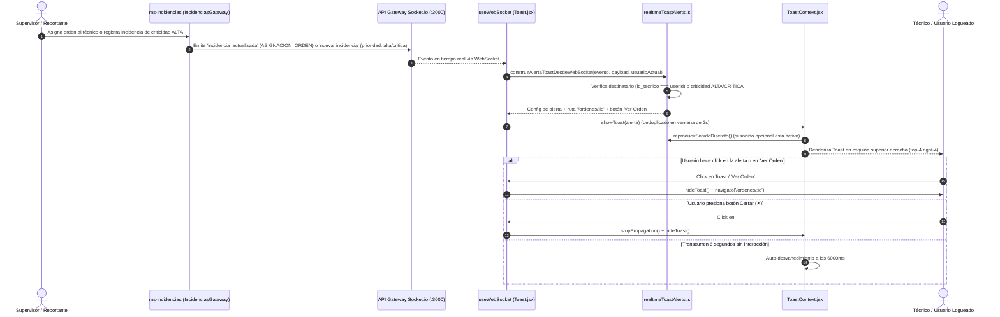

# Documentación Técnica — TAL-189: Sistema de Notificaciones Toast Flotantes en Tiempo Real

- **Identificador de Tarea:** `TAL-189`
- **Sprint / Período:** Sprint 3 — Semana 2
- **Módulos Involucrados:** `frontend-web` (integrado con `useWebSocket` de `TAL-186` y `ms-incidencias` de `TAL-185`)
- **Estado:** ✅ Completado y Verificado (100% Criterios de Aceptación)

---

## 1. Diagnóstico y Especificación del Requerimiento

> **Objetivo:** Disparar avisos emergentes visibles en pantalla cuando sucedan eventos de alta prioridad dirigidos al usuario actual.
>
> **Descripción:** Integrar el canal de eventos WebSocket con el componente Toast existente. Si se recibe una alerta de criticidad ALTA o se asigna una orden al técnico logueado, aparece un Toast interactivo con botón `'Ver Orden'` que redirige directamente al ticket.

### Problemática Previa
El componente `Toast.jsx` y su proveedor `ToastContext.jsx` únicamente soportaban mensajes estáticos locales (con una duración fija de 3 segundos en la esquina inferior derecha), carecían de conexión con el canal WebSocket en tiempo real, no permitían cierre manual, no ofrecían sonido discreto opcional ni contaban con interactividad para navegar hacia la orden de trabajo o ticket cuando ocurría una alerta de criticidad alta o una asignación al técnico en sesión.

---

## 2. Criterios de Aceptación y Verificación Técnica

| Criterio de Aceptación (`TAL-189`) | Estado | Verificación Técnica |
| :--- | :---: | :--- |
| **1. Las alertas emergentes aparecen en la esquina superior derecha con sonido discreto opcional.** | ✅ Cumple | `Toast.jsx` se posiciona en la esquina superior derecha (`fixed top-4 right-4 z-50`). La utilidad `reproducirSonidoDiscreto()` en `realtimeToastAlerts.js` sintetiza un pulso armónico suave mediante **Web Audio API** (`AudioContext`), controlado por la preferencia persistente en `localStorage` (`inframanager:toast_sound_enabled`) y por el botón de silenciamiento `#toast-sound-toggle` integrado en la alerta. |
| **2. Al hacer click en la alerta, navega a la orden de trabajo correspondiente.** | ✅ Cumple | Tanto el contenedor interactivo del Toast (`onClick`) como el botón explícito **`Ver Orden`** (`data-cy="toast-ver-orden"`) invocan `navigate(actionUrl)` hacia `/ordenes/:idOrden` (resuelto por `resolverRutaOrdenTrabajo`), cerrando la alerta y cargando directamente la orden de trabajo / ticket en `DetalleOrden.jsx`. |
| **3. Soporta cierre manual y auto-desvanecimiento tras 6 segundos.** | ✅ Cumple | Se configuró `TOAST_AUTO_DISMISS_MS = 6000` (6 segundos) en `ToastContext.jsx` con limpieza estricta de temporizadores (`clearTimeout(timerRef.current)`). Se incorporó el botón de cierre manual (`#toast-close-btn` / `data-cy="toast-close-btn"`) que detiene la propagación del click (`e.stopPropagation()`) y ejecuta `hideToast()` inmediatamente. |

---

## 3. Arquitectura y Flujo en Tiempo Real

---

## 4. Preservación de Lenguajes y Estándares

- Todos los archivos creados y modificados en `frontend-web` mantienen su lenguaje original (**JavaScript / JSX**); no se modificó el lenguaje de ningún archivo existente.
- Se preservó al 100% la retrocompatibilidad con las llamadas existentes a `showToast(mensaje, tipo)` y los selectores E2E (`#toast-notification`, `data-cy="toast-notification"`, `data-toast-type`).

---

## 5. Matriz de Archivos Creados y Modificados

| Archivo | Acción | Descripción |
| :--- | :---: | :--- |
| `frontend-web/src/utils/realtimeToastAlerts.js` | Creado | Lógica pura de filtrado de eventos WebSocket (criticidad ALTA y orden asignada al técnico logueado), resolución de ruta `/ordenes/:id`, preferencia de audio y síntesis de sonido discreto con Web Audio API. |
| `frontend-web/src/context/ToastContext.jsx` | Modificado | Soporte para alertas interactivas con título, `actionLabel` (`Ver Orden`), `actionUrl`, sonido opcional, cierre manual (`hideToast`) y auto-desvanecimiento tras `6000ms` (6 segundos). |
| `frontend-web/src/components/Toast.jsx` | Modificado | Suscripción al canal `useWebSocket`, posicionamiento en esquina superior derecha (`fixed top-4 right-4 z-50`), botón `'Ver Orden'`, navegación al hacer click en la alerta, toggle de sonido y botón de cierre manual. |
| `frontend-web/src/views/DetalleOrden.jsx` | Modificado | Respaldo para resolver la orden/ticket tanto por `id_orden` como por `id_incidencia` al navegar desde alertas en tiempo real. |
| `frontend-web/src/components/Toast.test.mjs` | Creado | Suite de 5 pruebas unitarias automatizadas con `node:test` validando la descripción y los 3 criterios de aceptación. |
| `frontend-web/cypress/e2e/tal-189-toast-tiempo-real.cy.js` | Creado | Suite de pruebas E2E en Cypress verificando posición superior derecha, sonido opcional, navegación a la orden, cierre manual y auto-desvanecimiento tras 6 segundos. |
| `frontend-web/package.json` | Modificado | Inclusión de `src/components/Toast.test.mjs` en el script `test:unit`. |
| `docs/Sprint-3/semana-2/TAL-189-sistema-notificaciones-toast-tiempo-real.md` | Creado | Documentación técnica de la tarea. |

---

## 6. Evidencia de Pruebas y Calidad

- **Pruebas Unitarias (`frontend-web`):** `39/39` pruebas aprobadas en `7/7` suites (`0` fallos), incluyendo las 5 nuevas pruebas de `src/components/Toast.test.mjs`.
- **Análisis Estático (`oxlint`):** `0` errores.
- **Build de Producción (`vite build`):** Compilación limpia sin errores.
