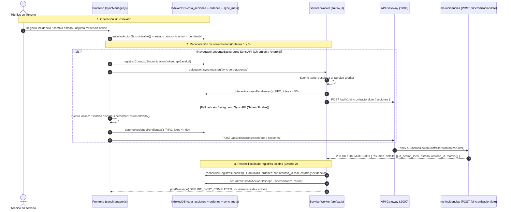

# Documentación Técnica — TAL-196: Cola de Sincronización en Segundo Plano (Background Sync)

- **Identificador de Tarea:** `TAL-196`
- **Sprint / Período:** Sprint 3 — Semana 3
- **Módulos Involucrados:** `frontend-web` (integrado con `IndexedDB` de `TAL-195`, `PWA Service Worker` de `TAL-170` y el endpoint `POST /api/v1/sincronizacion/lote` de `TAL-192`)
- **Estado:** ✅ Completado y Verificado (100% Criterios de Aceptación)

---

## 1. Diagnóstico y Especificación del Requerimiento

> **Objetivo:** Disparar la sincronización diferida automáticamente en segundo plano en cuanto el navegador detecte que el dispositivo recuperó conectividad.
>
> **Descripción:** Implementar el evento `sync` en el Service Worker (`sw.js`). Al volver la conexión, el Service Worker despierta, lee la cola de acciones pendientes guardadas en IndexedDB (`TAL-195: Implementación de IndexedDB en Frontend para Catálogo Offline`) e invoca el endpoint de sincronización masiva (`TAL-192: Endpoint de Sincronización Masiva en Lote para Datos Offline`).

### Problemática Previa
Con `TAL-170` se configuró `vite-plugin-pwa` en modo `generateSW` (solo precaché automático), con `TAL-195` se creó la tienda `cola_acciones` en IndexedDB (`inframanager_offline_db`) y con `TAL-192` se habilitó el endpoint `POST /api/v1/sincronizacion/lote` en `ms-incidencias` (expuesto por el API Gateway). Sin embargo, faltaba el motor de sincronización en segundo plano que escuchara el evento `sync` en el Service Worker (`sw.js`), despachara automáticamente las acciones pendientes en lotes de hasta 50 elementos al recuperar conectividad, reconciliara el estado de los registros locales tras la confirmación del servidor y ofreciera un mecanismo de fallback para navegadores sin soporte de `Background Sync API` (como Safari o Firefox).

---

## 2. Criterios de Aceptación y Verificación Técnica

| Criterio de Aceptación (`TAL-196`) | Estado | Verificación Técnica |
| :--- | :---: | :--- |
| **1. Sincronización automática sin intervención manual del usuario.** | ✅ Cumple | En `src/sw.js` se implementó `self.addEventListener('sync', ...)` para el tag `sync-cola-acciones`, que invoca `sincronizarColaEnServiceWorker()`. En `src/main.jsx` se inicializa `iniciarSincronizacionAutomatica()`, que escucha automáticamente los eventos `online` y `offline-queue-updated`, registrando el tag en `registration.sync.register('sync-cola-acciones')` o ejecutando la sincronización inmediata sin requerir acción manual del técnico. |
| **2. Actualización del estado de los registros locales tras confirmación exitosa del servidor.** | ✅ Cumple | Al recibir la respuesta `200` o `207` de `POST /api/v1/sincronizacion/lote`, `confirmarAccionSincronizada` y `reconciliarRegistrosLocales` en `backgroundSync.js` actualizan cada registro confirmado (`estado === 'OK'`): 1. En `cola_acciones`: su `estado_sincronizacion` pasa a `'sincronizado'`, almacenando `recurso_id` y `sincronizado_en`. 2. En `ordenes`: reemplaza el identificador temporal por el `recurso_id` definitivo en `crear_incidencia` (reescribiendo además referencias en acciones dependientes como `subir_evidencia`), actualiza el estado local en `actualizar_estado`, anexa la evidencia en `subir_evidencia` y marca `estado_sincronizacion: 'sincronizado'` y `pendiente_sync: false`. 3. Si un ítem devuelve `estado === 'ERROR'`, se marca con `estado_sincronizacion: 'error'` y `ultimo_error: resultado.motivo`. |
| **3. Manejo de fallback si el navegador no soporta Background Sync API.** | ✅ Cumple | `soportaBackgroundSync()` verifica la presencia de `'serviceWorker' in navigator && 'SyncManager' in window`. Si el navegador no soporta `SyncManager` (o si `registration.sync.register` falla), `solicitarSincronizacion()` e `iniciarSincronizacionAutomatica()` ejecutan automáticamente `sincronizarEnPrimerPlano()` al detectar el evento `online`, al encolar nuevas acciones con red disponible y mediante un sondeo periódico de respaldo (`INTERVALO_FALLBACK_MS = 30000`), coordinado con **Web Locks API** (`ejecutarConBloqueo`) para impedir ejecuciones duplicadas. |

---

## 3. Arquitectura y Flujo de Sincronización

---

## 4. Preservación de Lenguajes y Estándares

- Todos los archivos creados y modificados en `frontend-web` mantienen estrictamente su lenguaje original (**JavaScript / JSX**).
- Se migró la configuración de `VitePWA` en `vite.config.js` a la estrategia `injectManifest` apuntando a `src/sw.js`, conservando intacto el precaché de activos (`self.__WB_MANIFEST`), el `manifest.json` y todos los criterios de `TAL-170`.

---

## 5. Matriz de Archivos Creados y Modificados

| Archivo | Acción | Descripción |
| :--- | :---: | :--- |
| `frontend-web/src/sw.js` | Creado | Service Worker con precaché (`self.__WB_MANIFEST`), navegación SPA offline y listener `self.addEventListener('sync', ...)` para procesar la cola de IndexedDB en segundo plano. |
| `frontend-web/src/services/sync/backgroundSync.js` | Creado | Motor de procesamiento por lotes (`<= 50` acciones), resolución en dos fases para dependencias (`crear_incidencia` antes de `subir_evidencia`/`actualizar_estado`), reconciliación de registros locales en `ordenes` y `cola_acciones`, y bloqueo de concurrencia con Web Locks API. |
| `frontend-web/src/services/sync/syncManager.js` | Creado | Orquestador del lado de la aplicación: detección de `SyncManager`, registro automático del tag `sync-cola-acciones`, sincronización de credenciales a `sync_meta` y fallback automático en primer plano (`online`, `offline-queue-updated` e intervalo periódico). |
| `frontend-web/src/services/storage/offlineDb.js` | Modificado | Actualización a versión `2` añadiendo la tienda `sync_meta` (limpiada atómicamente en `limpiarDatosOffline` al cerrar sesión), enriquecimiento de `actualizarEstadoAccionOffline` con `recurso_id` y `sincronizado_en`, y utilidades `eliminarOrdenOffline` y `actualizarPayloadAccionOffline`. |
| `frontend-web/src/services/authService.js` | Modificado | Protección de entorno (`typeof window !== 'undefined'`) en `notifySessionChange` para ejecución segura en entornos sin DOM (Service Worker / Node test runner). |
| `frontend-web/vite.config.js` | Modificado | Configuración de `VitePWA` con `strategies: 'injectManifest'`, `srcDir: 'src'` y `filename: 'sw.js'`. |
| `frontend-web/src/main.jsx` | Modificado | Arranque automático de `iniciarSincronizacionAutomatica()` junto al registro del Service Worker. |
| `frontend-web/src/services/sync/backgroundSync.test.mjs` | Creado | Suite de 9 pruebas unitarias automatizadas con `node:test` que verifican los 3 criterios de aceptación, lotes de 50 ítems, resolución de dependencias, resiliencia ante errores `5xx`/`401` y fallback sin `SyncManager`. |
| `frontend-web/cypress/e2e/tal-196-background-sync.cy.js` | Creado | Spec E2E de Cypress para la sincronización diferida y fallback en primer plano. |
| `frontend-web/package.json` | Modificado | Inclusión de `src/services/sync/backgroundSync.test.mjs` en el script `test:unit`. |
| `docs/Sprint-3/semana-3/TAL-196-cola-sincronizacion-segundo-plano-background-sync.md` | Creado | Documentación técnica de la tarea. |

---

## 6. Evidencia de Verificación

- **Pruebas Unitarias (`npm run test:unit`):** `61/61` pruebas aprobadas en `9/9` suites (`0` fallos).
- **Linter (`npm run lint`):** `0` errores y `0` advertencias en los archivos de la tarea.
- **Compilación Producción (`npm run build`):** Exitosa, generando `dist/sw.js` con `injectManifest` (`40 entries` precacheadas).
