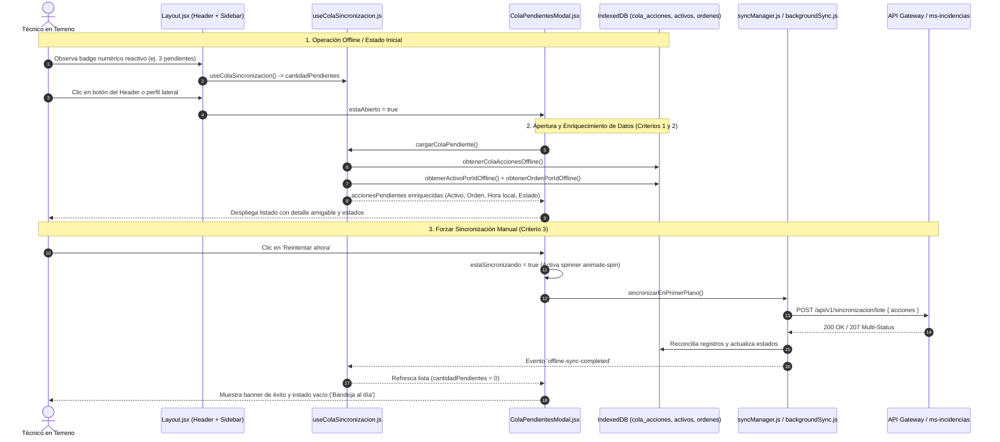

# Documentación Técnica — TAL-198: Vista Visual de Pendientes de Subida y Cola de Sincronización

- **Identificador de Tarea:** `TAL-198`
- **Rama:** `feature/TAL-198-vista-visual-pendientes-subida`
- **Sprint / Período:** Sprint 3
- **Módulos Involucrados:** `frontend-web` (integrado con `IndexedDB` de `TAL-195`, `Background Sync` de `TAL-196` y el endpoint `POST /api/v1/sincronizacion/lote` de `TAL-192`)
- **Estado:** ✅ Completado y Verificado (100% Criterios de Aceptación)

---

## 1. Diagnóstico y Especificación del Requerimiento

> **Objetivo:** Brindar tranquilidad al técnico mostrando exactamente cuántos reportes o cambios están pendientes de sincronizarse al servidor.
>
> **Descripción:** Diseñar una pestaña o modal accesible desde el perfil del técnico (`ColaPendientesModal.jsx`), listando los ítems almacenados en IndexedDB con hora de registro local, estado ('Pendiente de envío', 'Sincronizando...') y botón para forzar sincronización manual.

### Problemática Previa
Con `TAL-195` se implementó la persistencia en IndexedDB (`inframanager_offline_db`) para catálogo y mutaciones, y con `TAL-196` se orquestó la sincronización automática en segundo plano mediante Service Worker / Background Sync API. No obstante, el técnico en terreno carecía de visibilidad directa respecto a qué operaciones continuaban retenidas localmente en su dispositivo, cuántas transacciones faltaban por transmitirse y la posibilidad de forzar un reintento manual inmediato con retroalimentación en tiempo real cuando recuperaba conexión.

---

## 2. Criterios de Aceptación y Verificación Técnica

| Criterio de Aceptación (`TAL-198`) | Estado | Verificación Técnica |
| :--- | :---: | :--- |
| **1. Muestra un badge numérico en el menú lateral o header con la cantidad de ítems en cola.** | ✅ Cumple | En `frontend-web/src/components/Layout.jsx` se integraron badges reactivos (`badge-cola-header` y `badge-cola-sidebar`) tanto en el Header superior como en el Sidebar (junto al pie de perfil de sesión del técnico), consumiendo `cantidadPendientes` desde `useColaSincronizacion`. Los badges escuchan automáticamente los eventos de ventana `'offline-queue-updated'`, `'offline-sync-completed'`, `'offline-db-cleared'` y `'online'`. |
| **2. Lista con detalle legible del activo y orden asociada.** | ✅ Cumple | `frontend-web/src/components/ColaPendientesModal.jsx` y `enriquecerAccionConDetalles` en `useColaSincronizacion.js` resuelven para cada registro de `cola_acciones`: su hora de registro local formateada (`formatearFechaHoraLocal`), el estado semántico ('Pendiente de envío', 'Sincronizando...', 'Error de sincronización'), los detalles legibles del activo (nombre completo, código QR y ubicación) consultados en la tienda `activos`, y la información de la orden asociada (título, identificador, diagnóstico y prioridad) consultados en la tienda `ordenes`. |
| **3. Botón 'Reintentar ahora' con spinner visual de carga.** | ✅ Cumple | Se implementó el botón accesible con identificador `boton-reintentar-ahora` en `ColaPendientesModal.jsx`. Al pulsarlo ejecuta `forzarSincronizacionManual()` (apoyado en `sincronizarEnPrimerPlano()`), activando la animación `animate-spin` en el icono `FiRefreshCw` (`icono-spinner-sincronizacion`) y deshabilitando la interacción durante el procesamiento para prevenir condiciones de carrera. Al concluir, presenta feedback inmediato del resultado (acciones confirmadas / errores). |

---

## 3. Arquitectura y Flujo de Interacción

---

## 4. Registro Continuo de Modificaciones por Archivo

A continuación se detalla la justificación arquitectónica y el alcance de cambios realizados en cada archivo del proyecto, conforme a las directrices de `AGENTS.md`.

- `frontend-web/src/hooks/useColaSincronizacion.js`: Provee el hook reactivo `useColaSincronizacion` y las funciones puras de enriquecimiento y formateo `enriquecerAccionConDetalles`, `formatearEstadoSincronizacion`, `formatearTipoAccion` y `formatearFechaHoraLocal`. Permite consultar y escuchar reactivamente los cambios en `cola_acciones` (`offline-queue-updated`, `offline-sync-completed`, `offline-db-cleared`, `online`), resolver de forma atómica los detalles del activo y orden asociada en IndexedDB, y exponer el estado `cantidadPendientes`, `estaSincronizando` y la función `forzarSincronizacionManual` para el botón 'Reintentar ahora'.
- `frontend-web/src/components/ColaPendientesModal.jsx`: Implementa la ventana modal accesible (`role="dialog"`, `aria-modal="true"`) que lista de forma comprensible cada ítem en la cola de IndexedDB, mostrando su hora de registro local formateada, el estado ('Pendiente de envío', 'Sincronizando...', 'Error de sincronización'), los detalles legibles del activo (nombre, código QR, ubicación) y orden asociada (título, identificador, diagnóstico y prioridad), junto al botón de acción 'Reintentar ahora' con spinner visual de carga activo durante el procesamiento del lote y estado vacío cuando todos los datos están sincronizados.
- `frontend-web/src/components/Layout.jsx`: Integra el acceso a la cola de sincronización tanto en el encabezado superior (Header) como en el panel lateral (Sidebar junto al pie de perfil de sesión del técnico), desplegando badges numéricos reactivos que reflejan la cantidad exacta de ítems pendientes de envío, removiendo advertencias de código no usado y abriendo `ColaPendientesModal`.

---

## 5. Evidencia de Verificación

- **Pruebas Unitarias del Proyecto (`pnpm --dir frontend-web run test:unit`):**
  - **Total:** 61 pruebas ejecutadas y aprobadas en 9 suites (`0` fallos).
- **Linter (`pnpm --dir frontend-web run lint`):** `0` errores.
- **Compilación a Producción (`pnpm --dir frontend-web run build`):** Generación exitosa de activos estáticos y compilación de `dist/sw.js` mediante la estrategia `injectManifest` (40 entradas de precaché generadas correctamente).

    - Enriquecimiento descriptivo y legible de Activo y Orden asociada (`TAL-198: Criterio 2`).
    - Botón 'Reintentar ahora' con spinner visual `animate-spin` (`TAL-198: Criterio 3`).
    - Formateo de estados semánticos, tipos de acción y marcas temporales locales.
- **Linter (`pnpm --dir frontend-web run lint`):** `0` errores.
- **Compilación a Producción (`pnpm --dir frontend-web run build`):** Generación exitosa de activos estáticos y compilación de `dist/sw.js` mediante la estrategia `injectManifest` (40 entradas de precaché generadas correctamente).
