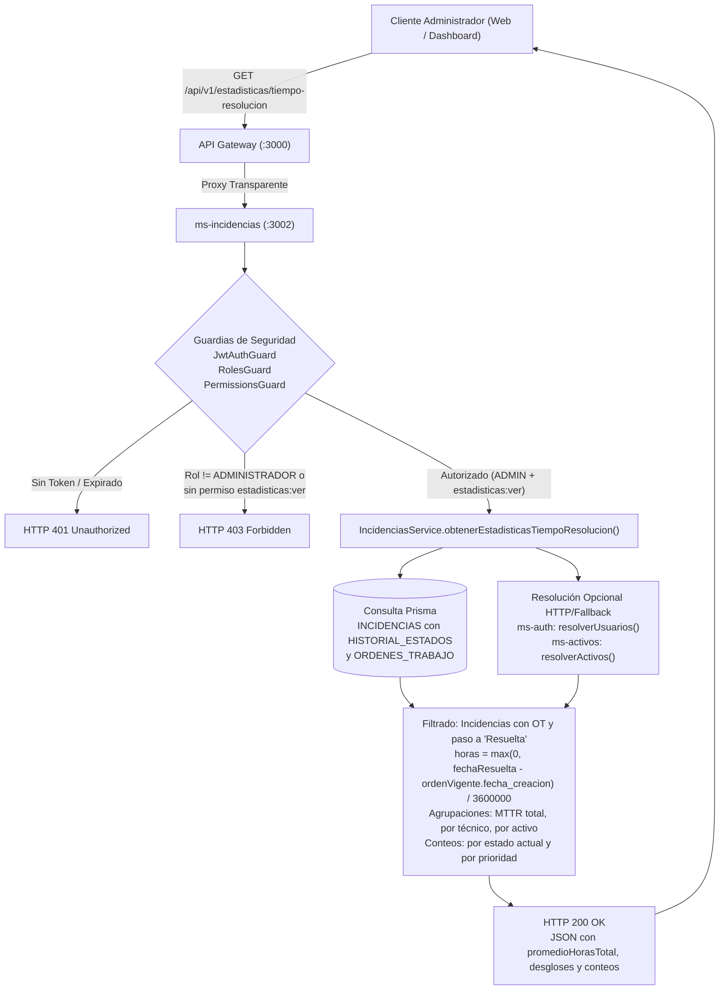

# TAL-128: Endpoint de Métricas: Tiempo de Resolución Promedio (MTTR) e Indicadores de Incidencias

## 1. Diagnóstico y Contexto del Requerimiento

El Mean Time to Resolution (**MTTR** o Tiempo Medio de Resolución) es uno de los indicadores clave de rendimiento (KPI) más críticos para la gestión del mantenimiento de infraestructura y equipamiento en el Sistema Centralizado de Gestión de Infraestructura (SCGI). Permite medir la eficiencia operacional de los equipos de soporte y técnicos asignados ante fallas operacionales.

El requerimiento **TAL-128** define la implementación de un endpoint de observabilidad y analítica de alto nivel en `ms-incidencias`, expuesto perimetralmente a través del **API Gateway**, que consolide:
1. **MTTR Global (`promedioHorasTotal`)**: Promedio de tiempo (en horas) transcurrido entre la creación de la orden de trabajo vigente y la resolución efectiva de la incidencia.
2. **Total de Órdenes Resueltas (`totalOrdenesCerradas`)**: Cantidad de incidencias resueltas computadas.
3. **Desglose por Técnico Asignado (`desglosePorTecnico`)**: Eficiencia, cantidad y horas promedio por técnico de soporte.
4. **Desglose por Activo (`desglosePorActivo`)**: Horas promedio de resolución y total de incidencias resueltas por equipo o activo físico.
5. **Conteo Global por Estado Actual (`conteoPorEstado`)**: Distribución del parque total de incidencias según su estado vigente en el historial.
6. **Conteo Global por Prioridad (`conteoPorPrioridad`)**: Distribución del universo total de incidencias por nivel de criticidad/prioridad (`baja`, `media`, `alta`, `critica`).

---

## 2. Decisión Arquitectónica Acordada con el Scrum Master

### Restricción del Modelo Entidad-Relación (MER Oficial)
> [!IMPORTANT]
> **El MER oficial no se modifica ni se agregan columnas ni migraciones a la base de datos.**
> Ni la tabla `INCIDENCIAS` ni `ORDENES_TRABAJO` requieren nuevos campos de timestamp para este cálculo.

### Regla de Negocio Acordada (Scrum Master)
Para determinar la fecha y hora de cierre al calcular el MTTR de una incidencia:
1. **Fecha de Inicio del Trabajo**: Se toma la `fecha_creacion` del registro en `ORDENES_TRABAJO` vigente (el más reciente de esa incidencia ordenado por `fecha_creacion DESC, id_orden DESC`).
2. **Fecha de Resolución**: Se toma la `fecha_creacion` del registro más reciente en la tabla `HISTORIAL_ESTADOS` donde la incidencia haya transitado a un estado cuyo `nombre_estado` sea `"Resuelta"` (comparación *case-insensitive*).
3. **Cálculo de Duración en Horas**:
   $$\text{horas} = \max\left(0, \frac{\text{fechaResuelta} - \text{fechaOrden}}{3\,600\,000}\right)$$
   Redondeado a 2 decimales para precisión de reporte.
4. **Manejo de Casos Borde**:
   - Si no existen órdenes resueltas (`totalOrdenesCerradas === 0`), `promedioHorasTotal` retorna estrictamente `0` (nunca `NaN` ni `Infinity`).
   - Las incidencias que aún no han alcanzado el estado `"Resuelta"` o que carecen de órdenes de trabajo asociadas no se incluyen en el cálculo del MTTR, pero sí participan en los mapas globales de `conteoPorEstado` y `conteoPorPrioridad`.

---

## 3. Resumen Detallado de Cambios, Añadidos y Justificación

| Componente / Archivo | Tipo | ¿Qué se añadió o cambió? | ¿Por qué se hizo? (Justificación Técnica) |
|---|---|---|---|
| `api gateway/index.js` | **Modificado** | Proxy transparente para `/api/v1/estadisticas` apuntando a `MS_INCIDENCIAS_URL` con `rewritePrefix: '/api/v1/estadisticas'`, preservando el proxy `/api/v1/incidencias`. | **Enrutamiento Perimetral**: Permite exponer tanto la ruta semántica directa `GET /api/v1/estadisticas/tiempo-resolucion` como la canónica `GET /api/v1/incidencias/estadisticas/tiempo-resolucion`. |
| `api gateway/index.test.js` | **Modificado** | Prueba unitaria y de integración para validar la resolución transparente de `/api/v1/estadisticas/tiempo-resolucion` y `/api/v1/incidencias/estadisticas/tiempo-resolucion`. | **Aseguramiento de Calidad**: Garantiza que el Gateway no aplique reescrituras erróneas ni colisione con otras rutas existentes. |
| `ms-incidencias/src/incidencias/incidencias.service.ts` | **Modificado** | Implementación del método `obtenerEstadisticasTiempoResolucion(authHeader?: string)` con cálculo de MTTR según regla del Scrum Master, resolución remota desacoplada de técnicos (`resolverUsuarios`) y activos (`resolverActivos`), y agregaciones por estado y prioridad. | **Lógica de Negocio Centralizada**: Ejecuta el cálculo analítico sin mutaciones de base de datos y con tolerancia a fallas si microservicios satélites no responden. |
| `ms-incidencias/src/incidencias/incidencias.controller.ts` | **Modificado** | 1. Inclusión de `GET estadisticas/tiempo-resolucion` en `IncidenciasController`.<br/>2. Nuevo controlador exportado `EstadisticasController` con `@Controller('estadisticas')` y `GET tiempo-resolucion`. | **Doble Exposición Retrocompatible**: Respeta el prefijo global `api/v1` configurado en `configureHttp(app)` soportando ambas URL sin romper contratos previos. |
| `ms-incidencias/src/incidencias/incidencias.module.ts` | **Modificado** | Registro de `EstadisticasController` en el arreglo `controllers` del módulo. | **Inyección de Dependencias NestJS**: Permite que el framework compile y registre las rutas HTTP asociadas al controlador de estadísticas. |
| `openapi.yaml` | **Modificado** | Incorporación aditiva de `GET /estadisticas/tiempo-resolucion` y `GET /incidencias/estadisticas/tiempo-resolucion`, junto al esquema `EstadisticasTiempoResolucion` y respuestas estándar (200, 401, 403, 500). Actualización de versión a `1.5.0`. | **Gobernanza del Contrato API**: Documenta formalmente el contrato acordado entre TI2 y TI4 para paneles analíticos de administración. |
| `docs/TAL-128-metricas-mttr-indicadores-incidencias.md` | **Nuevo Archivo** | Documento técnico de diseño, decisiones arquitectónicas, especificación de contratos y evidencia de pruebas. | **Trazabilidad y Entrega Scrum**: Documentación del entregable conforme a las directrices del equipo. |

---

## 4. Arquitectura y Flujo de Procesamiento



---

## 5. Seguridad y Control de Acceso (RBAC)

El endpoint contiene un estricto triple nivel de validación decorativa y ejecución de guardianes:

```typescript
@Controller('estadisticas')
@UseGuards(JwtAuthGuard, RolesGuard, PermissionsGuard)
export class EstadisticasController {
  @Get('tiempo-resolucion')
  @Roles('ADMINISTRADOR')
  @RequirePermissions('estadisticas:ver')
  obtenerEstadisticasTiempoResolucion(@Headers('authorization') authHeader?: string) { ... }
}
```

- **Autenticación (`JwtAuthGuard`)**: Valida la existencia, firma y vigencia del JWT en la cabecera `Authorization: Bearer <token>`. Si falta o expiró, arroja `401 Unauthorized`.
- **Rol (`RolesGuard`)**: Verifica que `req.user.rol` o `req.user.role` sea `'ADMINISTRADOR'` o `'ADMIN'`. De lo contrario, arroja `403 Forbidden`.
- **Permiso Granular (`PermissionsGuard`)**: Verifica que el arreglo de claims `permissions` contenga explícitamente `'estadisticas:ver'`. De lo contrario, arroja `403 Forbidden`.

---

## 6. Especificación de Endpoints y Esquema de Respuesta

### Rutas Disponibles
- `GET /api/v1/estadisticas/tiempo-resolucion`
- `GET /api/v1/incidencias/estadisticas/tiempo-resolucion`

### Cabeceras Requeridas
```http
Authorization: Bearer <token_jwt_administrador>
```

### Respuestas HTTP

#### HTTP 200 OK (Respuesta Exitosa)
```json
{
  "promedioHorasTotal": 14.25,
  "totalOrdenesCerradas": 4,
  "desglosePorTecnico": [
    {
      "id_tecnico": "3fa85f64-5717-4562-b3fc-2c963f66afa6",
      "nombre_tecnico": "Carlos Santana",
      "totalOrdenesCerradas": 3,
      "promedioHoras": 12.33
    },
    {
      "id_tecnico": "8bb31e42-7890-41ab-88fe-1a2b3c4d5e6f",
      "nombre_tecnico": "María Gonzalez",
      "totalOrdenesCerradas": 1,
      "promedioHoras": 20.0
    }
  ],
  "desglosePorActivo": [
    {
      "id_activo": "7cb43b02-1279-4d89-a292-6f29dfd824d5",
      "nombre_activo": "Bomba Hidráulica B1",
      "totalOrdenesCerradas": 2,
      "promedioHoras": 10.5
    },
    {
      "id_activo": "9ff55e11-3322-4a1b-90bc-001122334455",
      "nombre_activo": "Generador Eléctrico Principal",
      "totalOrdenesCerradas": 2,
      "promedioHoras": 18.0
    }
  ],
  "conteoPorEstado": {
    "Reportada": 6,
    "Asignada": 3,
    "En Progreso": 2,
    "Resuelta": 4,
    "Cerrada": 1
  },
  "conteoPorPrioridad": {
    "baja": 4,
    "media": 7,
    "alta": 3,
    "critica": 2
  }
}
```

#### HTTP 401 Unauthorized
```json
{
  "statusCode": 401,
  "message": "Token de acceso requerido",
  "error": "Unauthorized"
}
```

#### HTTP 403 Forbidden (Rol o Permiso Insuficiente)
```json
{
  "statusCode": 403,
  "message": "Acceso denegado: permiso insuficiente para ejecutar esta accion",
  "error": "Forbidden"
}
```

---

## 7. Evidencia de Pruebas Unitarias y Verificación

Las pruebas abarcan:
1. **Cálculo de MTTR con paso a `"Resuelta"` en `HISTORIAL_ESTADOS`**: Verifica la correcta diferencia de horas con respecto a la orden vigente y el redondeo a 2 decimales.
2. **Caso Borde (Sin órdenes cerradas)**: Valida que ante incidencias sin resolver retorne `promedioHorasTotal: 0` y `totalOrdenesCerradas: 0` sin arrojar `NaN` o `Infinity`.
3. **Desgloses por Técnico y por Activo**: Agrupación correcta de totales y promedios, resolución de nombres y fallback a `null`.
4. **Conteos por Estado y Prioridad**: Distribución íntegra sobre todo el universo de incidencias según su estado actual más reciente.
5. **Seguridad RBAC (403 Forbidden)**: Rechazo efectivo para roles técnicos, supervisores o reportantes, y usuarios administradores sin el permiso `'estadisticas:ver'`.
6. **Compilación y Build**: Ejecución exitosa de `pnpm --dir ms-incidencias run build` y suite completa de tests unitarios.
