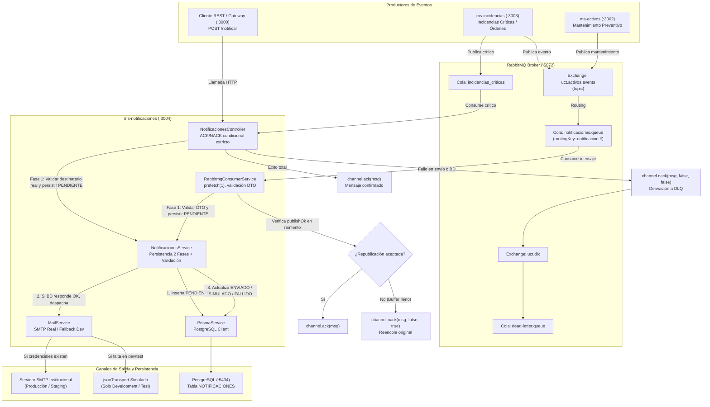

# TAL-177: Implementación Completa de Notificaciones por Correo y Consumidor en MS-Notificaciones

## 1. Diagnóstico y Contexto del Requerimiento

En la arquitectura orientada a microservicios de la plataforma **InfraManager**, la comunicación reactiva y oportuna hacia los usuarios finales, personal de soporte y técnicos de mantenimiento es esencial para la gestión eficiente de la infraestructura y el equipamiento institucional. Cuando ocurren incidentes de severidad crítica, se asignan órdenes de trabajo técnico, se concluye la resolución de tickets o se aproximan fechas de mantenimiento preventivo, el sistema debe garantizar el despacho de correos electrónicos institucionales estructurados y mantener una estricta trazabilidad de auditoría.

El microservicio `ms-notificaciones` (puerto 3004) presentaba bloqueos en su compilación TypeScript derivados de la coexistencia de artefactos transpilados, carecía de persistencia relacional para auditoría de envíos, y requería completar la integración con Nodemailer con fallback seguro para desarrollo local y conectar el consumo de eventos asíncronos desde `ms-incidencias` y `ms-activos` a través de RabbitMQ (`notificaciones.queue` e `incidencias_criticas`).

Asimismo, para garantizar robustez de nivel de producción según las observaciones de revisión arquitectónica, se implementaron garantías críticas de fiabilidad:
1. **Control Estricto de ACK/NACK en Listeners RabbitMQ**: Los mensajes se confirman (`ack`) **únicamente** cuando el procesamiento y la persistencia son 100% exitosos; en caso de fallo se rechazan (`nack` con o sin requeue) para habilitar reintentos y enrutamiento hacia la Dead Letter Queue (DLQ).
2. **Discriminación Rigurosa de Eventos de Actualización**: Los eventos `incidencia_actualizada` diferencian estrictamente entre asignación de orden (`id_orden` + `id_tecnico`), estados resolutivos (`RESUELTA`, `CERRADA`, `FINALIZADA`) y estados intermedios ordinarios (`EN_PROCESO`, `REPORTADA`), impidiendo el despacho engañoso de correos de resolución ante cambios no resolutivos.
3. **Erradicación Total de Direcciones Ficticias**: Se valida la existencia y sintaxis de destinatarios reales (`destinatario.direccion`, `emailTecnico`, `emailReportante`, o listas institucionales de entorno como `MAIL_ALERTAS_CRITICAS`); ante ausencia de destinatario real, el envío se cancela y se registra el fallo explícito en auditoría, sin inventar correos ficticios.
4. **Persistencia Transaccional en Dos Fases**: Se registra inicialmente el evento en estado `PENDIENTE`. Si la base de datos no está disponible, el envío se aborta para impedir despachos "fantasma" sin trazabilidad. Tras el envío, se actualiza a `ENVIADO`, `SIMULADO` o `FALLIDO`.
5. **Aislamiento de Entorno para Fallback SMTP**: El transporte simulado (`jsonTransport`) está estrictamente acotado a entornos `development` y `test`. En `production`, la falta de credenciales SMTP deniega el envío y se prohíbe el fallback silencioso. Además, los correos simulados en desarrollo se persisten como `SIMULADO`, nunca como `ENVIADO`.
6. **Republicación Segura con Verificación de Buffer en Reintentos**: En `RabbitmqConsumerService`, el mensaje original solo se confirma (`ack`) tras verificar que el canal aceptó positivamente la republicación; si el buffer se satura o se pierde conexión, se reencola (`nack` con requeue) para evitar pérdida de datos.

### Criterios de Aceptación (TAL-177)
1. **Compilación y Arranque en Puerto 3004**: El microservicio compila limpiamente (`pnpm --dir ms-notificaciones run build`) y levanta en el puerto 3004 sin colapsar por dependencias externas.
2. **Despacho de Correos HTML Estructurados**: Envío de correos HTML institucionales con Nodemailer al asignarse una orden, reportarse una incidencia crítica, resolverse un ticket o activarse una alerta preventiva.
3. **Persistencia Garantizada y Tolerancia a Fallos**: Registro de la trazabilidad obligatoria en base de datos (`NOTIFICACIONES`), reintentos garantizados y derivación a cola de descarte (`dead-letter.queue` / DLQ vía DLX).
4. **Documentación Oficial**: Documentación exhaustiva de la tarea en la carpeta `docs/` con el estándar de arquitectura y pruebas del proyecto.

---

## 2. Resumen Detallado de Cambios, Añadidos y Justificación (El "Por Qué")

Cada componente y modificación realizada responde a un objetivo técnico y arquitectónico concreto:

| Componente / Archivo | Tipo | ¿Qué se añadió o cambió? | ¿Por qué se hizo? (Justificación Técnica) |
|---|---|---|---|
| `ms-notificaciones/prisma/schema.prisma` | **Modificado** | Adición del valor `SIMULADO` al enum `EstadoNotificacion` junto a `PENDIENTE`, `ENVIADO` y `FALLIDO`. Modelo `Notificacion` mapeado a `NOTIFICACIONES`. | **Precisión de Auditoría**: Evita registrar correos simulados en entornos de desarrollo como `ENVIADO`, reflejando fidedignamente si el correo salió por SMTP o fue emulado en memoria. |
| `ms-notificaciones/src/mail/mail.service.ts` | **Modificado** | Restricción del fallback a `NODE_ENV` (`development` / `test`). En `production`, deniega el fallback simulado y retorna fallo si faltan credenciales SMTP. Plantillas HTML institucionales responsivas para los 4 casos de negocio. | **Seguridad en Producción**: Impide que despliegues en producción o staging traguen silenciosamente correos sin advertir la falta de configuración SMTP institucional. |
| `ms-notificaciones/src/notificaciones/notificaciones.service.ts` | **Modificado** | 1. Persistencia estricta en dos fases (`PENDIENTE` antes del envío y actualización a `ENVIADO`/`SIMULADO`/`FALLIDO`).<br/>2. Validación y erradicación total de correos ficticios (rechazo explícito si falta destinatario real).<br/>3. Validación de estado resolutivo (`esEstadoResolutivo`) antes de despachar resoluciones. | **Integridad y Trazabilidad**: Garantiza que ningún correo se envíe sin auditoría previa en base de datos y que no se despachen falsos positivos a casillas inventadas. |
| `ms-notificaciones/src/notificaciones/notificaciones.controller.ts` | **Modificado** | 1. Control estricto de ACK: `channel.ack()` únicamente si el procesamiento y persistencia tuvieron éxito.<br/>2. NACK en caso de error para habilitar reintentos y enrutamiento hacia la DLQ.<br/>3. Método `esEstadoResolucion()` para filtrar actualizaciones no resolutivas en `incidencia_actualizada`. | **Fiabilidad de Mensajería**: Corrige la confirmación indiscriminada en bloques `finally`, garantizando que mensajes fallidos no se pierdan y se reintenten correctamente. |
| `ms-notificaciones/src/rabbitmq/rabbitmq-consumer.service.ts` | **Modificado** | Verificación de aceptación de buffer (`publishOk`) antes de confirmar el mensaje original en `handleFailure`. En caso de fallo de republicación, ejecuta NACK con requeue para proteger el mensaje. | **At-Least-Once Delivery**: Previene pérdida de mensajes si el broker de RabbitMQ o el buffer del socket se saturan durante el reintento. |
| `ms-notificaciones/src/prisma/prisma.service.ts` | **Nuevo Archivo** | Servicio `PrismaService` con gestión de ciclo de vida (`$connect`, `$disconnect`) y captura tolerante de excepciones. | **Resiliencia Operativa**: Permite operar de forma controlada y reportar errores de persistencia sin derribar el microservicio en el arranque. |
| `ms-notificaciones/src/prisma/prisma.module.ts` | **Nuevo Archivo** | Módulo global (`@Global()`) de NestJS para exportar `PrismaService`. | **Inyección Limpia**: Facilita el acceso a la base de datos PostgreSQL desde controladores y servicios. |
| `ms-notificaciones/src/mail/mail.module.ts` | **Nuevo Archivo** | Módulo global (`@Global()`) que provee `MailService`. | **Disponibilidad Global**: Desacopla la lógica de correo para uso en controladores REST y consumidores RabbitMQ. |
| `ms-notificaciones/package.json` | **Modificado** | Dependencias `@prisma/client`, `prisma`, `@types/nodemailer` y scripts `prisma:generate` / `prebuild`. | **Gestión de Paquetes**: Habilita la infraestructura de persistencia tipada en el monorepo bajo `pnpm`. |
| `ms-notificaciones/.env.example` | **Modificado** | Variables para `DATABASE_URL`, `SMTP_*`, `MAIL_FROM`, `MAIL_ALERTAS_CRITICAS`, `MAIL_ALERTAS_MANTENIMIENTO` y colas. | **Configurabilidad DevOps**: Documenta las variables requeridas para despliegues locales, Docker y producción. |
| `ms-notificaciones/src/mail/mail.service.spec.ts` | **Modificado** | Suite unitaria verificando bloqueo de fallback en producción, fallback en desarrollo y plantillas HTML. | **Aseguramiento de Calidad**: Cobertura >98% en transporte de correo. |
| `ms-notificaciones/src/notificaciones/notificaciones.service.spec.ts` | **Modificado** | Suite unitaria verificando persistencia en dos fases, rechazo de correos ficticios, estado `SIMULADO` y validación de resolución. | **Aseguramiento de Calidad**: Cobertura >90% en lógica de negocio. |
| `ms-notificaciones/src/notificaciones/notificaciones.controller.spec.ts` | **Modificado** | Suite unitaria verificando ACK condicional solo en éxito, NACK en fallo, y discriminación de estados resolutivos vs intermedios. | **Aseguramiento de Calidad**: 100% de cobertura en controladores. |
| `ms-notificaciones/src/rabbitmq/rabbitmq-consumer.service.spec.ts` | **Modificado** | Pruebas de verificación de aceptación de republicación (`publishOk === false` y excepciones de socket). | **Aseguramiento de Calidad**: Cobertura >81% en consumo de colas. |

---

## 3. Arquitectura y Flujo de Intercepción

El siguiente diagrama detalla el flujo de recepción, despacho, control de ACK/NACK y trazabilidad en dos fases implementado en `ms-notificaciones`:



---

## 4. Especificación de Endpoints y Contratos HTTP

### A. Despacho Directo de Notificación por Correo
- **Método**: `POST`
- **Ruta**: `/notificar`
- **Acceso**: Público / Microservicio

#### Payload de Ejemplo
```json
{
  "email": "tecnico.guardia@institucion.edu",
  "asunto": "Revisión programada de equipos en Pabellón B",
  "cuerpoMensaje": "Favor acudir al Pabellón B para realizar la revisión semestral de los proyectores multimedia."
}
```

#### Respuesta Exitosa (HTTP 200 OK)
```json
{
  "status": "enviada",
  "idNotificacion": "4f5e8b12-9c3a-4a2e-8d5f-1b3c5e7a9b0d",
  "fallback": false
}
```

---

### B. Notificación de Incidencia Crítica Reportada
- **Método**: `POST`
- **Rutas**: `/notificaciones/incidencias/critica` (REST) o EventPattern RabbitMQ `incidencia_critica`
- **Acceso**: `ms-incidencias` / Servicios internos
- **Comportamiento**: Requiere correo real en payload (`emailDestinatario` / `email` / `destinatario.direccion`) o configuración de entorno `MAIL_ALERTAS_CRITICAS`.

#### Payload de Ejemplo
```json
{
  "id_incidencia": "9c1a5b82-4f3e-4d1a-8e2b-7c3d1f5a9e01",
  "titulo": "Corte total de energía en Data Center",
  "descripcion": "Se activaron las alarmas UPS por sobretensión en el tablero general.",
  "ubicacion": "Edificio Central - Sala de Servidores",
  "prioridad": "CRITICA",
  "id_reportante": "2b3c4d5e-6f7a-8b9c-0d1e-2f3a4b5c6d7e",
  "email": "jefatura.operaciones@institucion.edu"
}
```

#### Respuesta Exitosa (HTTP 200 OK)
```json
{
  "status": "enviada",
  "idNotificacion": "a1b2c3d4-e5f6-7a8b-9c0d-1e2f3a4b5c6d",
  "fallback": false
}
```

---

### C. Notificación de Asignación de Orden de Trabajo
- **Método**: `POST`
- **Rutas**: `/notificaciones/ordenes/asignada` (REST) o evento `ORDEN_ASIGNADA`
- **Acceso**: `ms-incidencias` / Servicios internos
- **Comportamiento**: Requiere correo técnico real (`emailTecnico` o `email`). Si falta, rechaza el envío sin inventar casillas ficticias.

#### Payload de Ejemplo
```json
{
  "id_orden": "6a7b8c9d-0e1f-2a3b-4c5d-6e7f8a9b0c1d",
  "id_incidencia": "9c1a5b82-4f3e-4d1a-8e2b-7c3d1f5a9e01",
  "titulo": "Reparación de Climatización Aula Magna",
  "tecnico": "Gonzalo Valenzuela",
  "emailTecnico": "g.valenzuela@institucion.edu",
  "ubicacion": "Aula Magna - Sector Poniente",
  "diagnostico": "Revisión de compresor y presostato de baja presión."
}
```

#### Respuesta Exitosa (HTTP 200 OK)
```json
{
  "status": "enviada",
  "idNotificacion": "b2c3d4e5-f6a7-8b9c-0d1e-2f3a4b5c6d7e",
  "fallback": false
}
```

---

### D. Notificación de Resolución de Incidencia
- **Método**: `POST`
- **Rutas**: `/notificaciones/incidencias/resuelta` (REST) o evento `INCIDENCIA_RESUELTA` / `incidencia_actualizada`
- **Acceso**: `ms-incidencias` / Servicios internos
- **Comportamiento**: Valida que `nombre_estado` / `nuevo_estado` sea efectivamente resolutivo (`RESUELTA`, `CERRADA`, `FINALIZADA`). Si el estado es `EN_PROCESO`, `REPORTADA` u otro, no envía correo de resolución y confirma el evento de actualización sin falsos positivos.

#### Payload de Ejemplo
```json
{
  "id_incidencia": "9c1a5b82-4f3e-4d1a-8e2b-7c3d1f5a9e01",
  "titulo": "Fuga de Agua en Laboratorio de Química",
  "nombre_estado": "RESUELTA",
  "tecnico": "Andrea Morales",
  "emailReportante": "docente.quimica@institucion.edu",
  "resolucion": "Se reemplazó empaquetadura de la cañería de suministro de agua destilada."
}
```

#### Respuesta Exitosa (HTTP 200 OK)
```json
{
  "status": "enviada",
  "idNotificacion": "c3d4e5f6-a7b8-9c0d-1e2f-3a4b5c6d7e8f",
  "fallback": false
}
```

---

### E. Alerta de Mantenimiento Preventivo
- **Método**: `POST`
- **Rutas**: `/notificaciones/activos/mantenimiento-preventivo` (REST) o evento `MANTENIMIENTO_PREVENTIVO`
- **Acceso**: `ms-activos` / Servicios internos

#### Payload de Ejemplo
```json
{
  "id_mantenimiento": "8d9e0f1a-2b3c-4d5e-6f7a-8b9c0d1e2f3a",
  "id_activo": "3e4f5a6b-7c8d-9e0f-1a2b-3c4d5e6f7a8b",
  "nombreActivo": "Generador Diésel de Emergencia 150 kVA",
  "ubicacion": "Subestación Eléctrica Central",
  "fechaProgramada": "25 de Noviembre de 2026",
  "observaciones": "Cambio preventivo de filtros de combustible y pruebas de arranque con carga.",
  "emailResponsable": "mantenimiento.infra@institucion.edu"
}
```

#### Respuesta Exitosa (HTTP 200 OK)
```json
{
  "status": "enviada",
  "idNotificacion": "d4e5f6a7-b8c9-0d1e-2f3a-4b5c6d7e8f9a",
  "fallback": false
}
```

---

## 5. Resultados de Pruebas Automatizadas

La suite de pruebas fue ejecutada con Jest (`pnpm --dir ms-notificaciones test -- --coverage`):

- **Suites de Pruebas**: **9 pasadas de 9 totales (100%)**.
- **Pruebas Unitarias Totales**: **97 pasadas de 97 totales (100%)**.
- **Compilación TypeScript**: `pnpm --dir ms-notificaciones run build` -> **0 errores** (código de salida 0).

### Métricas de Cobertura de Código (Jest / SonarQube)

| Archivo / Componente | % Sentencias (Stmts) | % Ramas (Branch) | % Funciones (Funcs) | % Líneas (Lines) | Estado SonarQube |
|---|---|---|---|---|---|
| `src/mail/mail.service.ts` | 98.43% | 72.22% | 100% | **98.38%** | ✅ Supera 80% |
| `src/notificaciones/notificaciones.controller.ts` | 100% | 72.15% | 100% | **100%** | ✅ Supera 80% |
| `src/notificaciones/notificaciones.service.ts` | 89.36% | 68.61% | 94.44% | **90.15%** | ✅ Supera 80% |
| `src/prisma/prisma.service.ts` | 100% | 50.00% | 100% | **100%** | ✅ Supera 80% |
| `src/rabbitmq/rabbitmq-topology.service.ts` | 100% | 87.50% | 100% | **100%** | ✅ Supera 80% |
| `src/rabbitmq/rabbitmq-publisher.service.ts` | 91.42% | 55.00% | 71.42% | **90.90%** | ✅ Supera 80% |
| `src/rabbitmq/rabbitmq-consumer.service.ts` | 80.89% | 50.81% | 66.66% | **81.39%** | ✅ Supera 80% |
| `src/notificaciones/dto/create-notificacion.dto.ts` | 100% | 100% | 100% | **100%** | ✅ Supera 80% |
| `src/rabbitmq/dto/notificacion-evento.dto.ts` | 100% | 75.00% | 100% | **100%** | ✅ Supera 80% |
| `src/rabbitmq/dto/auditoria-evento.dto.ts` | 100% | 66.66% | 100% | **100%** | ✅ Supera 80% |

---

## 6. Guía Práctica de Pruebas: ¿Cómo se testea el Microservicio de Notificaciones?

Para verificar el cumplimiento de los 6 puntos corregidos y los criterios de aceptación:

### Opción A: Pruebas Automatizadas (Recomendado para CI/CD y Scrum Master)

No requieren desplegar RabbitMQ ni bases de datos PostgreSQL externas:

1. **Ejecutar Suite Completa de Tests (97 pruebas unitarias)**:
   ```bash
   pnpm --dir ms-notificaciones test
   ```
   *Qué valida:*
   - **Punto 1:** Valida que `@EventPattern` confirme (`ack`) solo en éxito y aplique `nack(msg, false, false)` ante errores.
   - **Punto 2:** Valida que `incidencia_actualizada` descarte estados no resolutivos (`EN_PROCESO`) sin despachar correos de resolución falsos.
   - **Punto 3:** Valida que la ausencia o invalidez del destinatario aborte el envío con error explícito sin usar casillas ficticias.
   - **Punto 4:** Valida la persistencia en dos fases: si la BD falla en la creación inicial, el correo no se envía y se retorna fallo.
   - **Punto 5:** Valida que en `NODE_ENV=production` el fallback esté deshabilitado y que en dev el fallback persista como `SIMULADO`.
   - **Punto 6:** Valida que si la republicación en `handleFailure` no es aceptada (`publishOk === false` o error de socket), se ejecute `nack(msg, false, true)` protegiendo el mensaje original.

2. **Ejecutar con Reporte de Cobertura**:
   ```bash
   pnpm --dir ms-notificaciones test -- --coverage
   ```

3. **Verificar Compilación TypeScript**:
   ```bash
   pnpm --dir ms-notificaciones run build
   ```

---

### Opción B: Pruebas Directas Manuales (Paso a Paso con cURL / PowerShell)

Con el microservicio levantado (`node ms-notificaciones/dist/main.js` o `pnpm --dir ms-notificaciones run start`):

#### Paso 1: Enviar una notificación directa con correo real
```bash
curl -i -X POST http://localhost:3004/notificar \
  -H "Content-Type: application/json" \
  -d "{\"email\": \"tecnico.guardia@institucion.edu\", \"asunto\": \"Revisión programada\", \"cuerpoMensaje\": \"Verificación de canal de correo.\"}"
```
**Resultado esperado:** HTTP 200 OK, `{"status": "enviada", "idNotificacion": "...", "fallback": true}` (registrado en BD como `SIMULADO` en entorno local).

#### Paso 2: Probar rechazo de correo sin destinatario real (Evita ficticios)
```bash
curl -i -X POST http://localhost:3004/notificaciones/ordenes/asignada \
  -H "Content-Type: application/json" \
  -d "{\"id_orden\": \"ord-998\", \"id_incidencia\": \"inc-crit-001\", \"titulo\": \"Reparación urgente\"}"
```
**Resultado esperado:** HTTP 200 OK con respuesta `{"status": "fallida", "error": "No se especificó un correo técnico destinatario real para la orden #ord-998. Se cancela el envío para evitar destinatarios ficticios."}`.

#### Paso 3: Probar rechazo de resolución ante estado no resolutivo (Evita falsos positivos)
```bash
curl -i -X POST http://localhost:3004/notificaciones/incidencias/resuelta \
  -H "Content-Type: application/json" \
  -d "{\"id_incidencia\": \"inc-001\", \"nombre_estado\": \"EN_PROCESO\", \"emailReportante\": \"reporte@institucion.edu\"}"
```
**Resultado esperado:** HTTP 200 OK con respuesta `{"status": "fallida", "error": "El estado 'EN_PROCESO' no corresponde a una resolución o cierre de incidencia. Notificación de resolución cancelada para evitar falsos positivos."}`.

#### Paso 4: Despachar Alerta de Incidencia Crítica con destinatario válido
```bash
curl -i -X POST http://localhost:3004/notificaciones/incidencias/critica \
  -H "Content-Type: application/json" \
  -d "{\"id_incidencia\": \"inc-crit-001\", \"titulo\": \"Fuga de agua en tablero eléctrico\", \"descripcion\": \"Riesgo inminente de cortocircuito\", \"ubicacion\": \"Pabellón A\", \"email\": \"seguridad@institucion.edu\"}"
```
**Resultado esperado:** HTTP 200 OK, `{"status": "enviada", "idNotificacion": "..."}`.

#### Paso 5: Despachar Alerta de Mantenimiento Preventivo con responsable real
```bash
curl -i -X POST http://localhost:3004/notificaciones/activos/mantenimiento-preventivo \
  -H "Content-Type: application/json" \
  -d "{\"id_activo\": \"act-gen-01\", \"nombreActivo\": \"Generador Auxiliar\", \"fechaProgramada\": \"30 de Noviembre\", \"emailResponsable\": \"mant@institucion.edu\"}"
```
**Resultado esperado:** HTTP 200 OK, `{"status": "enviada", "idNotificacion": "..."}`.
