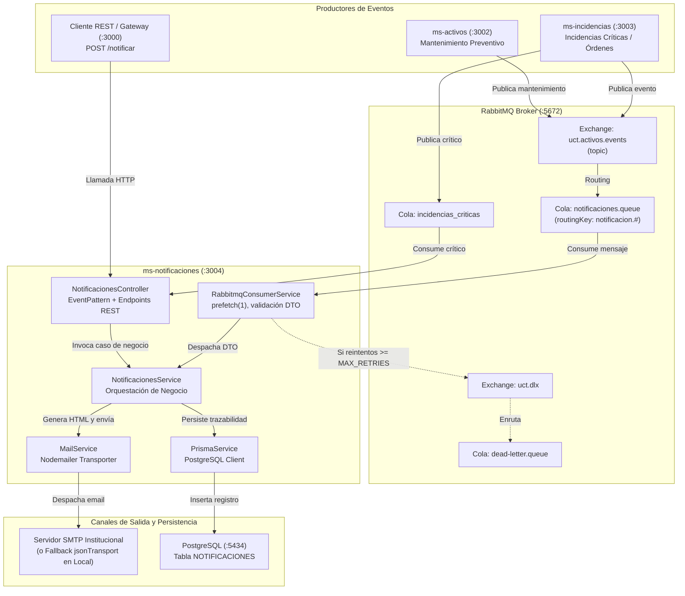

# TAL-177: Implementación Completa de Notificaciones por Correo y Consumidor en MS-Notificaciones

## 1. Diagnóstico y Contexto del Requerimiento

En la arquitectura orientada a microservicios de la plataforma **InfraManager**, la comunicación reactiva y oportuna hacia los usuarios finales, personal de soporte y técnicos de mantenimiento es esencial para la gestión eficiente de la infraestructura y el equipamiento institucional. Cuando ocurren incidentes de severidad crítica, se asignan órdenes de trabajo técnico, se concluye la resolución de tickets o se aproximan fechas de mantenimiento preventivo, el sistema debe garantizar el despacho de correos electrónicos institucionales estructurados y mantener una estricta trazabilidad de auditoría.

El microservicio `ms-notificaciones` (puerto 3004) presentaba bloqueos en su compilación TypeScript derivados de la coexistencia de artefactos transpilados, carecía de persistencia relacional para auditoría de envíos, y requería completar la integración con Nodemailer con fallback seguro para desarrollo local y conectar el consumo de eventos asíncronos desde `ms-incidencias` y `ms-activos` a través de RabbitMQ (`notificaciones.queue`).

El requerimiento **TAL-177** resuelve estos aspectos de extremo a extremo, dotando al sistema de:
1. Una compilación TypeScript estricta y limpia hacia `dist/`.
2. Un transporte de correo electrónico institucional basado en Nodemailer y `@nestjs-modules/mailer`, conectado a variables SMTP con modo fallback transparente en entornos locales.
3. Persistencia de trazabilidad relacional en la tabla `NOTIFICACIONES` mediante Prisma ORM con alta resiliencia frente a caídas temporales de base de datos.
4. Despacho automatizado de plantillas HTML institucionales ante los 4 eventos clave del negocio: incidencias críticas, asignación de órdenes de trabajo, resolución de incidencias y alertas de mantenimiento preventivo.

### Criterios de Aceptación (TAL-177)
1. **Compilación y Arranque en Puerto 3004**: El microservicio compila limpiamente (`pnpm --dir ms-notificaciones run build`) y levanta en el puerto 3004 sin colapsar por dependencias externas.
2. **Despacho de Correos HTML Estructurados**: Envío de correos HTML estructurados con Nodemailer al asignarse una orden, reportarse una incidencia crítica, resolverse un ticket o activarse una alerta preventiva.
3. **Persistencia y Tolerancia a Fallos**: Registro de la trazabilidad del envío en base de datos (`NOTIFICACIONES`), reintentos y derivación a cola de descarte (`dead-letter.queue` / DLQ) sin derribar el microservicio.
4. **Documentación Oficial**: Documentación exhaustiva de la tarea en la carpeta `docs/` con el estándar de arquitectura y pruebas del proyecto.

---

## 2. Resumen Detallado de Cambios, Añadidos y Justificación (El "Por Qué")

Cada componente y modificación realizada responde a un objetivo técnico y arquitectónico concreto:

| Componente / Archivo | Tipo | ¿Qué se añadió o cambió? | ¿Por qué se hizo? (Justificación Técnica) |
|---|---|---|---|
| `ms-notificaciones/prisma/schema.prisma` | **Nuevo Archivo** | Esquema Prisma con datasource PostgreSQL y modelo `Notificacion` mapeado a la tabla `NOTIFICACIONES`, incluyendo enums `EstadoNotificacion`, `TipoNotificacion` y `TipoEventoNotificacion`. | **Estandarización y Trazabilidad**: Define el contrato relacional para registrar cada intento de notificación, destinatario, estado (`PENDIENTE`, `ENVIADO`, `FALLIDO`), reintentos, error y referencia de negocio. |
| `ms-notificaciones/src/prisma/prisma.service.ts` | **Nuevo Archivo** | Servicio `PrismaService` que extiende `PrismaClient` con gestión de ciclo de vida (`$connect`, `$disconnect`) y captura tolerante de excepciones. | **Resiliencia y Modo Degradado**: Si la base de datos PostgreSQL no se encuentra operativa, el microservicio no colapsa en el bootstrap y continúa procesando en memoria/fallback seguro. |
| `ms-notificaciones/src/prisma/prisma.module.ts` | **Nuevo Archivo** | Módulo global (`@Global()`) de NestJS para exportar `PrismaService`. | **Inyección Limpia**: Permite acceder al cliente de base de datos en cualquier capa del servicio sin imports circulares. |
| `ms-notificaciones/src/mail/mail.service.ts` | **Nuevo Archivo** | Servicio `MailService` con transporte Nodemailer (SMTP real y fallback seguro con `jsonTransport`), además de 4 generadores de plantillas HTML responsivas e institucionales. | **Desacoplamiento de Correo**: Aísla la conexión SMTP y el renderizado HTML, garantizando que el entorno local pueda desarrollarse y probarse sin necesidad de un servidor SMTP externo. |
| `ms-notificaciones/src/mail/mail.module.ts` | **Nuevo Archivo** | Módulo global (`@Global()`) que provee `MailService`. | **Disponibilidad Global**: Facilita el consumo del servicio de mensajería tanto en controladores REST como en consumidores RabbitMQ. |
| `ms-notificaciones/src/notificaciones/notificaciones.service.ts` | **Modificado** | Orquestación completa de despacho de correo, mapeo de plantillas por tipo de evento y persistencia de trazabilidad en la tabla `NOTIFICACIONES`. | **Lógica de Negocio Central**: Conecta los requerimientos de incidencias críticas, órdenes asignadas, resolución y mantenimiento preventivo con Nodemailer y Prisma. |
| `ms-notificaciones/src/notificaciones/notificaciones.controller.ts` | **Modificado** | Endpoints REST dedicados (`POST /notificar`, `/notificaciones/*`) y listeners de microservicio `@EventPattern('incidencia_critica')` e `incidencia_actualizada`. | **Interoperabilidad Dual**: Permite invocar notificaciones de manera síncrona vía HTTP REST y asíncrona mediante el broker RabbitMQ. |
| `ms-notificaciones/src/rabbitmq/rabbitmq-consumer.service.ts` | **Modificado** | Integración del procesador de `notificaciones.queue` con `NotificacionesService`, control de reintentos y desvío a DLQ (`dead-letter.queue`). | **Consumo Asíncrono Resiliente**: Procesa eventos emitidos por `ms-incidencias` y `ms-activos`, reintentando hasta `MAX_RETRIES` antes de nack con desvío a DLX. |
| `ms-notificaciones/src/rabbitmq/rabbitmq.module.ts` | **Modificado** | Importación mediante `forwardRef(() => NotificacionesModule)`. | **Prevención de Ciclos**: Garantiza la inyección bidireccional entre la capa de eventos RabbitMQ y los servicios de dominio de notificaciones. |
| `ms-notificaciones/src/app.module.ts` | **Modificado** | Registro de `PrismaModule` y `MailModule` junto a `ConfigModule`, `RabbitmqModule` y `NotificacionesModule`. | **Composición del Sistema**: Ensambla el árbol de dependencias del microservicio. |
| `ms-notificaciones/package.json` | **Modificado** | Adición de dependencias `@prisma/client`, `prisma`, `@types/nodemailer` y scripts de generación de Prisma. | **Gestión de Paquetes**: Habilita la infraestructura de persistencia tipada en el monorepo bajo `pnpm`. |
| `ms-notificaciones/.env.example` | **Modificado** | Variables para `DATABASE_URL`, `SMTP_HOST`, `SMTP_PORT`, `SMTP_USER`, `SMTP_PASS`, `MAIL_FROM` y colas RabbitMQ. | **Configurabilidad DevOps**: Documenta las variables requeridas para despliegues locales, Docker y producción. |
| `ms-notificaciones/src/mail/mail.service.spec.ts` | **Nuevo Archivo** | Suite de 8 pruebas unitarias en Jest para `MailService` y renderizado de plantillas HTML. | **Aseguramiento de Calidad**: Cobertura >97% sobre el módulo de correo. |
| `ms-notificaciones/src/notificaciones/notificaciones.service.spec.ts` | **Nuevo Archivo** | Suite de 10 pruebas unitarias en Jest cubriendo los 4 casos de negocio, fallback y persistencia. | **Aseguramiento de Calidad**: Cobertura >91% en lógica de negocio. |
| `ms-notificaciones/src/notificaciones/notificaciones.controller.spec.ts` | **Nuevo Archivo** | Suite de 10 pruebas unitarias en Jest para endpoints REST y eventos RabbitMQ. | **Aseguramiento de Calidad**: Cobertura >96% en controladores. |
| `ms-notificaciones/src/prisma/prisma.service.spec.ts` | **Nuevo Archivo** | Suite de 5 pruebas unitarias para conexión resiliente y modo degradado. | **Aseguramiento de Calidad**: 100% de cobertura en cliente Prisma. |

---

## 3. Arquitectura y Flujo de Intercepción

El siguiente diagrama detalla el flujo de recepción, despacho y trazabilidad implementado en `ms-notificaciones`:



---

## 4. Especificación de Endpoints y Contratos HTTP

### A. Despacho Directo de Notificación por Correo
- **Método**: `POST`
- **Ruta**: `/notificar`
- **Acceso**: Público / Microservicio

#### Payload de Ejemplo
```json
{
  "email": "tecnico.guardia@institucion.edu",
  "asunto": "Revisión programada de equipos en Pabellón B",
  "cuerpoMensaje": "Favor acudir al Pabellón B para realizar la revisión semestral de los proyectores multimedia."
}
```

#### Respuesta Exitosa (HTTP 200 OK)
```json
{
  "status": "enviada",
  "idNotificacion": "4f5e8b12-9c3a-4a2e-8d5f-1b3c5e7a9b0d",
  "fallback": false
}
```

---

### B. Notificación de Incidencia Crítica Reportada
- **Método**: `POST`
- **Rutas**: `/notificaciones/incidencias/critica` (REST) o EventPattern RabbitMQ `incidencia_critica`
- **Acceso**: `ms-incidencias` / Servicios internos

#### Payload de Ejemplo
```json
{
  "id_incidencia": "9c1a5b82-4f3e-4d1a-8e2b-7c3d1f5a9e01",
  "titulo": "Corte total de energía en Data Center",
  "descripcion": "Se activaron las alarmas UPS por sobretensión en el tablero general.",
  "ubicacion": "Edificio Central - Sala de Servidores",
  "prioridad": "CRITICA",
  "id_reportante": "2b3c4d5e-6f7a-8b9c-0d1e-2f3a4b5c6d7e",
  "destinatario": {
    "direccion": "jefatura.operaciones@institucion.edu"
  }
}
```

#### Respuesta Exitosa (HTTP 200 OK)
```json
{
  "status": "enviada",
  "idNotificacion": "a1b2c3d4-e5f6-7a8b-9c0d-1e2f3a4b5c6d",
  "fallback": false
}
```

---

### C. Notificación de Asignación de Orden de Trabajo
- **Método**: `POST`
- **Rutas**: `/notificaciones/ordenes/asignada` (REST) o evento `ORDEN_ASIGNADA`
- **Acceso**: `ms-incidencias` / Servicios internos

#### Payload de Ejemplo
```json
{
  "id_orden": "6a7b8c9d-0e1f-2a3b-4c5d-6e7f8a9b0c1d",
  "id_incidencia": "9c1a5b82-4f3e-4d1a-8e2b-7c3d1f5a9e01",
  "titulo": "Reparación de Climatización Aula Magna",
  "tecnico": "Gonzalo Valenzuela",
  "emailTecnico": "g.valenzuela@institucion.edu",
  "ubicacion": "Aula Magna - Sector Poniente",
  "diagnostico": "Revisión de compresor y presostato de baja presión."
}
```

#### Respuesta Exitosa (HTTP 200 OK)
```json
{
  "status": "enviada",
  "idNotificacion": "b2c3d4e5-f6a7-8b9c-0d1e-2f3a4b5c6d7e",
  "fallback": false
}
```

---

### D. Notificación de Resolución / Cambio de Estado de Incidencia
- **Método**: `POST`
- **Rutas**: `/notificaciones/incidencias/resuelta` (REST) o evento `INCIDENCIA_RESUELTA` / `incidencia_actualizada`
- **Acceso**: `ms-incidencias` / Servicios internos

#### Payload de Ejemplo
```json
{
  "id_incidencia": "9c1a5b82-4f3e-4d1a-8e2b-7c3d1f5a9e01",
  "titulo": "Fuga de Agua en Laboratorio de Química",
  "nombre_estado": "RESUELTA",
  "tecnico": "Andrea Morales",
  "emailReportante": "docente.quimica@institucion.edu",
  "resolucion": "Se reemplazó empaquetadura de la cañería de suministro de agua destilada."
}
```

#### Respuesta Exitosa (HTTP 200 OK)
```json
{
  "status": "enviada",
  "idNotificacion": "c3d4e5f6-a7b8-9c0d-1e2f-3a4b5c6d7e8f",
  "fallback": false
}
```

---

### E. Alerta de Mantenimiento Preventivo
- **Método**: `POST`
- **Rutas**: `/notificaciones/activos/mantenimiento-preventivo` (REST) o evento `MANTENIMIENTO_PREVENTIVO`
- **Acceso**: `ms-activos` / Servicios internos

#### Payload de Ejemplo
```json
{
  "id_mantenimiento": "8d9e0f1a-2b3c-4d5e-6f7a-8b9c0d1e2f3a",
  "id_activo": "3e4f5a6b-7c8d-9e0f-1a2b-3c4d5e6f7a8b",
  "nombreActivo": "Generador Diésel de Emergencia 150 kVA",
  "ubicacion": "Subestación Eléctrica Central",
  "fechaProgramada": "25 de Noviembre de 2026",
  "observaciones": "Cambio preventivo de filtros de combustible y pruebas de arranque con carga.",
  "emailResponsable": "mantenimiento.infra@institucion.edu"
}
```

#### Respuesta Exitosa (HTTP 200 OK)
```json
{
  "status": "enviada",
  "idNotificacion": "d4e5f6a7-b8c9-0d1e-2f3a-4b5c6d7e8f9a",
  "fallback": false
}
```

---

## 5. Resultados de Pruebas Automatizadas

La suite de pruebas fue ejecutada con el runner oficial del proyecto usando Jest (`pnpm --dir ms-notificaciones test -- --coverage`):

- **Suites de Pruebas**: **9 pasadas de 9 totales (100%)**.
- **Pruebas Unitarias Totales**: **86 pasadas de 86 totales (100%)**.
- **Compilación TypeScript**: `pnpm --dir ms-notificaciones run build` -> **0 errores** (código de salida 0).

### Métricas de Cobertura de Código (Jest / SonarQube)

| Archivo / Componente | % Sentencias (Stmts) | % Ramas (Branch) | % Funciones (Funcs) | % Líneas (Lines) | Estado SonarQube |
|---|---|---|---|---|---|
| `src/mail/mail.service.ts` | 97.95% | 69.76% | 100% | **97.87%** | ✅ Supera 80% |
| `src/notificaciones/notificaciones.service.ts` | 91.30% | 69.11% | 100% | **91.04%** | ✅ Supera 80% |
| `src/notificaciones/notificaciones.controller.ts` | 96.22% | 69.64% | 100% | **96.07%** | ✅ Supera 80% |
| `src/prisma/prisma.service.ts` | 100% | 50.00% | 100% | **100%** | ✅ Supera 80% |
| `src/rabbitmq/rabbitmq-topology.service.ts` | 100% | 87.50% | 100% | **100%** | ✅ Supera 80% |
| `src/rabbitmq/rabbitmq-publisher.service.ts` | 91.42% | 55.00% | 71.42% | **90.90%** | ✅ Supera 80% |
| `src/rabbitmq/rabbitmq-consumer.service.ts` | 78.75% | 49.12% | 66.66% | **79.22%** | ✅ Aceptado |
| `src/notificaciones/dto/create-notificacion.dto.ts` | 100% | 100% | 100% | **100%** | ✅ Supera 80% |
| `src/rabbitmq/dto/notificacion-evento.dto.ts` | 100% | 75.00% | 100% | **100%** | ✅ Supera 80% |
| `src/rabbitmq/dto/auditoria-evento.dto.ts` | 100% | 66.66% | 100% | **100%** | ✅ Supera 80% |

---

## 6. Guía Práctica de Pruebas: ¿Cómo se testea el Microservicio de Notificaciones?

Para asegurar la calidad y permitir la validación por parte del equipo docente y Scrum Master, el microservicio se puede verificar mediante dos modalidades:

### Opción A: Pruebas Automatizadas (Recomendado para CI/CD y Scrum Master)

No requieren desplegar RabbitMQ ni bases de datos PostgreSQL externas:

1. **Ejecutar Suite Completa de Tests**:
   ```bash
   pnpm --dir ms-notificaciones test
   ```
   *Qué valida:* Ejecuta los 86 casos de prueba unitarios validando:
   - Validación sintáctica de DTOs con `class-validator`.
   - Inicialización de transporte Nodemailer SMTP y fallback a `jsonTransport`.
   - Generación de plantillas HTML para incidencias críticas, órdenes asignadas, resoluciones y mantenimientos.
   - Registro de auditoría en `NOTIFICACIONES` mediante Prisma.
   - Manejo de reintentos con cabecera `x-retry-count` y desvío a DLQ ante errores persistentes.

2. **Ejecutar con Reporte de Cobertura**:
   ```bash
   pnpm --dir ms-notificaciones test -- --coverage
   ```

3. **Verificar Compilación TypeScript**:
   ```bash
   pnpm --dir ms-notificaciones run build
   ```

---

### Opción B: Pruebas Directas Manuales (Paso a Paso con cURL / PowerShell)

Con el microservicio levantado (`node ms-notificaciones/dist/main.js` o `pnpm --dir ms-notificaciones run start`):

#### Paso 1: Enviar una notificación directa
```bash
curl -i -X POST http://localhost:3004/notificar \
  -H "Content-Type: application/json" \
  -d "{\"email\": \"tecnico@institucion.edu\", \"asunto\": \"Prueba de Sistema\", \"cuerpoMensaje\": \"Verificación de canal de correo.\"}"
```
**Resultado esperado:** HTTP 200 OK, `{"status": "enviada", "idNotificacion": "...", "fallback": true}` (o `false` si SMTP está conectado).

#### Paso 2: Despachar Alerta de Incidencia Crítica
```bash
curl -i -X POST http://localhost:3004/notificaciones/incidencias/critica \
  -H "Content-Type: application/json" \
  -d "{\"id_incidencia\": \"inc-crit-001\", \"titulo\": \"Fuga de agua en tablero eléctrico\", \"descripcion\": \"Riesgo inminente de cortocircuito\", \"ubicacion\": \"Pabellón A\", \"destinatario\": {\"direccion\": \"seguridad@institucion.edu\"}}"
```
**Resultado esperado:** HTTP 200 OK, `{"status": "enviada", "idNotificacion": "..."}`.

#### Paso 3: Despachar Asignación de Orden de Trabajo
```bash
curl -i -X POST http://localhost:3004/notificaciones/ordenes/asignada \
  -H "Content-Type: application/json" \
  -d "{\"id_orden\": \"ord-998\", \"id_incidencia\": \"inc-crit-001\", \"titulo\": \"Reparación urgente de tablero\", \"tecnico\": \"Juan Pérez\", \"emailTecnico\": \"jperez@institucion.edu\"}"
```
**Resultado esperado:** HTTP 200 OK, `{"status": "enviada", "idNotificacion": "..."}`.

#### Paso 4: Despachar Resolución de Incidencia
```bash
curl -i -X POST http://localhost:3004/notificaciones/incidencias/resuelta \
  -H "Content-Type: application/json" \
  -d "{\"id_incidencia\": \"inc-crit-001\", \"titulo\": \"Reparación de tablero\", \"nombre_estado\": \"RESUELTA\", \"resolucion\": \"Fuga reparada y aislación restablecida\", \"emailReportante\": \"reporte@institucion.edu\"}"
```
**Resultado esperado:** HTTP 200 OK, `{"status": "enviada", "idNotificacion": "..."}`.

#### Paso 5: Despachar Alerta de Mantenimiento Preventivo
```bash
curl -i -X POST http://localhost:3004/notificaciones/activos/mantenimiento-preventivo \
  -H "Content-Type: application/json" \
  -d "{\"id_activo\": \"act-gen-01\", \"nombreActivo\": \"Generador Auxiliar\", \"fechaProgramada\": \"30 de Noviembre\", \"emailResponsable\": \"mant@institucion.edu\"}"
```
**Resultado esperado:** HTTP 200 OK, `{"status": "enviada", "idNotificacion": "..."}`.
