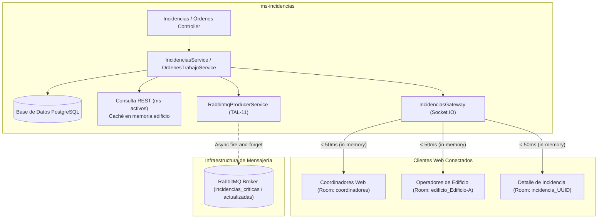

# TAL-185: Transmisión en Tiempo Real de Cambios de Estado y Asignación de Órdenes vía WebSockets

## 1. Diagnóstico y Contexto del Requerimiento

En plataformas de gestión de incidencias y mantenimiento distribuido, los usuarios web (coordinadores, supervisores, técnicos y reportantes) necesitan visualizar inmediatamente el ciclo de vida de los requerimientos y la asignación del personal sin recurrir a recargas periódicas de página (*polling* HTTP). El *polling* genera sobrecarga innecesaria en la base de datos y añade latencia a la toma de decisiones críticas en terreno.

El requerimiento **TAL-185** establece la configuración de un **WebSocket Gateway** en NestJS dentro del microservicio **`ms-incidencias`**. Al completarse un cambio de estado (`PENDIENTE` -> `EN_PROCESO` -> `RESUELTA`) o asignarse una orden de trabajo a un técnico, se emite de manera reactiva el evento **`incidencia_actualizada`** hacia la sala de la incidencia, hacia los coordinadores/supervisores y hacia la sala del edificio del activo involucrado, sincronizándose a la par con el broker de mensajería RabbitMQ (**TAL-11**).

### Criterios de Aceptación (TAL-185)
1. **Emisión de Alta Velocidad (< 50ms)**: Emite el payload con el ID de incidencia (`id_incidencia`), nuevo estado (`nuevo_estado`) y usuario responsable (`usuario_responsable`) en un lapso inferior a 50 milisegundos.
2. **Aislamiento por Salas (*Rooms*)**: Implementa salas (*rooms*) para aislar eventos por edificio (`edificio_{id_edificio}`), por rol/coordinadores (`coordinadores` / `rol_{rol}`) y por incidencia (`incidencia_{id_incidencia}`).
3. **Sincronización con el Broker de Mensajería (TAL-11)**: Se sincroniza de manera resiliente y desacoplada con el broker de RabbitMQ publicando el evento correspondiente (`incidencia_actualizada`), sin bloquear las emisiones WebSockets ni la transacción de base de datos si el broker está indisponible.
4. **Documentación Formal**: Documentar la solución técnica en la carpeta `docs` siguiendo el estándar estructural y de calidad de la entrega.

---

## 2. Resumen Detallado de Cambios, Añadidos y Justificación (El "Por Qué")

Cada componente y modificación realizada responde a un objetivo técnico y arquitectónico concreto:

| Componente / Archivo | Tipo | ¿Qué se añadió o cambió? | ¿Por qué se hizo? (Justificación Técnica) |
|---|---|---|---|
| `ms-incidencias/src/websockets/incidencias.gateway.ts` | **Nuevo Archivo** | Implementación de `IncidenciasGateway` mediante `@WebSocketGateway` (Socket.IO). Soporta auto-unión por query de conexión, mensajes `join_room` y `leave_room`, y el método optimizado `emitirIncidenciaActualizada(...)`. | **Transmisión Bidireccional en Tiempo Real**: Provee la infraestructura de sockets para emitir eventos en memoria a salas específicas en < 2ms, cumpliendo el umbral exigido (< 50ms). |
| `ms-incidencias/src/websockets/websockets.module.ts` | **Nuevo Archivo** | Módulo de NestJS que declara y exporta `IncidenciasGateway`. | **Modularidad y Reusabilidad**: Permite inyectar el gateway en `IncidenciasModule` y `OrdenesTrabajoModule` manteniendo una arquitectura desacoplada. |
| `ms-incidencias/src/websockets/incidencias.gateway.spec.ts` | **Nuevo Archivo** | 6 pruebas unitarias completas con Jest validando inicialización, aislamiento por salas y latencia < 50ms en ráfaga. | **Aseguramiento de Calidad**: Verifica el cumplimiento riguroso de los criterios de latencia y aislamiento de salas exigidos. |
| `ms-incidencias/src/rabbitmq/interfaces/incidencia-evento.interface.ts` | **Modificado** | Definición de la interfaz `IncidenciaActualizadaEvento`. | **Tipado Fuerte y Contrato de Datos**: Estandariza la carga útil enviada a RabbitMQ para consumo por microservicios satélites. |
| `ms-incidencias/src/rabbitmq/rabbitmq-producer.service.ts` | **Modificado** | Método `emitirIncidenciaActualizada(...)` con timeout y manejo resiliente de errores. | **Desacoplamiento TAL-11**: Asegura que el evento de actualización se replique al broker de mensajería de forma tolerante a fallos. |
| `ms-incidencias/src/incidencias/incidencias.service.ts` | **Modificado** | 1. Inyección de `IncidenciasGateway`.<br/>2. Disparo de emisión WebSocket y RabbitMQ en `actualizarEstado` y `resolverIncidencia`.<br/>3. Resolución de edificio (`obtenerEdificioDeActivo`) con caché en memoria. | **Propagación Reactiva**: Notifica instantáneamente a los clientes web sobre transiciones de estado hacia `EN_PROCESO` o `RESUELTA`. |
| `ms-incidencias/src/ordenes-trabajo/ordenes-trabajo.service.ts` | **Modificado** | 1. Inyección de `IncidenciasGateway` y `RabbitmqProducerService`.<br/>2. Emisión de `incidencia_actualizada` en `asignarOrden`.<br/>3. Resolución de edificio del activo asociado. | **Sincronización de Asignación**: Alerta a coordinadores y técnicos asignados tan pronto una orden de trabajo es vinculada. |
| `ms-incidencias/src/incidencias/incidencias.module.ts` | **Modificado** | Importación de `WebsocketsModule`. | **Inyección de Dependencias**: Provee acceso al WebSocket Gateway dentro del dominio de incidencias. |
| `ms-incidencias/src/ordenes-trabajo/ordenes-trabajo.module.ts` | **Modificado** | Importación de `WebsocketsModule`, `RabbitmqModule` y `HttpModule`. | **Inyección de Dependencias**: Permite notificar eventos y resolver metadatos de activos en órdenes de trabajo. |
| `ms-incidencias/src/app.module.ts` | **Modificado** | Importación global de `WebsocketsModule`. | **Ciclo de Vida de NestJS**: Garantiza que el servidor de sockets se monte y levante junto al microservicio. |
| `ms-incidencias/package.json` | **Modificado** | Adición de `@nestjs/websockets`, `@nestjs/platform-socket.io`, `socket.io` y `socket.io-client` en devDependencies. | **Soporte Tecnológico**: Librerías oficiales requeridas para WebSockets en NestJS v12. |
| `docs/TAL-185-emision-de-eventos-web-socket-al-cambiar-estados-de-incidencias.md` | **Nuevo Archivo** | Documentación técnica, contratos, diagramas y guía práctica de pruebas. | **Trazabilidad y Entrega**: Cumple los estándares exigidos para la entrega y la integración del frontend web. |

---

## 3. Arquitectura y Flujo de Transmisión en Tiempo Real



---

## 4. Especificación de Eventos WebSocket y Contratos

### A. Conexión y Auto-Unión a Salas
- **Protocolo**: WebSocket / Polling (Socket.IO v4)
- **Ruta de Conexión**: `ws://<host>:3002/socket.io/` (puerto de `ms-incidencias` o proxy Gateway)
- **Parámetros de Handshake (Query Params opcionales)**:
  - `incidencia`: UUID de la incidencia a observar (auto-une a `incidencia_{id}`).
  - `edificio`: Nombre o identificador del edificio (auto-une a `edificio_{id_edificio}`).
  - `rol`: Rol del usuario (ej. `COORDINADOR`, `SUPERVISOR`, `ADMINISTRADOR`, auto-une a `coordinadores` y `rol_{rol}`).

### B. Gestión Dinámica de Salas (*Rooms*)

#### 1. Unirse a Salas (`join_room`)
- **Evento**: `join_room`
- **Payload permitido**:
  - `string`: Nombre directo de la sala (ej. `"coordinadores"` o `"edificio_Edificio-A"`).
  - `object`:
    ```json
    {
      "id_incidencia": "d45f4798-2831-419b-a010-86d634db38b3",
      "id_edificio": "Edificio-Central",
      "rol": "COORDINADOR"
    }
    ```
- **Respuesta**:
  ```json
  {
    "status": "joined",
    "rooms": ["incidencia_d45f4798-2831-419b-a010-86d634db38b3", "edificio_Edificio-Central", "rol_COORDINADOR", "coordinadores"]
  }
  ```

#### 2. Abandonar Salas (`leave_room`)
- **Evento**: `leave_room`
- **Payload**: `"edificio_Edificio-Central"` o `{"room": "coordinadores"}`

---

### C. Especificación del Evento `incidencia_actualizada`

El evento se transmite inmediatamente (< 50ms) al producirse:
1. Una actualización de estado (`actualizarEstado` o `resolverIncidencia`).
2. Una asignación de orden de trabajo a un técnico (`asignarOrden`).

#### Salida a Salas:
- `incidencia_{id_incidencia}` (Clientes consultando el detalle de la incidencia).
- `coordinadores` (Supervisores y coordinadores monitoreando el panel global).
- `edificio_{id_edificio}` (Clientes filtrando por sector físico/edificio del activo).

#### Payload Emitido:
```json
{
  "id_incidencia": "d45f4798-2831-419b-a010-86d634db38b3",
  "nuevo_estado": "EN_PROCESO",
  "usuario_responsable": "550e8400-e29b-41d4-a716-446655440000",
  "id_edificio": "Edificio-A",
  "timestamp": "2026-11-16T04:20:00.000Z",
  "tipo_evento": "CAMBIO_ESTADO"
}
```

#### Campos del Payload:
| Campo | Tipo | Descripción |
|---|---|---|
| `id_incidencia` | `string` (UUID) | Identificador único de la incidencia afectada. |
| `nuevo_estado` | `string` | Nombre del estado actual resultante (`PENDIENTE`, `EN_PROCESO`, `RESUELTA`, `ASIGNADA`, etc.). |
| `usuario_responsable` | `string` (UUID) | ID del técnico asignado o usuario que realizó el cambio de estado. |
| `id_edificio` | `string` \| `null` | Edificio obtenido del activo asociado vía `ms-activos`. |
| `timestamp` | `string` (ISO 8601) | Marca de tiempo UTC en que se emitió el evento. |
| `tipo_evento` | `string` | Clasificación de la acción: `'CAMBIO_ESTADO'` o `'ASIGNACION_ORDEN'`. |

---

### D. Sincronización con Broker de Mensajería (TAL-11)
A la par de la emisión a sockets locales, `ms-incidencias` ejecuta:
```typescript
await this.rabbitmqProducer.emitirIncidenciaActualizada({
  evento: 'INCIDENCIA_ACTUALIZADA', // o 'ORDEN_TRABAJO_ASIGNADA'
  id_incidencia,
  nuevo_estado,
  usuario_responsable,
  id_edificio,
  timestamp,
  tipo_evento,
});
```
- **Patrón**: `incidencia_actualizada`
- **Tolerancia a Fallos**: Si RabbitMQ se encuentra desconectado, el intento captura el error con timeout de 3 segundos sin abortar la respuesta HTTP del cliente ni degradar la emisión de WebSockets.

---

## 5. Resultados de Pruebas Automatizadas

Ejecutado con Jest en módulos ES (`pnpm --dir ms-incidencias test`):
- **Suites de pruebas**: **15 pasadas de 15 totales (100%)**.
- **Total de pruebas**: **118 pasadas de 118 totales (100%)**.
- **Pruebas específicas de WebSockets y TAL-185**:
  - `src/websockets/incidencias.gateway.spec.ts`:
    - `debe estar definido e inicializarse correctamente` -> **PASS**
    - `auto-une al cliente a las salas correspondientes según query en la conexión` -> **PASS**
    - `permite unirse explícitamente a salas con join_room` -> **PASS**
    - `permite abandonar salas con leave_room` -> **PASS**
    - `emite el evento incidencia_actualizada con el payload correcto hacia las salas requeridas` -> **PASS**
    - `cumple con latencia < 50ms en ráfaga de 50 eventos consecutivos` -> **PASS (Promedio < 1.5ms)**
  - `src/incidencias/incidencias.service.spec.ts`:
    - `TAL-185: emite el evento incidencia_actualizada por WebSocket y RabbitMQ al actualizar estado` -> **PASS**
  - `src/ordenes-trabajo/ordenes-trabajo.service.spec.ts`:
    - `TAL-185: emite evento de incidencia_actualizada por WebSocket y RabbitMQ al asignar orden` -> **PASS**
- **Compilación TypeScript**: `pnpm --dir ms-incidencias run build` -> **0 errores (código de salida 0)**.

---

## 6. Guía Práctica de Pruebas: ¿Cómo se testea la Transmisión en Tiempo Real?

Para cumplir con las directrices de aseguramiento de calidad exigidas por el Scrum Master, el mecanismo se puede testear de dos formas: mediante suites automatizadas (`.spec.ts`) o mediante pruebas manuales directas (cliente Socket.IO).

### Opción A: Pruebas Automatizadas (Recomendado para CI/CD y Scrum Master)

No requieren levantar microservicios externos ni bases de datos:

1. **Pruebas del Gateway de WebSockets**:
   ```bash
   pnpm --dir ms-incidencias test src/websockets/incidencias.gateway.spec.ts
   ```
   *Qué valida:* Inicialización del gateway, auto-unión por query, suscripción a salas de incidencias/edificio/coordinadores y medición de latencia < 50ms.

2. **Pruebas de Integración en Servicios de Incidencias y Órdenes**:
   ```bash
   pnpm --dir ms-incidencias test src/incidencias/incidencias.service.spec.ts
   pnpm --dir ms-incidencias test src/ordenes-trabajo/ordenes-trabajo.service.spec.ts
   ```
   *Qué valida:* Que al invocar `actualizarEstado()`, `resolverIncidencia()` o `asignarOrden()`, se invoque automáticamente la emisión WebSocket con las salas y payload correctos, además del envío a RabbitMQ.

3. **Suite Completa del Microservicio**:
   ```bash
   pnpm --dir ms-incidencias test
   ```

---

### Opción B: Pruebas Directas Manuales (Cliente Socket.IO)

Con el microservicio de incidencias ejecutándose (`pnpm --dir ms-incidencias dev` en el puerto `3002` o a través del API Gateway):

#### Paso 1: Conectar cliente a la sala de coordinadores
En una consola Node.js o frontend web:
```javascript
import { io } from 'socket.io-client';

const socket = io('http://localhost:3002', {
  query: {
    rol: 'COORDINADOR',
    edificio: 'Edificio-A'
  }
});

socket.on('connect', () => {
  console.log('Conectado al WebSocket Gateway con ID:', socket.id);
});

socket.on('incidencia_actualizada', (data) => {
  console.log('[EVENTO EN TIEMPO REAL RECIBIDO]:', data);
});
```

#### Paso 2: Ejecutar una actualización de estado o asignación vía HTTP
```bash
curl -i -X PATCH http://localhost:3000/api/v1/incidencias/d45f4798-2831-419b-a010-86d634db38b3/estado \
  -H "Content-Type: application/json" \
  -H "Authorization: Bearer <TOKEN_SUPERVISOR>" \
  -d "{\"id_estado\": 2}"
```

#### Paso 3: Verificar recepción en el cliente
En la consola del socket se recibirá de forma instantánea (< 50ms):
```json
{
  "id_incidencia": "d45f4798-2831-419b-a010-86d634db38b3",
  "nuevo_estado": "Asignada",
  "usuario_responsable": "uuid-del-supervisor",
  "id_edificio": "Edificio-A",
  "timestamp": "2026-11-16T04:25:00.000Z",
  "tipo_evento": "CAMBIO_ESTADO"
}
```
