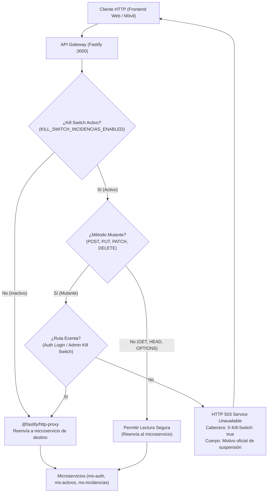

# TAL-4: Mecanismo de Suspensión de Emergencia (Kill Switch)

## 1. Diagnóstico y Contexto del Requerimiento

En arquitecturas distribuidas basadas en microservicios, eventos imprevistos como fallas críticas de integridad en base de datos, corrupciones de almacenamiento, migraciones de emergencia o ataques cibernéticos exigen detener inmediatamente las operaciones que muten el estado del sistema sin desconectar la infraestructura completa ni impedir que los usuarios o auditores consulten información.

El requerimiento **TAL-4** establece un mecanismo de **Kill Switch** (interruptor de corte de emergencia) a nivel del **API Gateway** y microservicios satélites que permite suspender instantáneamente todas las peticiones de escritura (`POST`, `PUT`, `PATCH`, `DELETE`) hacia los módulos afectados (específicamente incidencias y órdenes de trabajo), mientras mantiene operativas las peticiones de lectura segura (`GET`, `HEAD`, `OPTIONS`) y expone el estado de suspensión para la interfaz de usuario.

### Criterios de Aceptación (TAL-4)
1. **Denegación de Escritura con HTTP 503**: Cuando el Kill Switch está activo, cualquier operación mutante dirigida a los módulos afectados es interceptada inmediatamente, retornando **HTTP 503 Service Unavailable**, la cabecera HTTP **`X-Kill-Switch: true`** y el motivo oficial configurado.
2. **Lectura Segura Permitida**: Las peticiones de consulta (`GET`) continúan funcionando con normalidad para garantizar la observabilidad del sistema y la consulta de datos existentes.
3. **Exposición del Estado para el Frontend (TAL-188)**: Se exponen los endpoints `GET /api/v1/kill-switch` y `GET /api/v1/kill-switch/status` que permiten al frontend (tarea `[TAL-188]: Pantalla Global de Bloqueo por Mantenimiento`) consultar si el sistema está en suspensión y reanudar la operación normal automáticamente al desactivarse.
4. **Control para Rol ADMINISTRADOR**: Se implementa un endpoint de control administrativo (`POST /api/v1/admin/kill-switch` y `POST /api/v1/kill-switch`) protegido mediante token JWT con rol `ADMINISTRADOR` o clave de emergencia (`x-admin-key`), permitiendo activar y desactivar la suspensión en caliente sin reiniciar los servicios.
5. **Defensa en Profundidad**: Implementación tanto en la capa perimetral (**API Gateway** con Fastify) como en la capa interna de microservicio (**`ms-incidencias`** mediante `KillSwitchGuard` de NestJS).

---

## 2. Resumen Detallado de Cambios, Añadidos y Justificación (El "Por Qué")

Cada componente y modificación realizada responde a un objetivo técnico y arquitectónico concreto:

| Componente / Archivo | Tipo | ¿Qué se añadió o cambió? | ¿Por qué se hizo? (Justificación Técnica) |
|---|---|---|---|
| `api gateway/kill-switch.js` | **Nuevo Archivo** | Clase `KillSwitchManager` con estado en memoria, detección de métodos mutantes (`POST`, `PUT`, `PATCH`, `DELETE`), rutas exentas y validación de permisos de admin. | **Desacoplamiento y modularidad**: La lógica de corte de emergencia debe estar aislada para ser testeable unitariamente y reutilizable sin ensuciar la configuración de rutas del Gateway. |
| `api gateway/index.js` | **Modificado** | 1. Registro del hook `onRequest` de Fastify.<br/>2. Exposición de cabecera `X-Kill-Switch` en CORS.<br/>3. Rutas `GET /api/v1/kill-switch` y `POST /api/v1/admin/kill-switch`. | **Intercepción Perimetral Temprana**: El hook `onRequest` se ejecuta **antes** de que el proxy (`@fastify/http-proxy`) abra sockets con los microservicios, ahorrando ancho de banda y protegiendo la base de datos de inmediato. Exponer la cabecera en CORS permite que Axios en el navegador del frontend [TAL-188] la lea sin ser bloqueada por políticas de seguridad del navegador. |
| `api gateway/index.test.js` | **Modificado** | 6 tests automatizados con `node --test` usando `fastify.inject()`. | **Aseguramiento de Calidad**: Valida que no existan regresiones en el Gateway: bloqueo 503, lectura segura 200, autorización de admin y que el login no quede bloqueado ante emergencias. |
| `api gateway/.env.example` | **Modificado** | Parámetros `KILL_SWITCH_INCIDENCIAS_ENABLED`, `KILL_SWITCH_MOTIVO`, `ADMIN_API_KEY`. | **Configurabilidad DevOps**: Permite activar el Kill Switch desde el arranque en Docker/Kubernetes sin necesidad de peticiones HTTP en caso de contingencia programada. |
| `ms-incidencias/src/common/guards/kill-switch.guard.ts` | **Nuevo Archivo** | `KillSwitchGuard` en NestJS usando `CanActivate` y leyendo `process.env`. | **Defensa en Profundidad**: Si una petición salta el API Gateway (por ejemplo, en llamadas directas internas entre contenedores en la red Docker), el microservicio no queda desprotegido. |
| `ms-incidencias/src/common/guards/kill-switch.guard.spec.ts` | **Nuevo Archivo** | Pruebas unitarias completas con Jest simulando contextos HTTP. | **Cobertura de Código**: Garantiza que el guardián de NestJS rechace mutaciones con 503 y permita lecturas seguras en aislamiento. |
| `ms-incidencias/src/incidencias/incidencias.controller.spec.ts` | **Modificado** | 3 pruebas unitarias de integración directa para TAL-4 con el controlador de incidencias y el guardián. | **Trazabilidad en el Módulo**: Permite al Scrum Master y revisores comprobar el bloqueo de creación y la tolerancia a lectura directamente en la suite de pruebas del controlador de incidencias. |
| `ms-incidencias/src/app.module.ts` | **Modificado** | Provisión del guardián global como `APP_GUARD`. | **Seguridad por Defecto**: Protege todos los controladores del microservicio sin tener que anotar manualmente cada endpoint uno a uno. |
| `ms-incidencias/src/incidencias/incidencias.controller.ts` | **Modificado** | Eliminación de líneas de conflicto Git (`<<<<<<< HEAD`, etc.). | **Estabilidad del Build**: Un merge anterior de otros compañeros dejó marcadores de conflicto que impedían la compilación de TypeScript. |
| `docs/TAL-4-mecanismo-de-suspension-de-emergencia-kill-switch.md` | **Nuevo Archivo** | Documentación técnica, contratos, diagramas y guía de pruebas. | **Trazabilidad y Entrega**: Cumple los estándares exigidos por el Scrum Master y facilita la integración del frontend ([TAL-188]). |

---

## 3. Arquitectura y Flujo de Intercepción



---

## 4. Especificación de Endpoints y Contratos HTTP

### A. Consulta de Estado (Frontend TAL-188)
- **Método**: `GET`
- **Rutas**: `/api/v1/kill-switch` o `/api/v1/kill-switch/status`
- **Acceso**: Público / Autenticado

#### Respuesta cuando está ACTIVO (HTTP 200 OK)
**Cabeceras**:
```http
HTTP/1.1 200 OK
Content-Type: application/json; charset=utf-8
X-Kill-Switch: true
```
**Cuerpo JSON**:
```json
{
  "activo": true,
  "motivo": "Mantenimiento preventivo de emergencia en el módulo de incidencias. Solo consultas de lectura permitidas.",
  "servicios_afectados": ["incidencias"],
  "fecha_activacion": "2026-11-08T18:00:00.000Z"
}
```

#### Respuesta cuando está INACTIVO (HTTP 200 OK)
```json
{
  "activo": false,
  "motivo": "Mantenimiento preventivo de emergencia...",
  "servicios_afectados": ["incidencias"],
  "fecha_activacion": null
}
```

---

### B. Intercepción de Operaciones Mutantes Bloqueadas
- **Métodos**: `POST`, `PUT`, `PATCH`, `DELETE`
- **Rutas Afectadas**: `/api/v1/incidencias/*`, `/api/v1/ordenes-trabajo/*`, `/api/v1/estados-incidencia/*`, `/api/v1/tipos-evidencia/*`
- **Respuesta**: **HTTP 503 Service Unavailable**

**Cabeceras**:
```http
HTTP/1.1 503 Service Unavailable
Content-Type: application/json; charset=utf-8
X-Kill-Switch: true
```

**Cuerpo JSON**:
```json
{
  "statusCode": 503,
  "error": "Service Unavailable",
  "mensaje": "Mantenimiento preventivo de emergencia en el módulo de incidencias. Solo consultas de lectura permitidas.",
  "motivo": "Mantenimiento preventivo de emergencia en el módulo de incidencias. Solo consultas de lectura permitidas.",
  "killSwitch": true,
  "servicios_afectados": ["incidencias"],
  "fecha_activacion": "2026-11-08T18:00:00.000Z"
}
```

---

### C. Control Administrativo de Activación / Desactivación
- **Método**: `POST` o `PUT`
- **Rutas**: `/api/v1/admin/kill-switch` o `/api/v1/kill-switch`
- **Autenticación Requerida**:
  - Cabecera `Authorization: Bearer <jwt_token>` con claim `rol: "ADMINISTRADOR"` o `role: "ADMINISTRADOR"`.
  - O cabecera de emergencia `x-admin-key: <ADMIN_API_KEY>` (por defecto `admin-killswitch-secret`).

#### Payload de Ejemplo (Activar)
```json
{
  "activo": true,
  "motivo": "Mantenimiento crítico en servidor de base de datos PostgreSQL.",
  "servicios_afectados": ["incidencias"]
}
```

#### Payload de Ejemplo (Desactivar y Reanudar)
```json
{
  "activo": false
}
```

#### Respuesta Exitosa (HTTP 200 OK)
```json
{
  "statusCode": 200,
  "message": "Estado del Kill Switch actualizado exitosamente",
  "status": {
    "activo": false,
    "motivo": "Mantenimiento crítico en servidor de base de datos PostgreSQL.",
    "servicios_afectados": ["incidencias"],
    "fecha_activacion": null
  }
}
```

#### Respuesta No Autorizada (HTTP 403 Forbidden)
```json
{
  "statusCode": 403,
  "error": "Forbidden",
  "mensaje": "Se requiere rol ADMINISTRADOR o credencial administrativa válida para modificar el Kill Switch."
}
```

---

## 5. Resultados de Pruebas Automatizadas

### API Gateway (`api gateway`)
Ejecutado con el runner nativo de Node.js (`pnpm --prefix "api gateway" test`):
- **Total de pruebas**: **18 pasadas de 18 totales (100%)**.
- **Pruebas específicas de TAL-4**:
  - `TAL-4: GET /api/v1/kill-switch expone el estado actual para frontend (TAL-188)` -> **PASS**
  - `TAL-4: Kill Switch activo deniega operaciones de escritura con HTTP 503, cabecera X-Kill-Switch y motivo` -> **PASS**
  - `TAL-4: Kill Switch activo permite operaciones de lectura segura (GET)` -> **PASS**
  - `TAL-4: Rutas de autenticación (login) no son bloqueadas para permitir acceso administrativo` -> **PASS**
  - `TAL-4: Endpoint de control administrativo requiere rol ADMINISTRADOR o clave de emergencia` -> **PASS**
  - `TAL-4: Desactivar el Kill Switch reanuda inmediatamente las operaciones de escritura` -> **PASS**

### Microservicio de Incidencias (`ms-incidencias`)
Ejecutado con Jest en módulos ES (`pnpm --prefix ms-incidencias test`):
- **Suites de pruebas**: **14 pasadas de 14 totales (100%)**.
- **Total de pruebas**: **107 pasadas de 107 totales (100%)**.
  - `src/common/guards/kill-switch.guard.spec.ts` -> 3 tests pasados.
  - `src/incidencias/incidencias.controller.spec.ts` (TAL-4 block) -> 3 tests pasados.
- **Compilación TypeScript**: `pnpm --prefix ms-incidencias run build` -> **0 errores**.

---

## 6. Guía Práctica de Pruebas: ¿Cómo se testea el Kill Switch?

Para cumplir con las directrices de aseguramiento de calidad exigidas por el Scrum Master, el mecanismo se puede testear de dos formas: mediante suites automatizadas (`.test` / `.spec`) o mediante pruebas manuales directas (E2E vía HTTP).

### Opción A: Pruebas Automatizadas (Recomendado para CI/CD y Scrum Master)

No requieren levantar microservicios externos ni bases de datos:

1. **Pruebas en el API Gateway**:
   ```bash
   pnpm --prefix "api gateway" test
   ```
   *Qué valida:* Ejecuta `api gateway/index.test.js` levantando la instancia Fastify en memoria con `fastify.inject()` y probando:
   - Que `GET /api/v1/kill-switch` reporte el estado JSON.
   - Que un `POST /api/v1/incidencias` retorne código 503, encabezado `X-Kill-Switch: true` y el JSON con el motivo.
   - Que un `GET /api/v1/incidencias` no sea bloqueado por el hook.
   - Que peticiones a `/api/v1/auth/login` pasen siempre.
   - Que un usuario no autorizado reciba 403 al intentar encender o apagar el switch.
   - Que la desactivación reanude el tráfico inmediatamente.

2. **Pruebas Unitarias en el Microservicio (`ms-incidencias`)**:
   ```bash
   # Pruebas del guardián en aislamiento:
   pnpm --prefix ms-incidencias test kill-switch.guard.spec.ts

   # Pruebas integradas en el controlador de incidencias:
   pnpm --prefix ms-incidencias test incidencias.controller.spec.ts
   ```
   *Qué valida:* Valida que el módulo de incidencias reconozca la bandera del Kill Switch y rechace mutaciones con 503 protegiendo la base de datos mientras permite lecturas seguras.

---

### Opción B: Pruebas Directas Manuales (Paso a Paso con cURL / PowerShell)

Con el API Gateway corriendo (`node "api gateway/index.js"` en el puerto `3000`):

#### Paso 1: Consultar estado inicial (Inactivo)
```bash
curl -i http://localhost:3000/api/v1/kill-switch
```
**Resultado esperado:** HTTP 200 OK, `"activo": false`.

#### Paso 2: Activar el Kill Switch (como Administrador)
```bash
curl -i -X POST http://localhost:3000/api/v1/admin/kill-switch \
  -H "Content-Type: application/json" \
  -H "x-admin-key: admin-killswitch-secret" \
  -d "{\"activo\": true, \"motivo\": \"Mantenimiento crítico de emergencia en base de datos\"}"
```
**Resultado esperado:** HTTP 200 OK, `"message": "Estado del Kill Switch actualizado exitosamente"`.

#### Paso 3: Probar intento de mutación/escritura (Bloqueo 503)
```bash
curl -i -X POST http://localhost:3000/api/v1/incidencias \
  -H "Content-Type: application/json" \
  -d "{\"titulo\": \"Incidencia de prueba\", \"descripcion\": \"Falla en motor\"}"
```
**Resultado esperado:**
- **Status:** `503 Service Unavailable`
- **Cabecera:** `X-Kill-Switch: true`
- **Body:**
  ```json
  {
    "statusCode": 503,
    "error": "Service Unavailable",
    "mensaje": "Mantenimiento crítico de emergencia en base de datos",
    "killSwitch": true
  }
  ```

#### Paso 4: Probar lectura segura (Debe estar permitida)
```bash
curl -i http://localhost:3000/api/v1/incidencias
```
**Resultado esperado:** La petición **no** es interceptada por el Kill Switch (no devuelve 503 de Kill Switch, sino que pasa al microservicio o retorna la respuesta esperada de lectura).

#### Paso 5: Probar que las rutas de Auth no se bloquean
```bash
curl -i -X POST http://localhost:3000/api/v1/auth/login \
  -H "Content-Type: application/json" \
  -d "{\"email\": \"admin@test.com\", \"password\": \"123456\"}"
```
**Resultado esperado:** **No** retorna 503 de Kill Switch; permite a los administradores autenticarse.

#### Paso 6: Desactivar el Kill Switch y reanudar el sistema
```bash
curl -i -X POST http://localhost:3000/api/v1/admin/kill-switch \
  -H "Content-Type: application/json" \
  -H "x-admin-key: admin-killswitch-secret" \
  -d "{\"activo\": false}"
```
**Resultado esperado:** HTTP 200 OK, `"activo": false`. Las peticiones `POST /api/v1/incidencias` vuelven a pasar inmediatamente.
