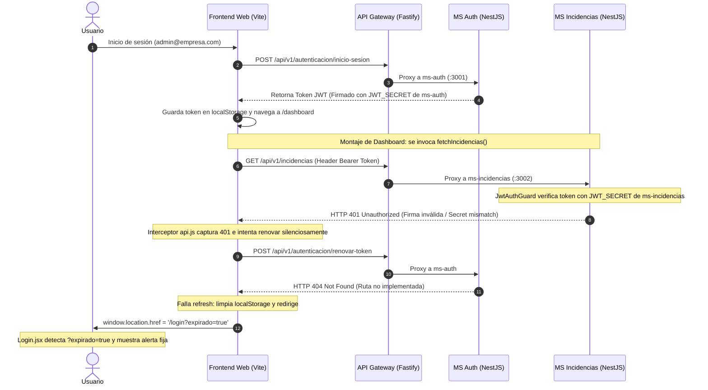

# Bitácora de Resolución: Diagnóstico de Tokens JWT, Sincronización de Secretos y Expiración de Sesión

**Fecha:** 30 de Octubre de 2026  
**Área:** Seguridad, Autenticación (JWT), API Gateway, Microservicios y Frontend Web  
**Estado:** Resuelto y Verificado exitosamente  

---

## 1. Resumen Ejecutivo

Al iniciar la plataforma mediante [`start.ps1`] y autenticarse en el cliente web con las credenciales sembradas (`admin@empresa.com` / `password123`), el sistema expulsaba forzosamente al usuario al cabo de 1 segundo hacia la pantalla de login, mostrando el mensaje de alerta:
> *"Tu sesión ha expirado por inactividad. Por favor, ingresa tus credenciales nuevamente."*

Se realizó un análisis exhaustivo del flujo de autenticación, almacenamiento de credenciales en el cliente y validación de tokens en los microservicios de backend. Se identificó una discrepancia en la clave secreta de firma/verificación JWT entre `ms-auth` y `ms-incidencias`, la ausencia del endpoint de renovación silenciosa de tokens (*Silent Refresh*) en `ms-auth`, y discrepancias en los roles asignados por los scripts de semilla.

---

## 2. Diagnóstico Técnico y Flujo del Error

El problema no correspondía a un temporizador real de inactividad, sino a una respuesta HTTP `401 Unauthorized` encadenada a un reintento fallido de renovación:

### Causas Raíz Detectadas:
1. **Discrepancia de `JWT_SECRET`:**  
   [`ms-auth/.env`] firmaba tokens utilizando `super_secret_key_change_me`, mientras que [`ms-incidencias/.env`] verificaba las peticiones entrantes con `dev-secret-change-me`. Esto causaba que `ms-incidencias` rechazara inmediatamente cualquier petición válida con un error `401 Unauthorized` (`JsonWebTokenError: invalid signature`).
2. **Mensaje de Interfaz Falso-Positivo:**  
   En [`Login.jsx`], la etiqueta *"Tu sesión ha expirado por inactividad..."* se renderiza cada vez que existe el parámetro de consulta `?expirado=true`. Este parámetro es agregado automáticamente por el interceptor de [`api.js`] ante cualquier fallo crítico de autorización.
3. **Falta de Endpoints de Silent Refresh en `ms-auth`:**  
   [`api.js`] implementaba la lógica frontend de TAL-131 para reintentar la solicitud renovando el token vía `/autenticacion/renovar-token` (o `/auth/refresh`). Sin embargo, [`ms-auth`] no exponía dichas rutas ni devolvía `refreshToken` en el login.
4. **Desalineación de Nombres de Roles:**  
   Los scripts de datos de prueba inyectaban roles con mayúsculas y acentos (`Administrador`, `Técnico`, `Usuario`), mientras que las políticas de autorización de NestJS (`RolesGuard`) exigían roles canónicos (`ADMINISTRADOR`, `TECNICO`, `REPORTANTE`).

---

## 3. Acciones y Modificaciones Realizadas

### 3.1. Estandarización de Variables de Entorno (`JWT_SECRET`)
Se unificó la clave secreta de firmado y validación JWT a `super_secret_key_change_me` de forma transversal en el proyecto:
- [`.env`] y [`.env.example`] (raíz)
- [`ms-auth/.env`] y [`ms-auth/.env.example`]
- [`ms-incidencias/.env`] y [`ms-incidencias/.env.example`]
- [`ms-activos/.env`] y [`ms-activos/.env.example`]

### 3.2. Sincronización Automática en `start.ps1`
Se agregó un bloque de verificación preventiva en el paso `[2/7]` de [`start.ps1`]. Si se detecta una diferencia entre el secreto configurado en `ms-auth` y `ms-incidencias`, el script actualiza automáticamente `ms-incidencias/.env` antes de levantar los servicios.

### 3.3. Implementación de Renovación de Tokens en `ms-auth` (TAL-125 / TAL-131)
1. **Configuración de Módulo:**  
   En [`ms-auth/src/auth/auth.module.ts`], se enlazó el tiempo de expiración a la variable de entorno `JWT_EXPIRATION` (con fallback de 24 horas), evitando que el token caduque prematuramente durante pruebas locales.
2. **Generación y Renovación de Refresh Token:**  
   En [`ms-auth/src/auth/auth.service.ts`]:
   - El método `login()` ahora genera y retorna un `refreshToken` con 7 días de vigencia, además del `token` / `accessToken` y la información del usuario.
   - Se implementó el método `refreshToken(refreshTokenStr)`, el cual verifica la validez de la credencial, comprueba el estado del usuario en base de datos y emite un nuevo par de tokens.
3. **Rutas en Controlador:**  
   En [`ms-auth/src/auth/auth.controller.ts`]:
   - `@Post(['refresh', 'renovar-token'])`: Recibe el token por cuerpo (`refreshToken`) o cabecera `Authorization: Bearer` y retorna el nuevo token.
   - `@Post(['logout', 'cerrar-sesion'])`: Endpoint estándar para invalidación y cierre de sesión seguro.

### 3.4. Robustez en Guards de Autorización (`RolesGuard`)
- En [`ms-auth/src/auth/roles.guard.ts`] y [`ms-incidencias/src/auth/roles.guard.ts`]:
  - Se normalizó la comparación a mayúsculas para evitar rechazos por variaciones de caja.
  - Se añadieron alias recíprocos de compatibilidad: `ADMINISTRADOR` $\leftrightarrow$ `ADMIN`, `REPORTANTE` $\leftrightarrow$ `USUARIO`, `TECNICO` $\leftrightarrow$ `TÉCNICO`.

### 3.5. Corrección de Semillas de Datos (`create-user.js` y `seed-rapido.cjs`)
- Se actualizaron [`ms-auth/create-user.js`] y [`seed-rapido.cjs`] para asociar a los usuarios de prueba directamente con los roles canónicos (`ADMINISTRADOR`, `TECNICO`, `REPORTANTE`), actualizando el `roleId` en caso de registros preexistentes.
